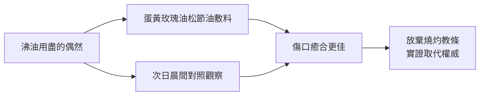

# 第 4 章 掙脫第一道枷鎖前的序曲：文藝復興的外科

## 第 1 節 安布魯瓦茲·帕雷（Ambroise Paré）：放棄沸油，用鴉片與蛋黃溫和對待傷口

### 一、1536 年杜林城下的一夜

1536 年，法國國王法蘭索瓦一世揮軍義大利，圍攻杜林（Turin）。在這場平凡的戰役中，一位二十六歲的隨軍外科醫師，將做出外科史上最著名的一次「對照觀察」。他叫安布魯瓦茲·帕雷（Ambroise Paré, 1510–1590）。

當時的軍中教條是：槍傷有毒，須以滾燙的沸油（燒熱的接骨木油混合劑）澆灌傷口「燒毒」，再以烙鐵燒灼止血。傷兵被按在木板上，忍受沸油灌入皮肉的酷刑。杜林戰役傷患太多，帕雷手邊的沸油用盡了。他別無選擇，只能憑記憶調配一種民間的溫和敷料：蛋黃、玫瑰油與松節油攪成的糊劑，敷上傷口後僅以布條包紮。

那一夜他輾轉難眠——「我擔心隔天會發現那些未經沸油處理的傷兵已經死去。」次日清晨，他走進傷兵營，看到的是外科史上最動人的一幕對比：

- **沸油組**：傷口發炎腫脹、劇痛發燒、邊緣焦黑；
- **溫和敷料組**：傷口安靜、炎症輕微、病人睡了一夜好覺。

帕雷在回憶錄中寫道：「我決定從此不再用沸油燒灼可憐的傷兵。」這不是實驗室裡的隨機對照試驗，卻具備了對照觀察的全部要素——同一戰場、同一批傷員、兩種處置、一個清晰的結果差異。**實證精神第一次戰勝了古典權威。**

### 二、理髮師-外科醫師的出身：制度的縫隙

帕雷的崛起本身是一次制度史事件。在中世紀的行會體系中，「外科」屬於手工技藝，與理髮師同業；能讀拉丁文、寫醫學論文的「內科醫師」則屬大學體系，地位懸殊。帕雷出身理髮師-外科醫師（barber-surgeon）學徒，**不懂拉丁文**——這個劣勢日後卻成為優勢：他被迫用母語法語寫作與思考，不受拉丁文教科書的蓋倫教條束縛。

### 三、法語出版：《創傷治療法》打破語言壟斷

1545 年，帕雷以法語出版《創傷治療法》（*La Méthode de traiter les plaies faites par hacquebutes*）。這是出版史上的關鍵一步：

1. **知識民主化**：理髮師-外科醫師終於能用母語讀到先進技術，繞過拉丁文的大學圍牆；
2. **活字印刷的槓桿**：印刷術讓一位戰場醫師的經驗，在數年內傳遍歐洲各國軍隊；
3. **外科的知識化**：外科開始從「手藝」轉為「可記述、可檢驗、可累積」的學問。

經濟與政治的力量同步推動：法國長期對哈布斯堡作戰，傷兵數量龐大，王室有強烈動機改善戰場救治。帕雷因實戰功績步步高升，成為四任國王的御醫——亨利二世、法蘭索瓦二世、查理九世與亨利三世。

### 四、宮廷政治：亨利二世之死

1559 年，亨利二世在比武中被長矛碎片刺入眼窩深部，帕雷受命救治，並請解剖學者維薩里會診。國王最終死於顱內感染與腦損傷——帕雷與維薩里如實記錄了死因。這件事意義深遠：御醫無力回天卻未被問罪，顯示**王室對外科醫師的信任已制度化**；而宮廷政治的庇護，讓帕雷在宗教戰爭的腥風血雨中（身為胡格諾派信徒）數度死裡逃生——據載查理九世藏匿了他，說「不能讓帕雷有任何閃失」。

### 五、「我為他包紮，上帝治癒他」

帕雷在著作扉頁題下：**「Je le pansay, Dieu le guarit」——我為他包紮，上帝治癒他。**這句話常被誤讀為謙卑的客套，實則是精妙的思想宣言：它把醫師的角色從「通神者」降為「匠人」，治癒的榮耀歸於上帝，而**責任與方法歸於人的雙手**。在一個燒灼術代表正統、放血代表權威的時代，這是一種溫和而徹底的思想革命。

### 六、多重驅動的交響

| 驅動力 | 作用 |
|---|---|
| 戰爭（政治） | 大量槍傷創造「實驗場」，王室資助戰地醫療 |
| 印刷（科技） | 法語出版讓技術突破行會與語言壁壘 |
| 宮廷（制度） | 御醫地位使非正統出身者進入權力核心 |
| 實證（思想） | 對照觀察挑戰蓋倫權威，開經驗檢驗之先河 |
| 教育（行會） | 理髮師-外科傳統保留動手文化，反而孕育革新 |

帕雷證明了一件事：外科的進步，往往始於一個人對病人痛苦的誠實。但溫柔的敷料無法解決另一個更致命的問題——**大出血**。烙鐵燒得焦黑，病人仍常死於血泊。帕雷在下一場戰役中，將拿起針線。

### 因果鏈條 → 第 2 節

帕雷以對照觀察擊潰了「燒灼是唯一正道」的教條；當烙鐵被放下，截肢斷面的湧血需要新答案。他從蓋倫與古人的殘篇中，拾回被遺忘的結紮法，並以針線、鴉片與耐心將其改造成可用之術——血管結紮術（Ligation）就此告別烙鐵，卻也一头撞上「感染」這道尚不可見的枷鎖。
