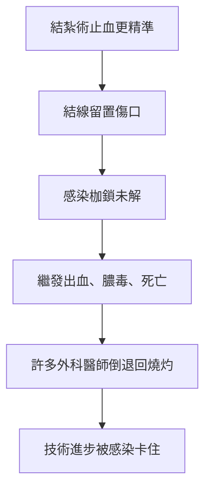

# 第 4 章 掙脫第一道枷鎖前的序曲：文藝復興的外科（續）

## 第 2 節 血管結紮術（Ligation）：告別烙鐵，用針線挽救大出血患者

### 一、從蓋倫的殘篇到帕雷的針線

血管結紮並非帕雷首創。古希臘的蓋倫（Galen）早已論述以線結紮血管，羅馬的塞爾蘇斯（Celsus）亦然；但中世紀的教條崇奉燒灼與沸油，結紮術幾近失傳，只在零星文獻中沉睡。帕雷在《創傷治療法》第十部《截肢術》中，將這門古老技術**恢復並系統化**：截肢時不待血管回縮，先以鴉片油敷於殘端止痛，再逐一夾出斷面血管，用「烏嘴鉗」夾住後以雙股絲線結紮，線尾留於傷口外，待血管與殘端癒合後再行抽出或任其脫落。

帕雷的改良有兩層：

1. **技術層**：結紮位置貼近血管斷端，避免大塊組織壞死；
2. **照護層**：以鴉片鎮痛、以蛋黃敷料保護傷口，讓病人熬過術後數日——這正是技術與止痛的早期聯手。

### 二、技術被「感染枷鎖」卡住：結紮的黑暗面

然而結紮術並未立即席捲外科。原因殘酷而簡單：**在無菌時代之前，留置傷口的結線是細菌的溫床**。多股絲線、大塊結紮組織、化膿的殘端——「術後潰爛」（laudable pus，當時竟被視為癒合徵兆）常沿結線蔓延，引發繼發出血與膿毒。於是出現了外科史的經典悖論：

**這是本書主軸的第一個關鍵因果：三大枷鎖互為鎖鏈。**不先掙脫「感染」，「出血」的技術進步就無法完全兌現。帕雷晚年其實心知肚明——他反覆強調清潔敷料、鴉片與蛋清的保護作用，是在感染理論誕生前，以經驗摸到的半步。

### 三、十七、十八世紀：普及與爭議

法國外科在 17–18 世紀的制度化，為結紮鋪路：

- **法國外科學院（Académie de Chirurgie，1731 年特許成立）**：外科脫離理髮師行會、取得獨立學術地位，截肢術成為可教、可考核的技術；
- **亨利·弗朗索瓦·勒德朗（Henri-François Le Dran, 1685–1770）**：主張截肢時即刻分離、逐一結紮主要血管，並強調傷口開放處理，反對草草縫合；
- **讓-路易·珀蒂（Jean-Louis Petit, 1674–1750）**：結合止血帶與結紮，使截肢從「與時間賽跑的屠戮」變為「從容的解剖操作」（詳見下一節）。

爭議始終存在：燒灼派譏結紮「留線必爛」，結紮派則以病例數回應。最終結紮勝出，不是靠雄辯，而是靠**軍醫體系的病例報告與學院講席的傳承**——制度讓技術得以累積。

### 四、工具改良：彎針、絲線與腸線

十八世紀起，結紮工具穩步精進：

| 工具 | 改良 | 效果 |
|---|---|---|
| 縫針 | 由直針改**彎針**，配持針鉗 | 可深達組織內精確鉤住血管 |
| 結線 | 絲線由粗改細、由多股趨單股 | 減少異物反應與感染面積 |
| 腸線（catgut） | 以羊腸製成、可被組織吸收 | 免去拆線，留置異物更少 |

「可吸收縫線」的理念尤其深刻：既然結線是感染之源，就讓它消失。這條思路要到無菌技術與化學工業成熟後才真正兌現，但十八世紀的工匠們已指出方向。

### 五、經濟與制度的合唱

結紮的普及離不開兩股非醫學力量：其一，**海軍與陸軍的擴張**——十八世紀歐洲戰爭頻仍，各國軍醫署需要可複製的手術流程，結紮+止血帶正是標準化流程；其二，**外科書籍的印刷市場**——Le Dran 的著作被譯成英語（W. Gooch、Thomas Gataker 等人的譯本在倫敦出版），知識跨越海峽，催生了約翰·亨特時代的倫敦外科。技術、市場、戰爭、學院，四輪驅動。

### 因果鏈條 → 第 3 節

結紮解決了「斷面血管」的問題，但截肢依然是賽跑：在結紮完成前，病人可能已死於失血，外科醫師的手也可能因滿手鮮血而打滑。要讓針線從容落定，需要一件能暫時掐斷整條血流的新工具——止血帶。從 1517 年 Fabry 的木棍絞盤，到 1718 年 Petit 的螺扣裝置，截肢手術的存活率將迎來第一次飛躍。
