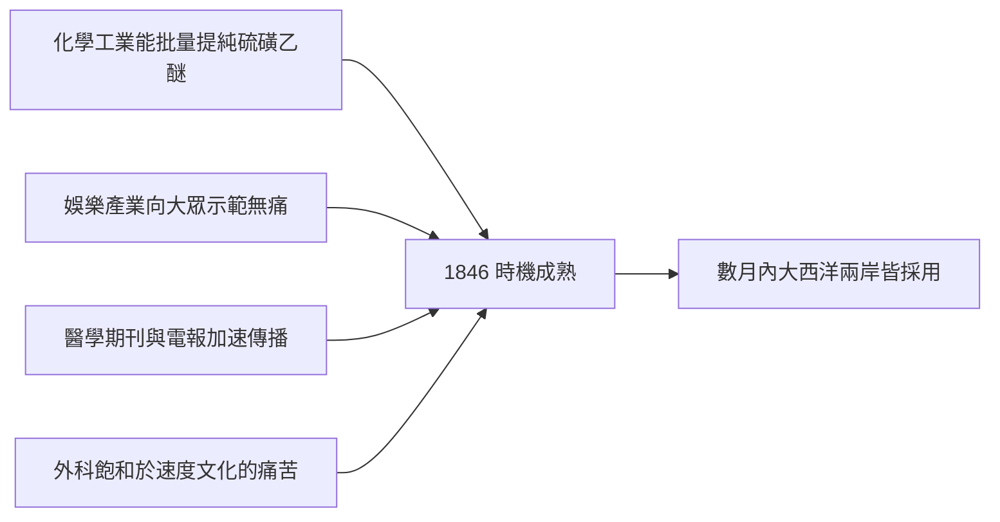

# 第 5 章 疼痛的枷鎖：麻醉的誕生（續）

## 第 2 節 乙醚與笑氣：1846 年麻醉日（Ether Day）在麻省總醫院的歷史性勝利

### 一、笑氣派對與「牙痛巡迴秀」

故事的起點不在醫院，而在市集。1799 年，英國化學家戴維（Humphry Davy）吸入一氧化二氮後發現痛覺遲鈍，並寫下「或可用於外科手術」的預言——無人理會。數十年後，這種「笑氣」漂洋過海，成為美國巡迴藥商與表演者的賺錢道具：**「歡笑派對」（laughing gas parties）**上，付費的年輕人吸入笑氣後狂笑、跳舞、跌撞而不覺疼痛。

一位名叫加德納·昆西·科爾頓（Gardner Quincy Colton）的流浪學生看準商機，組織起「牙痛巡迴秀」：先以笑氣逗樂觀眾，再當場替勇敢者拔牙——**觀眾親眼看到拔牙不痛，帳篷前大排長龍**。娛樂產業無意間完成了醫學界做不到的事：向大眾公開示範「無痛」是可重複的現象。

### 二、霍勒斯·威爾斯：失敗的先知

康乃狄克州的牙醫霍勒斯·威爾斯（Horace Wells）在 1844 年的一場笑氣秀上注意到：一名吸氣者跌傷小腿卻渾然不覺。次日，他請科爾頓為自己施笑氣、由同事拔牙——全程無痛。威爾斯深信自己握有改變外科史的鑰匙，1845 年初趕赴波士頓，在哈佛醫學院學生面前於麻省總醫院示範笑氣拔牙。病人中途呻吟（據載實際上疼痛輕微），學生們鬨然喝倒采：「騙子（humbug）！」

威爾斯從此一蹶不振。此後數年，他傾家蕩產推銷笑氣，與昔日搭檔反目，最終在紐約因精神失常、據載在吸入氯仿後於街上潑酸傷人被捕，1848 年在獄中自盡——年僅 33 歲。悲劇的註腳：他死前不久，法國醫學科學院已追認他為笑氣麻醉的發現者。

### 三、1846 年 10 月 16 日：Ether Day

威爾斯的前搭檔、波士頓牙醫威廉·莫頓（William T. G. Morton）轉而投向更穩定的藥物——**乙醚（sulfuric ether）**。在化學家查爾斯·傑克遜（Charles T. Jackson）的指點下，莫頓反覆實驗，先在家中的愛犬、自己與助手身上試藥，再為病人 Eben Frost 拔牙成功。麻省總醫院的外科主任約翰·柯林斯·沃倫（John Collins Warren）允許他公開示範。

1846 年 10 月 16 日，手術劇場（今稱**乙醚穹頂，Ether Dome**）座無虛席。病患 Edward Gilbert Abbott 頸部患有血管瘤，莫頓遲到（打磨吸入器耽誤了時間），沃倫不耐地說：「先生，你的病人已經就緒。」莫頓以玻璃吸入器讓 Abbott 吸入乙醚；病患沉沉睡去。沃倫劃開頸部腫瘤，病人**全程無痛、無掙扎**。沃倫轉向觀眾席，說出外科史上最著名的宣告：

> 「紳士們，這絕非騙術（This is no humbug）。」

威爾斯兩年前的恥辱，被同一座劇場親手洗雪。消息經《波士頓內外科學報》與私人通信，在數週內傳抵倫敦：**12 月，李斯頓便在倫敦大學學院醫院以乙醚完成歐洲首例麻醉截肢**——正是那位速度之王，第一時間放下了速度。

### 四、優先權醜聞：發現者皆潦倒

勝利日之後是無休止的內戰。莫頓堅持以「Letheon」之名申請專利牟利，醫學界譁然——救命之藥豈能壟斷？傑克遜宣稱自己才是真正的發現者，威爾斯與另一位早期試驗者克勞福德·朗（Crawford Long，1842 年已在喬治亞州私下用乙醚手術，卻遲至 1849 年才發表）也被捲入。各方在國會爭奪「麻醉發現者」頭銜與賞金，二十年纏訟無果。結局近乎寓言：**莫頓負債潦倒，1868 年目睹乙醚的司法辯論後中風死於馬車上；傑克遜精神失常，在病院中度過晚年。**所有爭奪者皆一無所得，而麻醉，免費地屬於了全人類。

### 五、地米托克利式的答案：何時成熟，勝於誰人發現

普魯塔克筆下，地米托克利聽聞有人自誇發明了一種棋戲，淡淡回道：**「棋盤要有個好地方，需要的是時機（a good occasion），而非一個好人。」**麻醉的歷史正是如此——朗早了四年卻無人知曉，威爾斯早了兩年卻倒在喝倒采之下，莫頓抓住的只是一次「時機成熟」：

瓶裝乙醚本身是工業化學的產物：硫磺與乙醇蒸餾、提純、分裝，在十九世紀中葉的藥坊已可穩定供應——**沒有化學工業，就沒有可攜帶、可複製的麻醉**。這正是為什麼 1842 年的美國鄉村醫師朗，注定無法點燃革命：孤例不能成為時代。而一旦時機到來，傳播快得驚人——波士頓到倫敦只用了兩個月，到巴黎、柏林、莫斯科不過數月。**技術一旦具備工業基礎與傳播網絡，發明權便不再是關鍵。**

### 因果鏈條 → 第 3 節

乙醚在手術台上贏得勝利，卻在大眾心中遭遇攔路虎：許多教會人士與道德家斥麻醉為「逃避上帝安排的苦難」，尤其針對女人分娩之痛。要讓疼痛的枷鎖徹底落地，麻醉需要一位最高的世俗背書者——一位即將臨盆、願意吸入氯仿的維多利亞女王。
