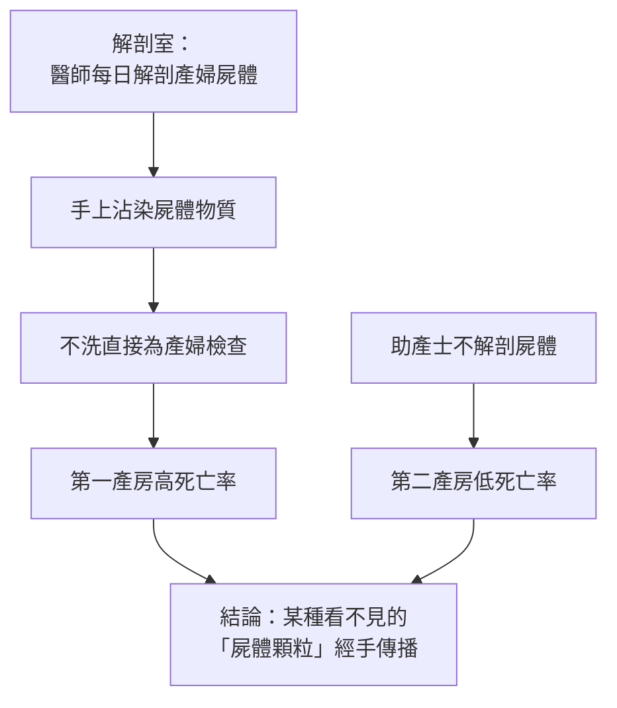

# 第 6 章 感染的枷鎖：從洗手到無菌手術室

## 第 1 節 產褥熱與產房地獄：塞麥爾維斯（Semmelweis）推行洗手的悲劇結局

### 一、兩間產房，兩種命運

1840 年代的維也納總醫院（Allgemeines Krankenhaus）產科分為兩個產房：**第一產房**由醫師與醫學生執掌，**第二產房**由助產士執掌。1841–1846 年間的統計呈現出荒誕的對比：

| 產房 | 接生者 | 產褥熱死亡率 |
|---|---|---|
| 第一產房 | 醫師與醫學生 | 高達 **18%**（個別月份逾 20%，1854 年某些月份甚至高於當月死亡嬰兒數的相關驚人紀錄） |
| 第二產房 | 助產士 | 約 **3%** |

產婦們跪求轉入第二產房；有據載寧愿在街頭生產者，其存活率竟高於第一產房。「產房地獄」名實相副。若按同院同時期的管理、病房條件與產婦群體來看，兩者差異理應極小——唯一穩定的差別是**人員**。這個謎題落在一位剛上任的助理醫師桌上：伊格納茲·塞麥爾維斯（Ignaz Semmelweis, 1818–1865），匈牙利裔的年輕產科醫師。

### 二、摯友之死：Kolletschka 的屍創感染

1847 年 3 月，塞麥爾維斯的摯友、法醫學教授雅各布·科萊奇卡（Jakob Kolletschka）在解剖屍體時被學生手術刀劃傷手指，數日後死於一種與產褥熱**病理解剖所見完全相同**的敗血症。

塞麥爾維斯在喪友之痛中抓住了那條線索：

當時的病原體理論尚未誕生；塞麥爾維斯以「屍體顆粒」（cadaverous particles）這個臨時概念，描述了**手作為傳播媒介**的機制——概念粗糙，因果正確。

### 三、1847 年 5 月：一盆漂白水

1847 年 5 月中旬，塞麥爾維斯下令：所有醫師與學生在進入產房前，必須以**含氯石灰（漂白水）溶液**洗手至無異味。效果立竿見影：第一產房死亡率自 18% 一路崩落至 1–2%，一度低於第二產房。他進一步推行器械清洗、檢查前再洗手，並解釋了更多現象（如分娩過久者死亡率高——反覆檢查所致）。

### 四、被排擠的先知：「紳士之手不骯髒」

理論正確、數據驚人，下場卻是放逐。原因層層疊加：

1. **階級與體面**：洗手令等於宣告「紳士的手是髒的、是殺人的」——維也納醫界領袖（如產科主任克萊因）視之為對整個職業的羞辱；
2. **理論冒犯**：「我們親手造成病人的死亡」——這一指控觸碰了醫學界最不願面對的道德神經；
3. **無理論支撐**：他說不出「顆粒」是什麼（細菌要到 1870 年代才被確立），批評者可輕易斥之為神秘主義；
4. **統計的弱勢**：當時主流醫學迷信個案推理與權威文本，對群體數字抱持輕蔑——**數字在權威面前沒有發言權**。

1849 年他的聘任未獲續期；1850 年他憤而返回布達佩斯。他在當地聖羅徹斯醫院再證洗手之效，1861 年出版《產褥熱的病因、概念與預防》——用冗長而憤怒的德文寫成，逐一批駁每一位反對者。反應是全面的沉默。他在公開信中辱罵同僚為「產婦的屠夫」，行為日趨失常（後世學者推測可能為阿茲海默型失智或精神疾病），1865 年被誘騙送入維也納精神病院，**兩週後死亡——據載死因是右手指傷後的敗血症**：被傷口感染殺死的人，正是發現了感染如何被傳播的人。歷史在此展現其最殘酷的對稱。

### 五、認識論教訓：證據為何不敵無理論

塞麥爾維斯事件是科學哲學的經典案例：

| 條件 | 塞麥爾維斯 | 後來的李斯特 |
|---|---|---|
| 有效的經驗干預 | 洗手 | 石炭酸消毒 |
| 可解釋機制的理論 | ✗（無細菌學說） | ✓（巴斯德微生物論） |
| 結局 | 被放逐、瘋死 | 名滿歐洲、封爵 |

**同樣的證據，有無理論框架，命運天壤之別。**人類的知識接受機制並非「數據說話」，而是「理論+數據+權威+自尊」的合議。這不是醫界特別愚蠢，而是認知的普遍結構——正因如此，巴斯德與李斯特的到來才成為歷史的必需。

### 因果鏈條 → 第 2 節

在塞麥爾維斯被沉默的同一個年代，英國北部工業城市格拉斯哥，一位外科教授正同時讀著兩樣東西：城市下水道工程報告裡的石炭酸除臭法，與來自巴黎的巴斯德論文。當「看不見的顆粒」獲得實驗證明，消毒便不再是羞辱醫師的道德訓誡，而成為可以設計的工程系統——約瑟夫·李斯特（Joseph Lister）即將把洗手升級為一整套外科消毒法。
