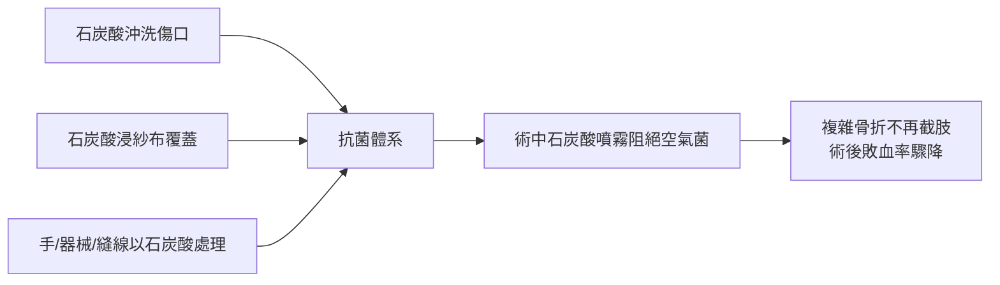

# 第 6 章 感染的枷鎖：從洗手到無菌手術室（續）

## 第 2 節 約瑟夫·李斯特（Joseph Lister）：石炭酸噴霧與外科消毒法

### 一、格拉斯哥的線索：下水道與牛乳的異味

1860 年，約瑟夫·李斯特（1827–1912）受聘為格拉斯哥大學外科教授。這座紡織與重工業城市的公害，意外地成為外科革命的線索：市議會為整治下水道與污水惡臭，使用了鄰近化學工業的副產品——**石炭酸（carbolic acid，苯酚）**，傾倒於污水後惡臭頓消。李斯特由此推想：腐敗的臭味與傷口的化膿，是否同源？**都市衛生工程與臨床外科，在化學工業的供應鏈上相遇了。**

### 二、1865 年：讀巴斯德，設計系統

1865 年，李斯特經其岳父、化學家 James Syme 的學術網絡，讀到了巴斯德（Louis Pasteur）關於**發酵與腐敗源於空氣中微生物**的論文——法德學術傳播網絡的又一次兌現。李斯特的過人之處，在於他把一個生物學結論**翻譯成一套外科工程系統**：既然感染源是微生物、且微生物需要空氣與接觸傳播，那麼外科要做的就是三件事——殺滅已進入者、阻絕將進入者、保持全程無菌環境。1865 年 8 月，他為一名腿部開放性骨折（複雜骨折）的男孩 Greentree 以石炭酸清洗傷口、浸敷敷料，骨折癒合、無膿無熱——首例成功。

### 三、1867 年《Lancet》系列論文

1867 年，李斯特在《刺胳針》（*The Lancet*）連載〈外科處置中的抗菌原理〉（*On the Antiseptic Principle in the Practice of Surgery*）系列論文，公開其體系：

### 四、量化對比：複雜骨折與截肢死亡率

在無抗菌時代，複雜骨折（皮膚破損、骨端外露）幾乎等同死刑——化膿、敗血，最終截肢，截肢者再死於殘端感染。李斯特公佈的成績（依其論文與後續報告）：**1867–1869 年間其病房的複雜骨折截肢死亡率從過去的約 45% 降至 15% 以下**，多數複雜骨折病人免於截肢。這組數字的震撼之處在於它不靠新手術技巧，只靠「沖洗與覆蓋」——**外科第一次以化學程序而非手上功夫贏得勝利。**

### 五、阻力與改良：從抗菌到無菌

英德兩國的反應起初冷淡，甚至有同行譏之為「法國理論的英國發燒貨」。但李斯特擁有塞麥爾維斯所無的三件武器：**微生物理論（巴斯德）、可量化報告（期刊）、與愛丁堡—倫敦—德國的講學網絡**。1870–71 年普法戰爭中，德國醫院嘗試抗菌法並傳回成功報告，德國外科界（Volkmann、Nussbaum、Bergmann）率先接納，反過來以「科學先進」的威望壓回英國——法德競爭再次成為醫學加速器。1877 年李斯特轉任倫敦國王學院醫院，以顯赫手術例證完成最後說服；1897 年獲封男爵——**外科醫師首次躋身貴族**。

石炭酸體系自身的缺陷也在實踐中暴露並被克服：

1. **刺激性**：石炭酸灼傷醫師與病人的皮膚、呼吸道，噴霧器最終被淘汰；
2. **更安全的替代**：碳酸鋅、氯化汞、碘仿等溫和抗菌劑相繼引入；
3. **範式的升級**：既然細菌無所不在，與其事後「抗菌」（antisepsis），不如事前「無菌」（asepsis）——高溫滅菌的器械、滅菌的手術衣，讓化學藥品退居輔助。

### 六、文化遺產：守護聖人與 Listerine

李斯特晚年成為外科的「守護聖人」：皇家學會會長、维多利亚女王的御用外科顧問、各國醫學院的名譽學位收割者。其影響滲入日常文化——1879 年，美國人以他的姓氏推出消毒漱口水 **「Listerine」**，此後一個世紀，「李斯特」三字成為消毒的代名詞。李斯特本人謙遜如一，晚年常言：榮耀屬於巴斯德。

### 因果鏈條 → 第 3 節

石炭酸證明了「看不見的敵人」可以被打敗，但它的刺鼻與灼傷也宣告：化學消毒只是過渡。要讓手術室真正成為無菌聖殿，需要的是一整套新的基礎設施——高壓蒸汽滅菌器、橡膠手套、口罩與帽子，乃至重新設計的醫院。而這套設施的第一件，竟起源於一段手術室裡的愛情。
