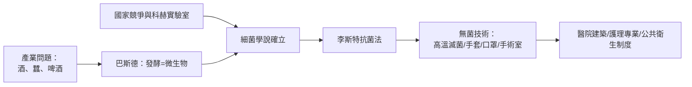

# 第 6 章 感染的枷鎖：從洗手到無菌手術室（終）

## 第 3 節 巴斯德的細菌學說與現代無菌手術室（高溫滅菌、橡膠手套與口罩）的誕生

### 一、產業問題驅動的科學革命

巴斯德（Louis Pasteur, 1822–1895）的細菌學說，並非純粹好奇心驅動——**它是由法國的產業危機資助出來的**。里昂的釀酒業飽受「酒變酸」之苦，他受命研究，發明「巴氏滅菌法」；南法的蠶農因蠶病瀕臨破產，他受命赴南方，找出微粒子病原；啤酒與葡萄酒的貿易競爭，又把他的實驗室推向「發酵是微生物的工作」這一總結論。經濟問題→科學結論→醫學應用，這條因果鏈在巴斯德身上完整走通。

與此同時，德國的科赫（Robert Koch）以顯微攝影、固體培養基與染色技術，將微生物學做成精確的實驗科學，1876 年證明炭疽桿菌致病，1882 年分離結核桿菌。**法德科學競爭**（普法戰後的國族情緒加持）使兩國政府競相投入細菌學研究——國家榮譽成為科學經費。到 1880 年代，「空氣中、手上、器械上有致病微生物」已成不可辯駁的科學事實，塞麥爾維斯的冤屈至此昭雪。

### 二、1889 年：為愛情發明的橡膠手套

約翰·霍普金斯醫院的外科主任威廉·霍爾斯特德（William Halsted）崇尚徹底的無菌操作。1889 年，他的手術護士卡羅琳·漢普頓（Caroline Hampton）因石炭酸與氯化汞消毒液而雙手皮炎、苦不堪言。霍爾斯特德向固特異橡膠公司訂製了**薄橡膠手套**——皮炎痊癒，次年兩人結婚。這段軼事背後是制度的躍進：手套從「保護護士的皮膚」很快變成「保護病人的無菌」——**愛情的發明，成為標準配備**。霍爾斯特德同時確立了橡膠手套、細緻止血、輕柔組織操作與精確縫合的「霍爾斯特德原則」，塑造了現代外科手術的氣質。

### 三、1890 年代：口罩、帽子與高壓蒸汽滅菌器

細菌學說的成熟，讓防護裝備迅速標準化：

| 年代 | 發明／制度化 | 依據 |
|---|---|---|
| 1880s–90s | 高壓蒸汽滅菌器（Chamberland、1890 年代醫院普及） | 芽孢耐化學藥，不耐高溫 |
| 1896–97 | 手術口罩（Mikulicz 等人依飛沫實驗引入） | 飛沫培養出細菌 |
| 1890s | 手術帽、專用手術衣（可煮沸滅菌） | 衣物攜菌實證 |
| 1890s | 滅菌器械台、無菌鋪巾 | 隔離接觸傳播 |

1890 年，德國外科醫師古斯塔夫·諾伊貝爾（Gustav Neuber）在基爾建成首座**專用無菌手術室**——可沖洗的牆面、隔離的更衣流線、限制人員進出。手術室的建築設計開始由細菌學說決定：**醫院建築，成為細菌理論的物化。**到 1910 年代，石炭酸噴霧正式讓位於「無菌技術」（aseptic technique）：器械高壓滅菌、人員刷手、無菌衣巾、手套口罩——今日手術室的原型宣告完成。

### 四、細菌學說重塑的三重世界

細菌學說的影響遠超手術室：

1. **醫院設計**：從南丁格爾式「通風、採光、間隔床位」的病房（她在克里米亞戰爭中已以環境衛生將死亡率從 42% 壓至 2%，雖然當時她信奉的是「瘴氣」而非細菌——**做對了事，說錯了理**），到防疫分區、隔離病房的現代醫院；
2. **護理制度化**：南丁格爾的統計、清潔與環境管理傳統，經細菌學說獲得科學根基，護理成為受訓的專業而非僕役；
3. **公共衛生制度**：水源檢驗、疫苗接種、疫情通報、牛奶巴氏滅菌——政府第一次以微生物科學為基礎立法。1892 年漢堡霍亂與科赫的調查、各國衛生部門的擴編，標誌著**公共衛生成為國家職能**。

### 五、收束：三大枷鎖盡解，外科黃金時代

回望本書的三章主軸：

- **疼痛**：1846 年乙醚、1847 年氯仿、1853 年女王背書；
- **出血**：結紮的針線、Petit 的止血帶、後起的血管外科；
- **感染**：洗手的直覺、石炭酸的抗菌、高溫滅菌與橡膠手套的無菌時代。

1880–1914 年，外科迎來黃金時代：腹腔被打開（Billroth 的胃切除、Halsted 的乳癌根治術）、胸腔與顱腔逐步探入、甲狀腺與膽道成為常規。曾經「速度為王」的屠宰場，變成燈火通明、衣著潔白、團隊協作的無菌聖殿。外科醫師從理髮師行會的匠人，蛻變為醫學院裡的科學家——這一蛻變，靠的從不只是技術，而是**戰爭、印刷、化學工業、王室、教會、國家競爭、行會制度與一位位不肯將就的醫者**，在數百年間的彼此驅動。

文明在手術刀下獲得了它第一次完整的自我救贖。

---

### 本章全書因果小結

> 帕雷放下沸油 → 結紮對抗出血 → 止血帶奪回時間 → 但疼痛鎖住精細手術 → 乙醚日開啟麻醉 → 氯仿與女王完成合法化 → 疼痛既解，感染現形 → 塞麥爾維斯以洗手撞牆 → 李斯特以理論破壁 → 巴斯德與科赫補齊科學 → 無菌手術室誕生 → 三大枷鎖盡解，外科黃金時代降臨。
