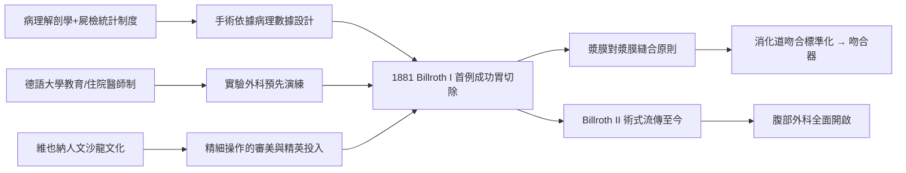

# 第 1 節 特奧多爾·比爾羅特（Theodor Billroth）：胃切除術與腹部外科的開端

1881 年 1 月 29 日，維也納手術室裡，特奧多爾·比爾羅特為一位43歲的胃癌女病人完成史上第一例成功的胃切除術。他切除幽門部腫瘤後，將胃殘端直接與十二指腸吻合——這個重建方式日後被稱為 **Billroth I**。病人存活，術後活了數月。在此之前，「打開腹腔」幾乎等於宣判死亡：腹膜腔一旦暴露，感染、休克、腸麻痺便接踵而至。比爾羅特證明了一件事：腹腔不是禁區，而是可以被打開、被縫合、被重建的空間。腹部外科的大門由此開啟。

## 為什麼是維也納：制度的勝利

比爾羅特的成就絕非個人天才的孤例，而是**德語醫學教育體系**的產物。19 世紀中葉，維也納、柏林相繼確立「病理解剖學」作為醫學核心：臨床醫師死後必須驗屍核對診斷，屍檢統計累積成病案大數據。這種「臨床—病理對照」文化，讓外科醫師第一次知道「切除哪一段、留多少、怎麼接」才有生存機率可循。比爾羅特本人正是病理學家出身，他在手術前已在動物實驗室反覆演練胃吻合技術——這是現代「實驗外科」的濫觴：手術不再靠膽量，而靠實驗數據。

維也納外科學派更建立了嚴格的住院醫師培訓、學術講座與期刊發表制度，知識以統計表格而非軼聞流傳。教育制度、病理學、統計方法三者互相咬合，才撐得起一次大型手術的冒險。

## 音樂家的手術刀：文化與醫學的交會

比爾羅特還有另一個身分：鋼琴家、音樂評論家，布拉姆斯的摯友。布拉姆斯常到他家演奏室內樂，比爾羅特的女兒被傳說是布拉姆斯的歌詞靈感來源。他在病床旁思考賦格與和聲，在音樂會後討論縫合。他甚至以筆名發表音樂評論，聲稱外科與音樂共享同一種「手上的精確與內在的結構感」。這段友誼象徵 19 世紀維也納的獨特土壤：人文與科學尚未分家，醫學院與音樂廳屬於同一個沙龍。文化資本滋養了精細操作的審美標準——縫合要像對位法一樣嚴謹——而外科聲望又反過來吸引精英投身醫學。

## 技術的遠因：從手縫到吻合器

比爾羅特的腹膜縫合技術確立了「漿膜對漿膜」癒合原則：讓漿膜面相貼，癒合快、不易漏。這一原則是日後一切消化道吻合的基礎，也是 20 世紀**吻合器**（縫合器）的思想遠因——機器不過是將比爾羅特的手工縫合法標準化、金屬化。至於處理遠端胃切除後重建的另一條路——胃與空腸吻合的 **Billroth II**（1885 年，由其學生完成），至今仍是胃部分切除、甚至減重手術的常用術式。一百四十年後，全球手術台上仍在重複比爾羅特的幾何學。

## 因果鏈條

腹腔被打開的勇氣，來自屍檢台上的數字、大學講堂的訓練，以及一間迴盪著布拉姆斯琴聲的書房。
