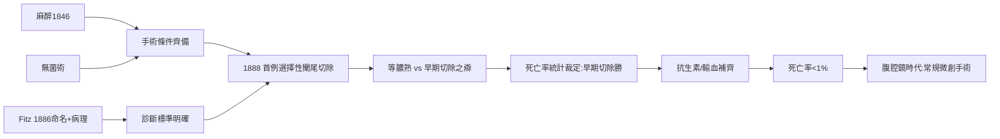

# 第 2 節 闌尾切除術的普及：一個曾經致命的小盲腸如何變成常規手術

1886 年，哈佛病理學家雷金納德·菲茨（Reginald Fitz）在美國醫師學會發表論文，正式命名 **appendicitis（闌尾炎）**，並以大量屍檢與手術標本證明：困擾內科醫師數百年、名稱混亂的「右下腹炎症」「盲腸周圍炎」，元凶就是那條幾厘米長的闌尾。命名即診斷，診斷即治療方向——菲茨明確主張早期切除。此前，闌尾炎的死亡率接近五成，病人死於穿孔、瀰漫性腹膜炎與膿瘍，而醫師只能「等待膿腫成熟」再引流，被動地與死神拔河。

## 命名者、定位者與執刀者

菲茨之後，紐約外科醫師麥克伯尼（Charles McBurney）於 1889 年描述闌尾炎最典型的壓痛點——臍與右髂前上棘連線外三分之一處，即**麥克伯尼點**，並倡導「一旦診斷確立、立即手術」。1888 年，克拉克（Thomas Morton）完成史上第一例**選擇性闌尾切除術**：不是等病人垂死才動刀，而是在診斷成立時主動出擊。「切除病根」取代「引流膿瘍」，外科從最後手段變成第一選擇。

## 為什麼偏偏在 1880 年代：條件已備齊

闌尾炎的病理並非 1886 年才存在，存在的是**手術的基礎設施**。麻醉（1846）已成熟四十年，讓腹部手術不再是一場酷刑；李斯特的無菌術與新一代的蒸汽滅菌、手套（1890 前後普及），讓開腹不再是細菌大遷徙。缺的最後一塊是「時機」觀念——而這正是一場持續數十年的辯論：保守派主張等炎症局限、膿腫「熟了」再處理；激進派如麥克伯尼主張**早期切除**，不等穿孔。死亡率統計給出了裁決：早期切除的死亡曲線遠低於等待組。統計文化（第 1 節比爾羅特時代的遺產）第一次直接裁定了一場手術策略之爭。

## 從五成死亡到常規手術

20 世紀初，英美興起「盲目闌尾切除」甚至防範性切除的爭議熱潮；1927 年芝加哥更爆發因診斷浮濫而被批評的「闌尾切除熱」，迫使醫界重視鑑別診斷——制度自我修正。隨著血型輸血（第 9 節）、抗生素（1940 年代）到位，闌尾炎死亡率從近 50% 暴跌至千分之幾。1980 年代腹腔鏡闌尾切除問世，三個小孔、住院一晚，成為全球最常見的急診手術之一。一條小小的盲腸，丈量出外科制度的成熟度：診斷標準、時機準則、統計稽核、器械迭代，環環相扣。

## 因果鏈條

屍檢文化命名疾病 → 壓痛點定位診斷 → 麻醉與無菌術解除技術枷鎖 → 統計裁定手術時機 → 死亡率崩落 → 社會信任外科 → 微創迭代。一個小手術，是一整套制度的試金石。
