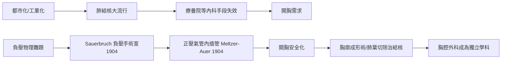

# 第 3 節 負壓手術室與胸腔外科：打破肺部塌陷的物理詛咒

胸腔曾經是外科的絕對禁地。原因是一條殘酷的物理定律：哺乳動物的呼吸依賴**負壓**——胸膜腔內壓低於大氣壓，像真空吸盤般把肺「吸」開。一旦打開胸壁，空氣湧入胸膜腔，負壓消失，肺便像洩氣的氣球般塌陷；更致命的是**縱隔撲動**：每次呼吸，縱隔在兩側壓力差下劇烈左右擺動，扭折大血管，病人在幾分鐘內休克死亡。這不是感染或疼痛的問題，而是物理學的詛咒——沒有人敢於開胸。

## 瘋狂工程：Sauerbruch 的負壓手術室

德國外科醫師紹爾布魯赫（Ferdinand Sauerbruch）在導師 Mikulicz 的實驗室想出一個天才又荒誕的方案：既然不能給病人加壓，那就把**全世界都變成負壓**。1904 年，他在布雷斯勞建起一座巨大的圓頂房間——**負壓手術室**：整個手術室被抽成低壓，病人胸部暴露在低壓空氣中，維持胸膜腔內外的壓力平衡；而外科醫師、護士全體戴上緊閉面罩，僅靠手臂從密閉袖套伸入低壓室內操作，自己在正常壓力下呼吸。手術像潛水艇倒過來進行：醫師是「乾艙」，病人是「低壓海」。機器轟鳴、面罩起霧、醫師汗流浹背地隔著袖套縫合——這是工程學對物理學的正面对決，而且它真的讓開胸手術成功了數十例。

## 簡潔的勝利：正壓插管

但負壓室註定是過渡品。同年，菲拉德爾菲亞的生理學家梅爾策（Meltzer）與奧爾（Auer）提出顛倒思路：不必改變整個房間，直接把**正壓空氣吹進氣管**——經氣管內插管間歇性加壓送氣，讓肺從內部被撐開，胸壁開放與否毫無影響。一行原理取代一座圓頂建築。正壓麻醉迅速淘汰負壓室，並成為今日全身麻醉與呼吸加護病房的基石。這是醫學史上「複雜方案被優雅方案取代」的經典一課：紹爾布魯赫的工程解決了問題的表象，梅爾策與奧爾的生理學解決了問題的本質。

## 肺結核：社會動力與外科回應

推動胸腔外科的最大社會力量，是 19 世紀**都市化與工業化**製造的肺結核大流行——擁擠的工廠宿舍、通風不良的貧民窟，讓「白色瘟疫」成為頭號死因，1900 年前後肺結核仍佔歐美死亡人口十分之一以上。當內科療法（療養院、氣胸療法）對重症失效，外科接手：**胸廓成形術**切除肋骨使肺塌陷靜養、空洞引流、1930 年代起肺葉與全肺切除。胸腔外科的進步又回饋戰場——二戰胸外傷處理、朝鮮戰場的胸內手術隊，軍事需求與結核流行共同把胸外科推向成熟。

## 因果鏈條

工業化城市的病菌 → 結核作為社會動力 → 物理詛咒逼迫工程奇觀（負壓室）→ 生理學洞察以簡馭繁（正壓插管）→ 開胸常規化 → 學科建制與戰場需求再驅動。一次「把全世界變成負壓」的瘋狂，最終讓位於一根氣管內導管。
