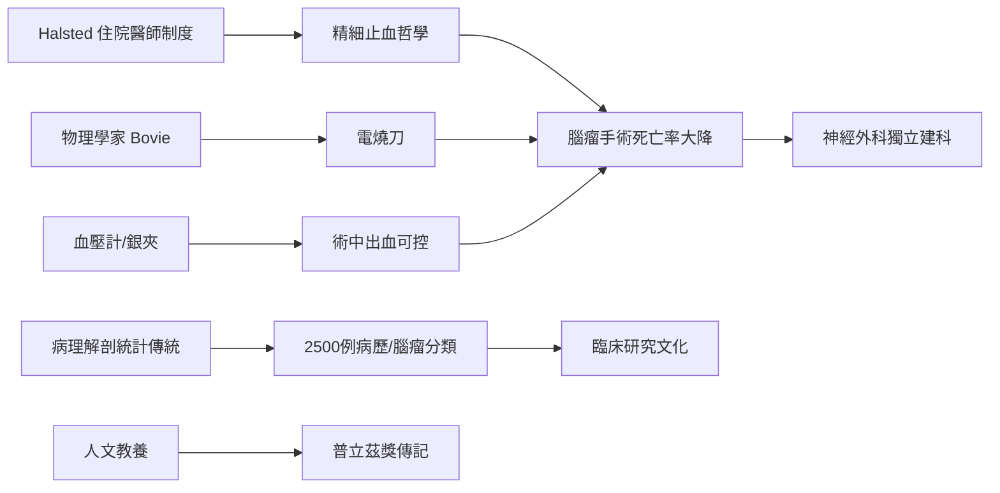

# 第 1 節 哈維·庫興（Harvey Cushing）：現代神經外科之父與腦腫瘤手術止血法

20 世紀初，腦部手術的死亡率高得令外科醫師卻步：腦組織不容牽拉、出血無法結紮、術中病人悄悄休克。哈維·庫興（Harvey Cushing, 1869–1939）用三十年時間，把這個「不可能的解剖區」變成手術可及之地，創立神經外科為獨立學科。

## 霍普金斯的教育制度：Halsted 的淬鍊

庫興的技藝成形於約翰霍普金斯，師從外科巨匠霍爾斯特德（William Halsted）。Halsted 開創的**住院醫師制度**——少數精英、長年訓練、嚴格漸進的責任分級、以手術紀錄與復原率考核——是現代外科教育的原型。庫興是這個制度的早期產品：他在 Halsted 身上學到的不只是技術，而是「輕柔操作、精確止血、愛護組織」的外科哲學。教育制度塑造手術風格，手術風格再由門徒制度複製到全世界——制度史的勝利。

## 止血的三件法寶：血壓計、銀夾與電燒刀

神經外科的第一殺手是出血。庫興的三大發明恰好針對它：

1. **血壓監測進手術室**：他推動將 Riva-Rocci 血壓計作為術中常規監測，成為麻醉監測的起點——術中休克第一次可以被「看見」並預防。他還記錄了顱內壓升高時的血壓與心跳變化（庫興反射）。
2. **銀夾止血**：以小銀夾夾閉腦表面與腫瘤的小血管，成為神經外科數十年的標配止血法。
3. **Bovie 電燒刀**：1920 年代，庫興與哈佛物理學家威廉·博維（William Bovie）合作，將高頻電流切割與凝固組織的裝置引進手術室。這是一次教科書級的跨學科協作——物理學家造出原型機，外科醫師在 1926 年的腦瘤手術中首次應用。電燒刀至今仍是全球手術台的基本配備。

## 統計文化：2500 例腦瘤的病歷帝國

庫興以近乎強迫症的方式保存每一份病歷：病史、影像（他大力推廣 X 光造影診斷腦瘤）、手術圖繪、病理標本、追蹤結果。他累積約 **2500 例腦腫瘤**的完整紀錄，與病理學家 Bailey 合作提出膠質瘤分類（1926），奠定神經病理學基礎；他又描述腎上腺皮質功能亢進的**庫興氏症**（1932）。教學病例檔案、術後隨訪、發表統計——這套「病歷即科學數據」的文化，是比爾羅特時代屍檢統計傳統的升級版，也是日後臨床研究的制度雛形。

## 文人醫師：日記與普立茲獎

庫興還是一位作家。他以書記員式的日記記錄戰地醫療（一戰隨英軍親歷）、師長軼聞與自我懷疑。退休後完成的奥斯勒傳記《威廉·奥斯勒爵士的一生》（*The Life of Sir William Osler*, 1925）於 1926 年獲**普立茲傳記獎**。聽診器與鋼筆在他手中並不衝突——再次印證本書的反覆主題：文化的教養規範著醫學的精度，而醫學的敘事又回哺文化。

## 因果鏈條

嚴格的教育制度 → 精細手術哲學；跨學科合作（物理學）→ 電燒止血；病歷統計文化 → 疾病分類與療效證明；人文素養 → 醫學傳記與職業倫理。神經外科不是被一個人發明的，而是被一整套制度、儀器與文化共同催生的。
