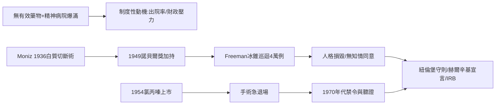

# 第 2 節 額葉切除術（Lobotomy）的黑歷史：從諾貝爾獎榮耀到醫學倫理的沉痛教訓

外科史不只有救贖，也有災難。額葉切除術——切斷大腦前額葉與深部連結以「治療」精神疾病的手術——從 1949 年諾貝爾生理學或醫學獎的桂冠，跌落為 20 世紀醫學倫理最沉痛的教材。它的興衰，是科技、制度、社會壓力與倫理覺醒相互角力的完整標本。

## Moniz 與 Freeman：從手術室到冰錐

1935 年，葡萄牙神經學家安東尼奧·埃加斯·莫尼斯（António Egas Moniz）在倫敦神經學會議上聽到猿猴額葉切除後變得溫馴的報告，數月內便與外科醫師利馬（Almeida Lima）完成首例人體**白質切斷術**。他報告病人「焦慮消除、情緒平穩」，將方法推廣為精神分裂症與重度憂鬱的療法，1949 年因此獲得諾貝爾獎——儘管長期追蹤顯示大量病人人格損毀、情感麻木甚至死亡，且他本人的科學證據極為薄弱。

在美國，精神科醫師華特·弗里曼（Walter Freeman）將手術「簡化」到荒謬的程度：不用手術室、不用麻醉（電擊昏迷代替），以**冰錐狀器具經眼窩上緣敲入腦內**攪斷白質——所謂「經眼窩額葉切除術」，號稱**十分鐘手術**。他開著旅行車巡迴全美各州精神病院，一天連做十餘台。估計全美共施行約四萬例，他本人經手逾兩千五百例，病人包括年僅十二歲的孩童。演出《慾望街車》聞名的女演員戴安娜·芭里（Dianne Barry）於 1953 年接受手術後，變得毫無表情、終生退出舞台——「治好瘋狂」的代價是抹去這個人。

## 制度性動機：爆滿的精神病院

為什麼醫界會容忍？答案在制度。1950 年代前，**有效精神科藥物完全缺位**，而慢性精神病患急速累積：1940-50 年代美國公立精神病院收容超過 50 萬人，每院超員一倍是常態，護理人力瀕臨崩潰。州政府預算緊張，院方需要「出院率」；對貧困、無家屬代言的病人，額葉切除是讓「難管者」變得溫馴的廉價工具。這是政治（財政壓力）、制度（收容體制）、經濟（人力成本）共同驅動的醫療決策——倫理在體系的重壓下被系統性邊緣化。而許多病人根本沒有**知情同意**：家屬簽字、醫院批准，本人從未被告知。

## 終結與制度回應

1954 年氯丙嗪（第一代抗精神病藥物）上市，藥物以更低風險達成類似效果，額葉切除數量斷崖式下跌；1970 年代，蘇聯率先明文禁止，美國醫界也實質終止此術。諾貝爾委員會從未公開解釋 1949 年的決定，至今保持沉默。更深遠的回應在制度層：二戰後**紐倫堡守則（1947）**確立自願同意原則，1964 年**赫爾辛基宣言**將人體試驗倫理成文化；1970 年代美國國會的調查聽證（揭露精神外科濫用）催生了研究倫理審查委員會（IRB）制度。手術刀史上最黑暗的一頁，換來了現代人體研究倫理的整座框架。

## 因果鏈條

收容體制超載 + 藥物真空 → 制度尋求廉價出口 → 未經檢驗的手術經諾貝爾獎背書擴散 → 媒體與統計稽核缺位放大傷害 → 藥物革命釜底抽薪 → 醜聞反哺倫理建制：知情同意、人體試驗規範、IRB。技術越強大，制度與倫理的護欄越不可缺席。
