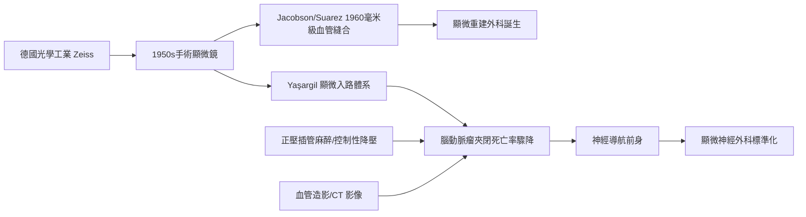

# 第 3 節 顯微神經外科：顯微鏡下精細縫合毫米級血管與神經

1970 年代以前，神經外科醫師的視野受限於裸眼：直徑一毫米以下的血管只能「避開」，無法「處理」。手術顯微鏡的引入，把外科的解析度提升了一個數量級——從「區域」進入「細胞間」。這場革命不是外科獨自完成的，而是光學工業、麻醉技術與影像診斷三股力量疊加的結果。

## 光學工業的基礎設施

手術顯微鏡的誕生，根基於德國的精密光學工業。蔡司（Zeiss）在 19 世紀末已與阿貝（Ernst Abbe）建立現代光學製造制度；1950 年代，蔡司應耳鼻喉科醫師需求推出商用**手術顯微鏡**（OPMI 系列原型），以長工作距離物鏡、腳踏變焦與同軸照明，讓醫師能在深部狹窄腔隙獲得立體放大影像。顯微鏡很快跨科傳播：耳科、眼科、婦科輸卵管再通，最後抵達難度最高的腦與脊髓。光學工程師或許從未想過，他們的消色差透鏡會在腦幹旁夾閉動脈瘤。

## Jacobson 與 Suarez：毫米級縫合的證明

1960 年，佛蒙特大學的血管外科醫師雅各布森（Julius Jacobson）與整形外科醫師蘇亞雷斯（Ernesto Suarez）以顯微鏡輔助，成功縫合 **1–2 毫米**的血管，暢通率高達 100%——論文以《實驗動物小血管縫合》宣告：只要放大視野，微血管級吻合在技術上是可能的。這項看似單純的技巧驗證，打開了斷肢再植、游離皮瓣移植、神經束膜縫合整個「顯微重建外科」的世界。技術一旦可複製，便沿著學會、培訓課程與期刊制度化，數年內全球傳播。

## Yasargil：顯微神經外科革命

把顯微鏡徹底植入神經外科的，是土耳其裔瑞士外科醫師亞薩吉爾（M. Gazi Yaşargil）。他在蘇黎世與顯微鏡工程師合作改良器械，發展出可自由調整角度的**器械固定臂與顯微鏡系統**，並於 1960–70 年代建立一套完整的顯微神經外科技術體系：經側裂入路夾閉**腦動脈瘤**、切除深部腫瘤、治療動靜脈畸形。他訓練了全球數千名神經外科醫師，其六卷教科書成為聖經。顱內動脈瘤手術死亡率從昔日的高危險驟降至個位數百分比——「顯微外科革命」由此得名。

## 疊加效應：顯微鏡 × 麻醉 × 影像

顯微外科的奇蹟不是單點突破，而是**技術疊加**：手術顯微鏡提供視覺解析度；顯微氣管內插管麻醉與控制性降壓（第 7 節正壓麻醉的後裔）讓病人長時間平穩、腦組織鬆弛低張；血管造影與日後 CT、MRI 提供術前地圖。三者缺一，革命不成。顯微鏡下醫師還需要第三隻手，於是衍生出固定臂、顯微鑷與微小動脈瘤夾的整個器械族譜——並孕育了以影像座標導引器械的構想：這正是今日**神經導航**（術前影像與顯微視野即時配準）的直接前身。

## 因果鏈條

光學工業供給鏡頭 → 生理實驗證明毫米級縫合可行 → 大師建立入路體系並制度化培訓 → 麻醉與影像補齊安全性 → 手術解析度革命 → 導航時代。顯微鏡教會外科的真理是：視野放大一級，可治療的疾病就多一層。
