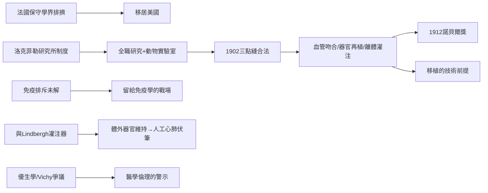

# 第 1 節 卡雷爾（Alexis Carrel）：血管三點縫合法與器官移植的理論基石

器官移植在今天每年拯救數以萬計的生命，但它的起點，是 1902 年里昂一位年輕外科醫師發明的一種縫法。亞歷克西斯·卡雷爾（Alexis Carrel, 1873–1944）的**血管三點固定縫合法**，讓直徑只有幾毫米的血管能被吻合得既不漏血、又不狹窄——這是「把一根血管接到另一根血管上」的關鍵技術，也是一切移植、搭橋、人工循環的技術前提。

## 三點縫合法的巧思

血管吻合的難題在於：縫針會把薄壁血管撕裂，線拉太緊管腔便狹窄血栓，太鬆則漏血。卡雷爾的解法極其優雅：在血管斷端等距放置**三針固定線**，各相距 120 度，牽引三線使圓形斷端變成三角形，邊緣自然張開、內膜對內膜；再依次在兩兩固定線之間連續縫合三個邊。張力均勻、管腔幾何穩定、縫線不接觸血流面——漏血與狹窄同時被化解。這個純手工的幾何學，至今仍是血管外科與顯微外科（第 8 節）的基本功。

## 里昂到紐約：研究型醫學制度

卡雷爾的發明起初在保守的法國外科界遭冷遇——他被迫離開里昂，遠渡北美。1906 年他加入紐約**洛克菲勒醫學研究所**，這所 1901 年創立、以全職實驗室研究為使命的機構，代表美國醫學的新制度：外科醫師帶薪做研究、配備動物實驗室與研究助理。正是在這裡，卡雷爾用犬隻完成了一系列驚人實驗：血管移植、器官再植、離體器官灌注，並在 1910 年代與飛行家林白（Charles Lindbergh）合作研製**玻璃灌注器**，試圖讓器官離體存活——「器官可以在體外被維持」的觀念由此誕生。1912 年，年僅 39 歲的卡雷爾因血管縫合與器官移植實驗獲**諾貝爾生理學或醫學獎**。法國老派的醫院制度留不住他，美國的研究型大學制度成全了他——制度決定天才的落點。

## 移植的理論基石

卡雷爾用狗做了自體、同種、異種的腎臟移植實驗：技術上他成功接活了移植腎，並讓動物存活數週至數年，但同種移植終究因排斥而失敗。他準確地留下結論：障礙不在縫合技術，而在「生物學因素」。這句話為日後 Medawar 的免疫排斥研究（第 9 篇）劃定了戰場。可以說：**卡雷爾解決了移植的工程學，留下免疫學給後世**。

## 爭議面：一位複雜的諾貝爾獎得主

卡雷爾不是聖人。他晚年公開鼓吹優生學，主張以機構「處置」罪犯與精神病人；1940 年代法國淪陷期間，他出任維希（Vichy）政權支持下成立的法國問題基金會主席，立場曖昧親近合作政權；他還熱衷神秘主義，自稱在露德見證不可思議的痊癒，遊走於科學與信仰之間。這些陰影提醒我們：技術天才的道德判斷，可能與其手術技巧同樣精確，也可能同樣脆弱——而 Lindbergh 這位合作者，日後也將以另一種令人不安的面貌重現於本書（航空技術與人工心肺的伏筆）。

## 因果鏈條

縫合幾何的發明 → 血管手術可行 → 研究型制度放大產能 → 諾貝爾獎背書 → 移植的工程前提確立 → 免疫難題移交後世；同時，優生學與維希陰影告誡：外科的榮光必須與倫理的警醒同行。
