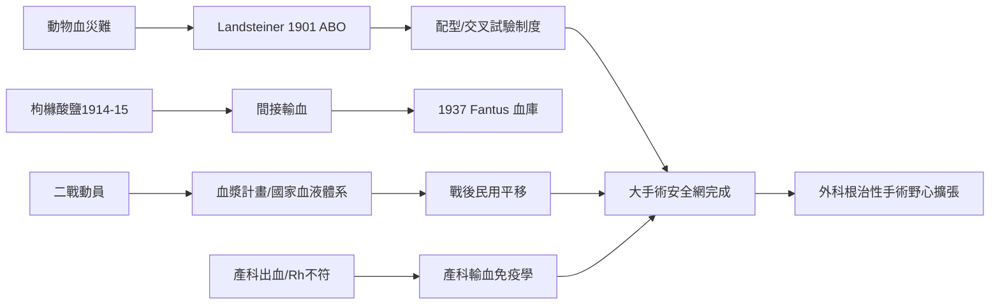

# 第 2 節 ABO 血型發現與抗凝劑：現代輸血技術讓大手術不再失血過多而亡

外科曾有一個揮之不去的陰影：手術台上的病人不是死於刀，而是死於血。止血可學（Halsted、庫興），但失血需要補充——而輸血在 20 世紀初之前，是一場賭命。

## 動物血災難與直接吻合時代

17 世紀起便有將動物血輸給人的嘗試，結果是溶血、發熱、死亡，法國與英國一度立法禁止。19 世紀末人對人輸血重啟，但兩大死結未解：血為何時而救命、時而致命？血離體為何立刻凝固？1900–1901 年，維也納的卡爾·蘭德施泰納（Karl Landsteiner）以簡單的血清混合實驗給出第一個答案：人的血液可分為 A、B、AB、O 型，異型血相遇即凝集溶血。**血型的發現把輸血從賭博變成配對**，他因此獲 1930 年諾貝爾獎；1927 年他再發現 MN 系統，1940 年（與 Wiener）發現 **Rh 因子**。要輸血安全，還需「配型」的組織制度：血型檢驗、交叉試驗進入常規流程——科學發現必須被編入檢驗室規程才成為安全。

## 抗凝劑與血庫

第二個死結由生理學解開：1914–15 年間，多國研究者幾乎同時發現**枸櫞酸鹽**可結合鈣離子、阻止血液凝固，且對人體無害。間接輸血（先抽血、儲存、再輸入）從此可行。1937 年，芝加哥庫克郡醫院的范圖斯（Bernard Fantus）建立美國第一所**血庫**（他創造 "blood bank" 一詞——銀行隱喻意味著血液成為可儲存、調度的公共資源）。冷藏技術與檸檬酸鹽溶液讓血有了「保存期限」，血液供應鏈誕生。

## 二戰：血漿計畫的政治動員

第二次世界大戰把輸血變成國家工程。美國的**血漿計畫**動員數千萬人捐血，血漿經乾燥處理、可長期儲運，在前線挽救無數傷兵；英國戰時輸血服務更成為日後國家衛生體系的雛形。戰爭的政治動員力、工業化的乾燥與冷鏈技術、全國志願捐血的公民文化——三者共鑄了現代血液銀行體系，戰後直接平移回民用醫療。

## 兩大引擎：戰場與產房

有趣的是，推動輸血學的從來不是手術室，而是**戰場與產房**：戰傷失血需要大量快速補血，產後出血與 Rh 不符的新生兒溶血病（1940 年代確認，1960 年代 Rh 免疫球蛋白預防）逼出了輸血與母胎免疫學的整個知識體系。外科是最大受益者：血型配對＋抗凝＋血庫就位後，胃切除、開胸、開心手術才敢放手追求「根治性切除」——輸血是大手術的安全網，安全網越牢固，外科的野心越大。

## 因果鏈條

血清實驗發現血型 → 配型制度 → 抗凝劑解決凝固 → 血庫建立供應鏈 → 戰爭動員工業化 → 戰場與產房累積證據 → 外科獲得補血安全網 → 大手術時代到來。一滴血的旅程，串起實驗室、檢驗科、血站、戰場與產房。
