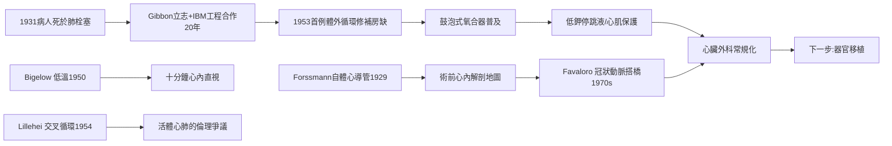

# 第 3 節 人工心肺機（Heart-Lung Machine）與體外循環：心臟停跳下的開心手術

心臟是身體唯一「不能停」的器官。要修補心臟內部，就必須讓它停下來；而它一停，腦在數分鐘內死亡。這個悖論封鎖心臟外科數十年——直到有人造出替代心與肺的機器。

## Gibbon：一句死因催生二十年工程

1931 年，費城傑佛遜醫學院的外科住院醫師吉本（John Gibbon）守著一位術後肺栓塞死去的病人整夜：若能在她肺動脈被堵住時，把靜脈血引出、加氧、泵回動脈，她或許能活。他立志造出**人工心肺機**。這個決定花了他二十餘年：與妻子 Mary 無數次的動物實驗，1939 年起獲得**IBM 的工業合作**——工程團隊將氧合器與滾壓泵迭代為可靠的膜式儀器。1953 年 5 月 6 日，Gibbon 以人工心肺機為一位 18 歲女孩關閉**心房中隔缺損**——史上第一例成功的體外循環開心手術。然而隨後數年他的團隊屢遭失敗，Gibbon 心灰意冷、退出臨床。偉大發明的劇本裡，低谷與勝利同樣漫長。

## 低溫法與交叉循環：機器成熟前的替代方案

在 Gibbon 磨機器的年代，加拿大外科醫師比奇洛（Wilfred Bigelow）於 1950 年證明**低溫**可降低代謝、延長循環停止的安全時間；明尼蘇達的 Lewis 於 1952 年以低溫阻斷循環完成首例心內直視手術——但低溫只給了約十分鐘，只能處理簡單病灶。1954 年，李拉海（C. Walton Lillehei）想出驚世駭俗的**交叉循環**：以病童的父親充當「活體心肺機」，父親的股動靜脈與孩子的循環並聯，心臟阻斷期間由父親的心肺維持兩人的生命。首例成功，父親捐出的是循環而非器官——但在早期手術死亡率仍高的年代，等於把兩條命押上一條手術台，引發猛烈倫理爭議。它所暴露的問題（供體風險、同意的複雜性）至今仍縈繞於活體移植倫理。1955 年後，改良的鼓泡式人工心肺機日趨可靠，交叉循環功成身退。

## 心臟停跳液與心肌保護

「心臟停下來之後如何再救回來」是另一半難題。1960 年代起，**低鉀高鉀的心臟停跳液**（冷灌冠狀循環，使心肌在電靜止與低溫下代謝驟降）標準化，心臟在停跳下被安靜地縫合，術後復跳如常。心肌保護的成熟，讓阻斷主動脈的時間從分鐘級延長到小時級——複雜的瓣膜置換與多支搭橋成為可能。

## 從一根導管到三支橋：Forssmann 與 Favaloro

心臟外科的前端，還有一段自體實驗的傳奇：1929 年，25 歲的德國外科住院醫師福斯曼（Werner Forssmann）說服同事將導尿管經自己的肘靜脈推入 65 公分，走到 X 光機下證實導管尖端**抵達自己的心臟**——心導管術誕生，他因此獲 1956 年諾貝爾獎（同時也因「自殘」被醫院開除）。導管診斷讓心內解剖在術前可見，心臟外科的「地圖」由此繪成。1970 年代，阿根廷外科醫師法瓦洛羅（René Favaloro）在克里夫蘭將**大隱靜脈冠狀動脈搭橋**（CABG）標準化，成為 20 世紀最常施行的心臟手術，每年拯救數百萬冠心病人。

## 因果鏈條

臨床死亡事件 → 工程師式執念與企業合作 → 體外循環問世 → 失敗低谷被低溫、交叉循環過渡支撐 → 停跳液完成心肌保護 → 導管造影提供地圖 → 搭橋手術規模化。心臟終於可以被打開——而下一步，是換一顆。
