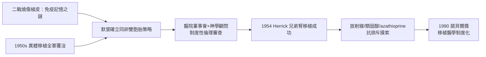

# 第 1 節 1954 年同卵雙胞胎腎臟移植：約瑟夫·默里（Joseph Murray）的第一場勝仗

## 一場「不可能」的手術

1954 年 12 月 23 日，波士頓 Peter Bent Brigham 醫院的手術室裡，外科醫師約瑟夫·默里完成了一項史無前例的手術：將 23 歲的 Ronald Herrick 的一顆腎臟，移植給他因腎炎瀕死的同卵雙胞胎兄弟 Richard Herrick。這顆腎臟在 Richard 體內運作了八年，直到他 1962 年死於原病復發——但在免疫學一無所知的年代，這八年等於宣告：器官移植不是空想。

默里選擇同卵雙胞胎，是一個被逼出來的策略。1950 年代初期，異體移植幾乎全數失敗：1950 年代初芝加哥、波士頓嘗試的屍體腎或活體非親屬腎移植，都在數天到數月內因排斥反應而衰竭。當時醫界已隱約意識到，身體會把外來組織當成敵人攻擊——這個「排斥反應之謎」正是移植的最大障礙。同卵雙胞胎基因完全相同，免疫系統理論上不會辨認對方為異物，這是唯一能繞過免疫屏障的路徑。

## 默里的免疫學啟蒙：來自戰場的燒傷

默里的洞見並非憑空而來。二戰期間，他在賓州 Valley Forge 陸軍總醫院照料燒燙傷士兵，為傷者進行植皮手術。他觀察到一個關鍵現象：用病人自己皮膚移植可以存活，取自他人的皮膚初時貼附、隨後卻脫落壞死，而再次取自同一捐贈者的皮膚，排斥來得更快、更猛。這種「加速排斥」暗示免疫系統具有記憶——這正是後天免疫的核心特徵。戰場上的燒傷病房，成了默里理解組織相容性的天然實驗室。戰後他回到波士頓，與哈佛的免疫學者合作，逐步把臨床觀察轉化為移植策略。

## 制度史：一場「倫理委員會」的內部辯論

1954 年的手術在技術之外，更是一場制度性的突破。在「健康的人為何要切掉一顆腎臟」的質疑下，Brigham 醫院罕見地組成了跨領域的內部審議：外科團隊向醫院董事會報告手術風險與收益，醫院聘請哈佛神學院的神學顧問評估「自我傷害」與「利他犧牲」的道德界線，法律顧問則確認健康兄弟的知情同意能力。這個由醫師、董事、神學家、律師組成的臨時委員會，被後世視為現代醫院倫理委員會（IRB/IRB 前身）的雛形之一。手術獲准的條件包括：Ronald 須充分理解風險、雙方家庭同意、並有獨立醫師分別代表兩位病人的利益。制度先行於技術，成為此後所有移植手術的範式——每一次醫學跨越自然界限，都必須先跨越社會的授權程序。

## 手術本身：技術細節與意義

默里採用後腹膜入路，將腎臟植入受者右側髂窩（異位移植），並精確吻合腎動脈、腎靜脈與輸尿管至膀胱。術後 Richard 的尿毒症狀迅速改善，順利出院。此手術證明了兩件事：異位移植的血管吻合技術可行；受者可以帶著一顆「外來」腎臟正常生活。1954 年之後，默里團隊繼續在雙胞胎間進行多例移植，並嘗試以全身放射線照射抑制免疫——這是抗排斥治療的野蠻起點，療效不穩定且死亡率高。1950 年代末，學界轉向類固醇（皮質激素）與 6-巰基嘌呤（6-MP）及其衍生物 azathioprine（1959-1963 年間進入臨床），組合免疫抑制使非雙胞胎移植首次有了可觀的存活率。

## 諾貝爾獎與歷史定位

1990 年，默里因「器官與細胞移植在治療人類疾病上的發現」獲諾貝爾生理學或醫學獎，與發明骨髓移植的 E. Donnall Thomas 同享殊榮。得獎距離 1954 年那場手術已三十六年——這段時間差正反映了移植醫學的艱難：從「同卵雙胞胎的例外」到「對抗排斥的普遍」，中間橫亙著免疫學、藥理學與倫理制度的三重長征。默里的勝仗，不僅是外科技術的勝利，更是「醫學、制度與社會共同協商」的勝利。

## 因果鏈條

1. **戰場經驗 → 免疫洞見**：燒傷植皮的加速排斥現象，讓默里理解組織免疫的特異性與記憶性。
2. **免疫屏障 → 制度創新**：無法解決排斥，就先用基因相同的雙胞胎繞過它；無法回答倫理疑慮，就發明審議制度來回答它。
3. **個案成功 → 藥物競賽**：1954 年的勝利證明移植可行，反而加劇了對抗排斥藥物的投入與摸索。
4. **技術突破 → 諾貝爾肯定**：三十六年的等待，印證基礎免疫學與臨床外科的長期互相驅動。
