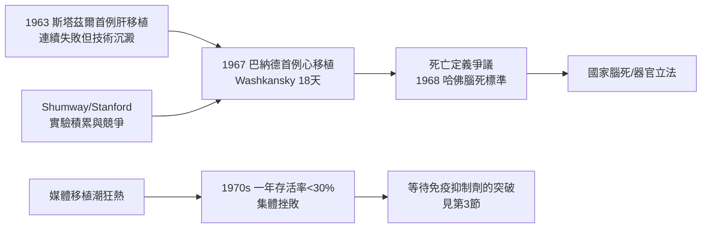

# 第 2 節 托馬斯·斯塔茲爾與巴納德：肝臟與心臟移植的生死挑戰

## 斯塔茲爾：連續失敗下的肝移植長征

1963 年 3 月 1 日，科羅拉多大學的托馬斯·斯塔茲爾（Thomas Starzl）完成了史上第一例人類肝臟移植，受者是一名三年先天性膽道閉鎖的病童，術中因凝血障礙死亡。此後數年，斯塔茲爾陸續完成多例肝移植，幾乎全數在數週至數月內死於排斥、感染或技術併發症。他與默里的經驗相通：移植的門檻不在吻合技術，而在免疫。斯塔茲爾以 azathioprine 加類固醇的組合免疫抑制為標準方案，又在動物實驗中反覆打磨多器官整塊切取與血管重建技術。他的堅持近乎固執——外界譏諷肝移植是「屠殺」，他卻持續發表失敗數據，讓全世界看清問題所在。這種「以失敗餵養科學」的做法，是移植醫學能熬過黑暗期的關鍵。

## 巴納德：1967 年的心臟震撼

1967 年 12 月 3 日，南非開普敦 Groote Schuur 醫院的克里斯提安·巴納德（Christiaan Barnard）將一名車禍腦死者（Denise Darvall）的心臟，移植給 54 歲的 Louis Washkansky。手術技術上完美——巴納德曾在美國向未來建立史丹佛心臟移植計畫的 Norman Shumway 學習低温與體外循環技術——Washkansky 的新心臟也確實跳動了，但因大劑量免疫抑制導致肺部感染，他在 18 天後去世。巴納德搶在美國同行之前完成首例，令 Shumway 與史丹佛團隊扼腕：他們已累積十餘年犬隻心臟移植實驗，卻在等一個「合適的時機」。這場開普敦與史丹佛的競爭，背後是醫學中心之間的聲望經濟：首例的榮耀屬於敢於跨過門檻的人，而後續的科學積累屬於系統化的實驗室。

## 腦死判定：移植的制度前提

巴納德的手術暴露了一個制度真空：從仍在跳動（或剛停止跳動）的身體取心，究竟算不算殺人？1968 年，哈佛醫學院發表「不可逆昏迷」的腦死判定標準，首次提出以腦幹功能喪失、而非心跳呼吸停止作為死亡定義。這不只是醫學標準，更是法律與宗教的重新協商：唯有腦死成為法定死亡，器官捐贈才能在不觸犯殺人禁忌的前提下進行。此後各國陸續立法（美國 1968 年統一屍體捐贈法、1980 年代各州腦死法），腦死判定從此成為一切器官移植的制度地基。可以說：沒有 1968 年哈佛標準，就沒有 1980 年代以後的移植產業。

## 移植潮與 1970 年代的集體挫敗

1968 年掀起了全球「移植潮」：一年之內全球完成上百例心臟移植，媒體把外科醫師塑造成新時代的英雄。但熱潮迅速退燒——排斥、感染與供體器官品質問題使一年存活率普遍低於 30%，多數中心陸續放棄，到 1970 年代中期只剩史丹佛等極少數中心苦撐。肝移植同樣慘澹，斯塔茲爾轉往匹茲堡繼續耕耘。這十年挫敗教會醫界一課：外科技術的天花板由免疫學決定；在有效免疫抑制問世之前，移植的狂熱只是媒體文化與醫學雄心的合謀。而媒體的角色是雙刃劍——它催生了捐贈文化與公部門立法（如美國 1984 年國家器官移植法、1986 年成立 UNOS 分配網絡），也在失敗案例中放大社會的道德恐慌。

## 因果鏈條

1. **實驗積累 → 首例膽識**：斯塔茲爾與史丹佛的動物實驗，使巴納德能在技術上一步到位。
2. **首例震撼 → 制度真空**：心跳還在的捐贈者逼出了腦死判定與立法。
3. **媒體狂熱 → 集體挫敗**：社會期待超前於免疫學能力，1970 年代的失敗反而為藥物革命蓄積動能。
4. **失敗數據 → 科學進步**：敢於發表失敗，是移植醫學穿越黑暗期的唯一方法。
