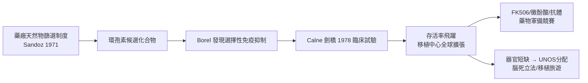

# 第 3 節 環孢素（Cyclosporine）與免疫抑制劑：解決排斥反應的分子藥物革命

## 來自挪威土壤的真菌：製藥產業的篩選制度

1971 年，瑞士製藥巨頭 Sandoz 的科學家在美國威斯康辛與挪威收集的土壤樣本中，分離出一株真菌 *Tolypocladium inflatum*，從其培養物中提純出一種結構奇特的環狀胜肽，編號 24-556，後命名為環孢素（cyclosporine）。這不是偶然的幸運，而是戰後製藥工業「天然物篩選制度」的產物：藥廠在全球系統性蒐集土壤、黴菌與放線菌，以標準化生物測定（assay）逐一檢驗抗菌、抗黴菌、抗發炎活性。環孢素最初是當作弱效抗黴菌劑篩出來的，幾乎被放棄——是制度化的篩選流程，讓它得以留存在候選化合物庫中，等待另一位科學家的目光。

## Borel 的關鍵一瞥

1972 年，Sandoz 的免疫學者讓·博雷爾（Jean Borel）注意到環孢素在動物實驗中選擇性抑制淋巴細胞增殖，卻不像類固醇那樣全面壓制骨髓與免疫防線——這是革命性的「選擇性免疫抑制」。Sandoz 隨即以公司資源推動藥理、毒理與量產純化（環孢素難以結晶純化，量產技術本身是重大投資）。這段歷史展示了科技與經濟的互相驅動：沒有藥廠的長期研發資本與專利制度，土壤裡的真菌永遠只是真菌。

## Calne 與劍橋：1978 年的臨床躍進

英國劍橋的羅伊·卡恩（Roy Calne）是這場分子革命的臨床推手。他在 1978 年將環孢素用於腎移植病人（先與類固醇合用，其後逐漸建立單用與聯合方案），結果令人震驚：排斥發生率與嚴重度大幅下降。1980 年代多中心試驗確立其地位後，腎移植一年存活率從約 50-60% 躍升至 80-90% 以上，心、肝移植也從「實驗性手術」變成「常規治療」。1983 年環孢素獲 FDA 核准，全球移植中心數量在十年內倍增——藥物一鍵解鎖了被凍結十年的外科能力。斯塔茲爾在匹茲堡率先將環孢素用於肝移植，終於把 1960 年代的慘澹成功率翻轉為可安慰家屬的數字。

## 後環孢素時代的藥物軍備

環孢素的成功開啟了免疫抑制劑的研發黃金時代：1980 年代日本藤澤藥品從土壤鏈黴菌分離出 FK506（他克莫司，tacrolimus），作用機制類似但效力更強；黴酚酸酯（mycophenolate mofetil）取代 azathioprine 成為主流抗代謝藥；1980 年代 anti-OKT3 單株抗體開啟抗體誘導與搶救治療，其後 basiliximab、alemtuzumab 與各種生物製劑接續登場。藥物組合（鈣調磷酸酶抑制劑＋抗代謝藥＋類固醇＋誘導抗體）使急性排斥大多可控，移植的戰場轉向慢性排斥、感染與長期藥物毒性（腎毒性、腫瘤）。

## 新難題：短缺、分配與移植旅遊

存活率飛躍帶來了新的社會經濟難題：需求遠超供給。器官短缺催生了分配制度的政治學——美國以 UNOS（今 OPTN）依病情、等待時間與地理分配器官；各國則在「知情同意捐贈」與「推定同意」（如西班牙模式）之間立法抉擇。需求外溢更催生了「移植旅遊」：富裕病患赴器官交易黑市氾濫的國家購買腎臟，引發 WHO 與《伊斯坦堡宣言》（2008）對器官商業化的國際規範。移植醫學從外科勝利，演變為全球化分配正義的試煉場。

## 因果鏈條

1. **制度篩選 → 分子發現**：藥廠的標準化篩選體制，是環孢素被「保存」下來的前提。
2. **企業資本 → 臨床驗證**：專利與研發投資支撐了從真菌到藥品的十年長征。
3. **藥物革命 → 外科解凍**：免疫抑制解鎖了早已成熟的吻合技術，移植從例外變常規。
4. **成功率提升 → 短缺危機**：醫學的成功反而製造了分配政治與全球倫理的新戰場。
