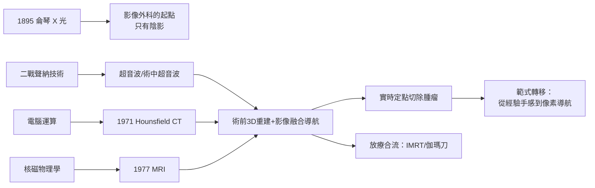

# 第 2 節 影像導引技術：超音波、CT 與 MRI 實時定點切除腫瘤

## 從侖琴的陰影到「看不見的病灶」

1895 年侖琴發現 X 光，外科第一次「看見」身體內部——但 X 光只提供疊加的陰影，對軟組織腫瘤、肝臟病灶與腦部病變幾乎無能為力。二十世紀的大部分時間，外科醫師仍依賴觸診與經驗：腫瘤摸得到才切得掉，摸不到的深部病灶往往直到開腹、開顱那一刻才第一次被肉眼看見。影像革命的使命，就是把「看不見的病灶」變成可測量、可定位、可規劃的地圖。

## 超音波：軍事聲納的民用轉生

超音波醫學是軍事科技轉民用的典範。二戰中成熟的聲納（SONAR）與雷達技術，戰後被工程師與醫師改裝為人體探測器：1940-50 年代美國的 Howry 與丹麥的 Edler、Hertz 等人先後做出二維超音波掃描與心臟超音波。超音波無游離輻射、即時、便宜、可攜，使其成為史上普及最快的影像工具。對外科而言，關鍵的飛躍是 1980 年代「術中超音波」（intraoperative ultrasound）：探頭直接放在肝臟表面，能偵測術前影像與觸診都漏掉的小型肝轉移灶，徹底改變肝腫瘤切除的決策——外科醫師的手感第一次被「掌上的聲波地圖」擴增。

## CT：電腦運算與影像的斷層革命

1971 年，英國 EMI 公司的工程師 Godfrey Hounsfield 與神經放射科醫師 James Ambrose 合作，在 Atkinson Morley 醫院完成首例人腦 CT 掃描。CT 的本質不是新的射線，而是新的數學與運算：以多角度 X 光投射數據，經電腦重建成橫斷面影像——這是電腦產業與醫學的匯流，Hounsfield 因此與 Cormack 共獲 1979 年諾貝爾生理學或醫學獎。CT 首次讓肝、胰、腹膜後腫瘤在術前被精確標定大小、數目與血管關係，手術從「進去找」變成「照圖切」。

## MRI：核磁物理學的另一場諾貝爾

MRI 則源自純物理：1946 年 Bloch 與 Purcell 發現核磁共振（1952 年諾貝爾物理學獎）；1970 年代 Raymond Damadian 提出組織鬆弛時間的腫瘤偵測概念並建造首台人體磁共振機，1977 年完成第一張人體 MRI 影像；Lauterbur 與 Mansfield 的梯度磁場成像法使其臨床化，兩人獲 2003 年諾貝爾生理學或醫學獎。MRI 對軟組織、神經與血管的解析力遠超 CT，且無輻射。三次諾貝爾獎（X 光、CT、MRI）串起一條主線：基礎物理學的每一波躍進，最終都化為外科手術檯上的導航能力。

## 影像融合、3D 重建與放療合流

當代外科的影像導引已是多模態的整合工程：術前 CT/MRI 影像經 3D 重建軟體轉為病人的專屬解剖模型，腫瘤、血管、膽管以不同顏色呈現，可事先模擬切除平面；影像融合導航系統在術中即時比對器械位置與術前影像，肝段切除、腦瘤切除與脊椎手術因此進入「像素導航」時代。影像也與放射線治療合流：從 1950 年代鈷-60 遠距治療，到今日以 CT 模擬定位的強度調控放療（IMRT）與立體定位放射手術（伽瑪刀、賽博刀），「用射線切除」與「用刀切除」共用同一套影像地圖。外科與腫瘤放射科的邊界，在影像的共通語言中逐漸溶解。

## 範式轉移：從經驗手感到像素導航

影像革命改變的不只是工具，而是外科的知識結構。傳統外科大師的權威來自「手感的累積」——病灶摸起來的硬度、分離時的阻力；影像時代的外科則在術前即已「完成」大部分診斷與規劃，手術檯上只是執行地圖。年輕醫師得以跨越經驗的年限，站在與大師相同的起點上。這既是教育的民主化，也引發新的問題：當地圖太精確，外科醫師是否正在失去觸摸與判斷的身體智慧？

## 因果鏈條

1. **軍事科技 → 醫學民用**：聲納轉生超音波，戰爭的投資意外餵養了和平的外科。
2. **物理學躍進 → 諾貝爾獎 → 臨床工具**：X 光、CT、MRI 三代影像，皆是基礎科學制度化的果實。
3. **影像精確 → 手術規劃前移**：決策從術中的直覺轉移到術前的像素，風險大幅下降。
4. **地圖能力 → 教育與權威重構**：影像民主化了外科知識，也挑戰了傳統大師的手感權威。
