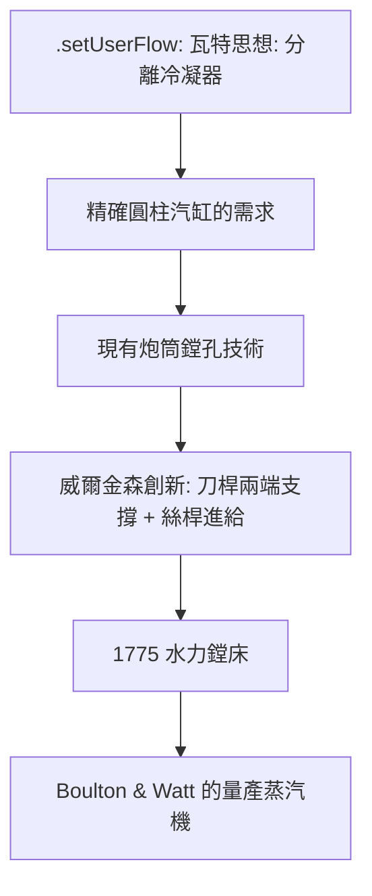

# 1.2 1775 年威爾金森水力鏜床的誕生：人類歷史上第一台真正意義上的工業工具機

## 從製炮到蒸汽機：John Wilkinson 的出身

John Wilkinson（1728–1808）是英國斯塔福德郡鑄鐵世家的兒子，父親經營小型鑄造與鍛造作坊。1750 年代，他與兄弟在鑄炮業中嶄露頭角：

- 他改良了炮管鏜孔工藝：把鏜刀桿兩端都支撐起來，穿過整支炮管切削——這個「刀桿兩端支撐」（overhung vs. supported）的區別，正是精密鏜孔的靈魂；
- 1750 年代末起，他陸續提出多項鏜床與水車驅動的專利；
- 1760 年代，他在伯明翰近郊經營自己的鑄鐵廠，以鑄炮、鑄管聞名，被同行戲稱為「IRON MAD WILKINSON」（瘋鐵人威爾金森）——他相信鐵能取代木材做出一切。

## 1774–1775 年：一台新鏜床

1774 年，威爾金森取得一項關鍵專利（英國專利 No. 1120，1774 年；1775 年再改進申請 No. 1281），描述了一種大口徑鑄鐵圓筒的鏜孔方法：

核心設計思想：

1. 工件（鑄鐵汽缸）固定不動；
2. 鏜刀桿由水輪驅動，兩端由外部支座支撐——刀桿穿過工件旋轉，而工件只有輕微的自我調整；
3. 刀桿的進給（沿軸向移動）以絲桿抬升傳動，使切削路徑在整個孔長內保持直線；
4. 每次切削後降低刀尖深度，反覆行星式鏜削。

這樣「刀桿長=工件長，反覆輕切削」的工藝，把誤差累積壓到最低——加工出來的孔，成為當時工程界難以想像的大口徑圓柱。

## 瓦特與波爾頓的加入

1775 年（部分史料記為 1776 年首機運行），瓦特的投資人由 Roebuck 轉手給了 Birmingham 的製造商 Matthew Boulton——波爾頓以巨資買下了瓦特專利的一半權益，並向國會申請延長專利保護期至 1800 年。

波爾頓立即意識到威爾金森鏜床的軍事級價值：他派工程師查看機器、並安排瓦特親自驗證加工結果。瓦特的評價流傳至今：

> 「威爾金森先生以珍奇的方式為我們鏜削汽缸，直徑五十英吋，這麼大又這麼準……在鏜孔的整個過程中，刀具不會偏離施進方向……」

現存的游標測量顯示，威爾金森鏜削的汽缸：

- 直徑可達 50 英吋（1.27 公尺）；
- 「最厚的鏜削片不超過一個老先令的厚度」（約 1-2 毫米）的總偏心，用工程技術表達就是誤差「小於手指甲厚度」——先令硬幣內部可以「薄薄嵌入一枚小硬幣」。

在當時的世界，這就是奇蹟。

## 為什麼是「第一台真正意義上的工具機」？

工具機（machine tool）的定義核心在於：以機械方式驅動刀具，對金屬進行精密切削，並且——加工精度高於操作者手工所能達到的水平。

以此標準衡量：

- 紐科門時代的粗糙手工鏜削：是人手工驅動的作坊技術，不能算；
- 維琴佐·伽利略之前的水力驅動炮筒鏜床：只加工炮筒，不算「產品化的工業加工設備」；
- 威爾金森 1775 鏜床：水力驅動、絲桿控制、可重複大直徑精密切削——成為「專為精密切削金屬設計的工業機器」。它催生了第一條可以規模化生產的蒸汽機供應鏈。

## 經濟與政治的共舞

- 專利制度的關鍵角色：1774–1775 年的專利，把威爾金森的鏜床技術鎖進了英國專利體系——他授權 Boulton & Watt 使用（並陸續供應汽缸），而其他鏜床模仿者需另想辦法。這也是英國專利制度運行的典型案例；
- Boulton & Watt 的商業模式很有意思：他們不賣蒸汽機，而是按汽缸直徑計算、用煤炭省下的量收取「royalty」（逐部收租）——沒有威爾金森提供的精密汽缸，這個商業模式根本不成立；
- 威爾金森自己是蒸汽機的最大用戶之一——他用蒸汽機驅動鼓風爐，加速他的鑄鐵王國。

## 小結

1775 年的水力鏜床，解決的不只是「一口汽缸」，而是一把 assessment 文明的鑰匙：它證明了大口徑的圓柱、圓孔在大規模工業中可以被「機械」而不是「手藝」量產。下一節，我們細看汽缸密合度的突破如何讓蒸汽機的熱效率與規模瞬間躍升，開啟工業革命的心臟。
