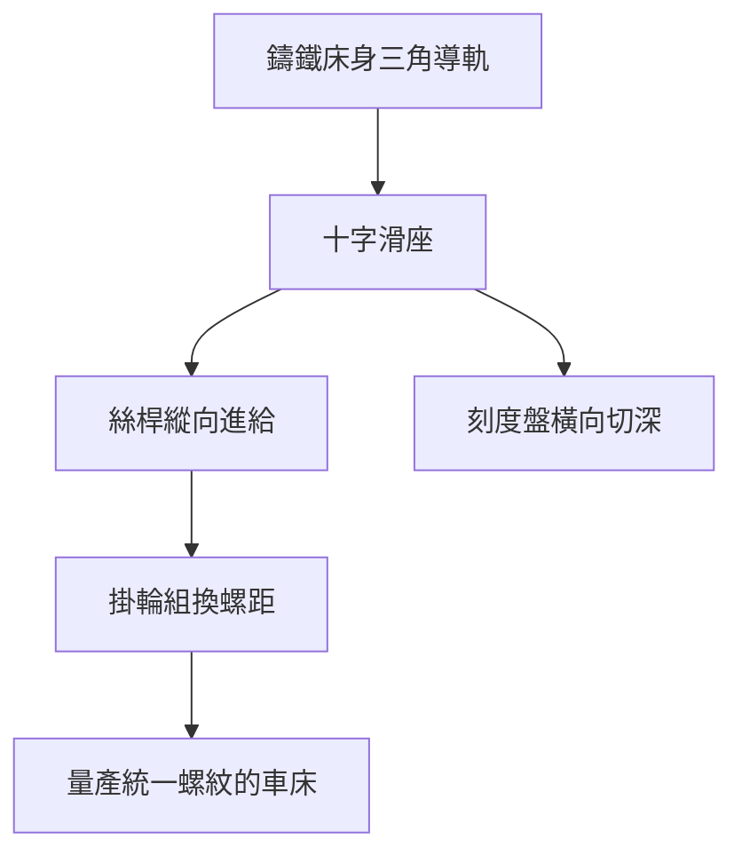

# 2.2 1797 年全金屬滑座車床（Slide-rest Lathe）：將切削刀具固定在滑台上的機械剛性革命

## 一個從亞歷山大的手稿到倫敦車間的概念

「滑座」（slide rest）的想法古已有之——文藝復興時代的工程手稿甚至 Leonardo da Vinci 的草圖中就出現過「刀架追隨絲桿」的概念。但在 18 世紀，它只偶爾出現在法國鐘錶匠的小型車床上。

把它變成一台「量產金屬加工的工業設備」，需要三個要素同時成熟：

1. 金屬床身：以鑄鐵鑄出一體化、剛性高的床身與導軌；
2. 絲桿傳動：以精密絲桿驅動滑座沿導軌移動，控制進給深度與速度；
3. 動力與變速：以水力或後來的蒸汽動力驅動主軸，保持穩定轉速。

## 亨利·莫茲利的出身與機緣

Henry Maudslay（1771–1831）出身貧寒，父親是倫敦 Woolwich 兵工廠的工匠。他在 12 歲左右進入倫敦的兵器庫的工作坊，在做「翻砂、打磨、配槍機」的童年中練出了極佳的手藝。

18 歲進入 Joseph Bramah 的鎖廠——這是英國當時最精密的作坊之一。Bramah 的防盜鎖號稱「無法撬開」，其核心是極度精密的黃銅與鋼件手藝。莫茲利成為 Bramah 車間的頭領之一，以「手最穩、腦最快」聞名。

但 1797 年，莫茲利因要求加薪被拒而離開 Bramah。1800 年代起，他自立門戶開設車間，開始製造屬於自己的工具機產品。

## 1797 年的滑座車床

莫茲利第一次記錄的「全金屬滑座車床」大約在 1797 年前後成形（英國專利史上的詳細規格存在版本爭議，但工業史界普遍承認他的倫敦車間在 1797 至 1800 年間完成了可量產的車床）。

其設計核心：

- 床身：鑄鐵三角導軌（V 形軌）；頭座、尾座以導軌為基準；
- 滑座：完全金屬的「十字滑座」（cross slide）——刀具以機械固定，橫向與縱向進給的深度由絲桿上的刻度盤控制；
- 絲桿：以車床自身車出的精密長絲桿驅動刀架縱向移動——可車出螺紋、也可做精確進給；
- 變速掛輪（change gears）：更換齒輪組，使車床能車不同螺距的螺紋。

## 意義一：把「手感」變成「刻度」

滑座車床的第一個革命是量化的進給控制：

- 刀具的進刀深度由刻度盤上的刻度決定——千分之一吋的切深從此可以被「讀出來」；
- 操作者不再是「憑手感的藝術家」，而是「照著數字操作的工程師」；
- 工件被車出來的結果，第一次可以「預先計算」——這是量產與互換的地基。

## 意義二：機床的自我複製（Machine tools make machine tools）

- Maudslay 車床用自己車出自己的絲桿、自己的導軌面、自己的主軸——一類「自我增值」的設備；
- 這帶來一個深遠的經濟規律：工具機的精度能「滾雪球」——上代精度決定下代精度的起點。這正是兩百年後「半導體設備自舉」邏輯的祖先。

## 意義三：從英國到全世界

1797–1831 年，莫茲利的車間成為英國工具機業的搖籃——他造車床、造蒸汽機用的小機件、造航海用的精密鏈條（他為布魯內爾的泰晤士隧道工程與海軍供應了大量精密機件），還培養出一批學徒。

他的青年學徒名單包含了後來 19 世紀英國機械的半壁江山：

- Nasmyth（納斯密斯）：日後的蒸汽錘之父；
- Whitworth（惠特沃斯）：標準螺紋與「萬分位」測量的宗師；
- Field 與 others：日後的標準工廠創辦人。

## 歷史地位的辯證

值得注意的是，滑座並非某一夜之間的「孤明發明」：

- 滑座的概念早於莫茲利許多：法國鐘錶匠 Thiout 等人在 18 世紀已使用小型滑座，是原理先行者；
- 莫茲利的第一個功勞，是把滑座車床做成標準化、可量產的精密金屬車床——將「作坊 gadget」升級為「工業性機器」；他更透過出貨與教育，訓練出第一批可以複製這種文化的工程師。

## 小結

1797 年滑座車床的誕生，宣告了「以機械結構取代手藝」的剛性革命。它以鑄鐵床身、絲桿進給、刻度盤控制三件套，讓精密與重複第一次在金屬加工中相遇；它讓英國在接下來半個世紀獨步世界。下一節，看莫茲利車間如何成為 19 世紀英國工程師的黃埔軍校。
