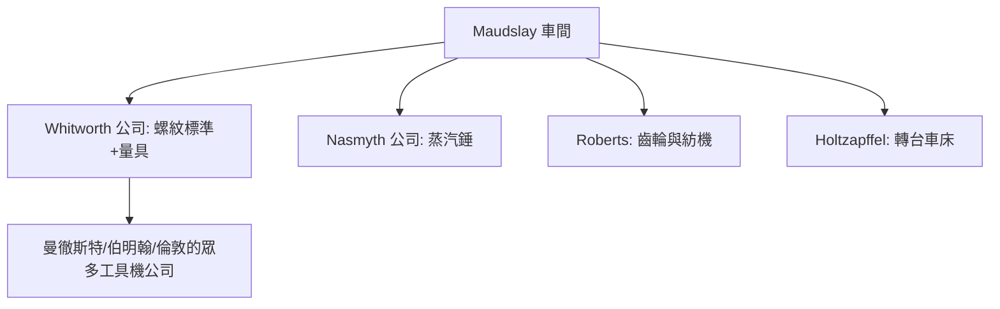

# 2.3 莫茲利的倫敦車間與徒弟們：培養出英國工業革命第二代工具機大師的黃埔軍校

## 蘇格蘭路旁的「聖殿」

1800 年起，莫茲利在倫敦開設自己的車間（先在 Margaret Street/Wells Street 一帶，後遷至 Westmin­ster Bridge 路旁的寬敞廠區）。走進他的工廠，你會看到當時世界上最乾淨、最有秩序的金屬加工環境：

- 地板是木製的，每天清掃（他自己有一個著名說法：「一個乾淨的車間是一個準確的車間」）；
- 所有工具、刀具、量具都是「成對」——莫茲利為每一種操作準備成套的量規（gauge）；
- 車間中的一切設備——包括車床本身——都是自家車床加工出來的（「以機造機」的滾雪球文化）。

他著名的都市傳說級故事：Maudslay 製造過一根「大螺桿」（famous screw）——先造一個大螺絲，再以其為基准檢驗後代螺絲。這種「以物為尺」的工藝聖物（母螺絲 master screw）成為英國精密製造的宗教圖騰。

## 徒弟七傑

莫茲利最偉大的「產品」不是車床，而是徒弟。19 世紀英國機械史上最著名的一批工具機公司創辦人，幾乎都出自他的車間：

- 約瑟夫·惠特沃斯（Joseph Whitworth，1803 起為學徒）：螺紋標準化、平面三板研磨法、微米級測量機——見第 3 章
- 詹姆斯·納斯密斯（James Nasmyth）：蒸汽錘（steam hammer）之父，1850s 大型鍛件革命
- Richard Roberts（理查·羅伯茨）：龍門刨床（planer）改良者與紡織機械大師——19 世紀最精於機械結構的工程師之一
- David Napier, William Muir, Charles Holtzapffel 等：各自創辦車床／印刷機／量具公司

這些人共享一套相同的工程倫理與文化標準：

1. 極簡的幾何：以平面、圓柱、圓孔作為一切機械的基礎；
2. 以量規代手感：每個工序都有可標準交換的量規（gauge）；
3. 機床自舉：以自家機器造自家機器，以自家量具量自家精度；
4. 師徒制教育：知識以「八年學徒＋口傳手授」的方式傳承。

## 從師徒制到「工程師甲級學院」

18 世紀末至 19 世紀中的英國，工程教育系統有一個奇特現象：

- 大學（牛津、劍橋）不教機械工程——工程被視為「匠技」不入學術殿堂；
- 蘇格蘭（格拉斯哥、愛丁堡）的大學有自然哲學課程，但缺乏車間；
- 學徒制是唯一的職業教育管道。

莫茲利車間因此成為一所「準工程學院」，其教育產量驚人：

- 八年學徒制（13–21 歲）；
- 白天：做工人；晚上：自修幾何與機械原理；
- 徒弟必須「能設計＋能動手＋能管理」三位一體。

這種英國式「學徒制工程熔爐」的文化，延續了半個世紀；直到 1860 年代 MIT 創校、德國理工學院（Technische Hochschule）體系成熟，系統化的工程學院才漸漸接棒。

## 經濟的迴響

莫茲利車間的培徒模式創造了一個「工具機家族樹」：

- 19 世紀中葉，英國佔有全球工具機出口的最大份額——「世界車間」（Workshop of the World）的背後，是莫茲利及徒弟們的公司群；
- 但英國的這種「師徒制天花板」也埋下了隱患：到了 1880–1914 年，當美國以「系統化＋標準化＋用職業學校」的製造體系後發崛起時，英國的傳統學徒文化在量產效率上漸落下風（第 4–5 章的主題）。

## 結語的思考

莫茲利的故事有一個深刻的教育學意義：

- 在沒有大學工程教育的時代，一間車間竟然可以複製出「工程文化」，靠的是——師徒關係、家族樹、世代的傳承；
- 這說明技術進步不僅依賴「發明」，還依賴「教育與制度」——從學徒制到理工學院，是一場漫長的接力。

## 小結

1797–1831 的莫茲利車間，是英國工程史上第一座「工具機黃埔軍校」。它以師徒制訓練出惠特沃斯、納斯密斯等一代大師；他們再開枝散葉，把英國推向「世界車間」的寶座。下一章，惠特沃斯——莫茲利最出色的徒弟——將把「平面」的宗教、螺紋的憲法與微米級量具，鑄成英國製造的新大街。
