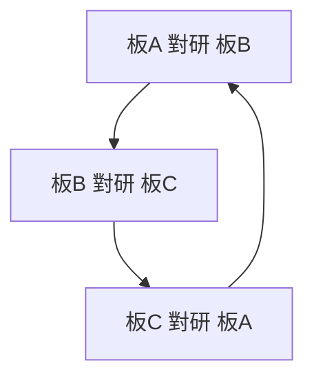

# 3.1 約瑟夫·惠特沃斯與平面的三板研磨法：製造極致絕對平面的工業宗教

## 惠特沃斯：從德比郡農家到莫茲利車間

Joseph Whitworth（1803–1887）出身德比郡，父親是市鎮的教會監督；他少年到倫敦，1820s 進入 Maudslay 車間，以「手最穩、心最細」聞名。一個傳說（Nasmyth 的回憶錄中的形象）：Maudslay 稱讚這個徒弟「能砍出標準的十進位」。

1833 年，Whitworth 在曼徹斯特自立門戶——當時的曼徹斯特是全球紡織機械的心臟，也是充滿訂單與煙塵的工業城市。他在 Chorlton 街的車間初期只做「以自家車床造自家車床」的小規模生產，但迅速豎起了「Whitworth 精度」的招牌。

## 核心問題：如何定義「平面」？

刀具與機床的一切精度，都有一個根源：導軌與基準面必須近乎絕對的平。

- 沒有絕對平面 → 導軌不平 → 滑座運動走偏 → 車出的工件是錐形或鼓形；
- 沒有絕對平面 → 兩塊平台互相對研時點接觸混亂 → 檢測無效；
- 那麼，平面本質上是「建立在什麼之上」的？

Whitworth 的答案是一個簡潔到近乎禪意的工藝（三板法/three-plate method）：

取三塊鐵板 A、B、C。工藝輪迴：

1. A 與 B 互相對研——A 相對 B 凸的地方，兩者就「互磨」到同一曲率（一凸一凹）；
2. 換 C 與 A 對研；
3. 再換 C 與 B 對研；
4. 重複輪換……數學上可以證明：三塊板會同時「收斂」到唯一共同解——絕對平面。

為什麼三塊就夠？因為兩塊板可以互成一對共軛曲面（凸配凹），永遠收斂不到平面；三塊板則共享唯一解——「絕對平面」在三板互相輪磨的極限中被「逼」出來。

Whitworth 的三板法在 1840 年前後成型，隨著他的工具機產品一起走出英國；至今晶圓研磨、光學平板、精密平台製造仍用同一原理（當代精密研磨師稱之為 lapping-in）。

## Whitworth 的「微米語言」：以萬分之一吋為職業單位

Whitworth 是英國第一個公開表明「以我的機器能做出萬分之一吋的精度」的工程師：

- 1841 年報告中，他系統性地使用了「一吋的百萬分之一」的表述（-millionth of an inch，英制「微密耳」）；
- 他以此為古老而有說服力地表明「測量可以比手工察覺更細」；
- 1851 年的倫敦萬國博覽會（Great Exhibition）上，Whitworth 展出了他的萬分位測量機（可分辨 1/1,000,000 吋），震撼了包括美國與歐陸在內的所有工程師——太平洋兩岸都看到了「英國測量精度」的巔峰。

## 宗教與倫理的層次

Whitworth 的三板法在今天聽來是工程技術；在當時，它是一種近乎宗教的「絕對」追求：

- 他的名言被反覆引用：「手藝不能靠經驗，必須靠測量（You cannot remove uncertainty by rule of thumb.）」；
- 他以「平面即真理」的哲學，把英國「經驗主義、親手文化」推向了「數學可證明＋可檢驗」的新準則；
- 他 1868 年捐出十萬英鎊資助曼徹斯特的 Owens College（日後 University of Manchester 的前身），推動以「可測量的科學」為核心的工程教育——這是英國制度史上承前啟後的一個案例。

## 小結

惠特沃斯以三板研磨法確立了「絕對平面」的可制造性，以萬分之一吋的量測開創微米時代的職業語言。他的機床、量規與教育捐款合力把「精度」從作坊的手感推向了數學與制度。下一節，我們看他最著名的公共財——惠特沃思螺紋標準。
