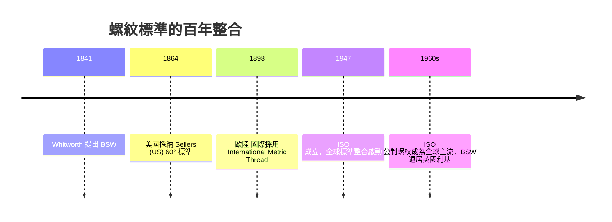

# 3.2 BSW 螺紋標準（Whitworth Thread）：全球第一個工業化標準螺紋規格的確立

## 從「一廠一制」到「一國一制」

1841 年之前，英國的螺絲世界是純粹的巴別塔：

- 各工廠自行車出螺紋，螺距、牙型角、外徑全憑本廠習慣；
- Maudslay 車間雖有「母螺絲」為基準，但那是車間內的聖物，出了車間即失效；
- 一家鐵路公司的螺栓，在另一家工廠配不到螺帽——緊固件幾乎不能互換。

Whitworth 認清了一個制度性的事實：螺紋不是「技術問題」，而是「標準問題」——正如語法，不是字典的先後，而是《聖經》的統一版本。

## 1841 年：Whitworth Thread 誕生

Whitworth 向倫敦土木工程師學會（Institution of Civil Engineers）提交論文《On a Uniform System of Screw Threads》，提出英國第一個全國螺紋標準：

- 牙型角 55°（V 形螺紋）；
- 每吋牙數（threads per inch）依外徑分檔——大直徑用更粗的螺距；
- 標準化外徑系列，使「螺栓可以跨廠互換」；
- 標準以圓角根部（後世稱為英制惠氏螺紋的核心特徵，圓弧牙底，可降應力集中）。

這個後來被稱為 BSW（British Standard Whitworth）的標準，是全球第一個由工程師提出、被工程院系會議接受、最終被政府採納（英國鐵路與海軍陸續跟進）的工業化緊固件標準。

## 標準的政治經濟學

- 網路效應：一旦英國鐵路公司用同一規格，供應商與維修商都被迫對齊；跨廠的貨運修配即刻獲得規模經濟；
- 打擊「孤品」：互換的螺絲背後，是「設計—製造—維修」的全線標準化，工廠不必再為每台機器保留專屬零件庫；
- 英國出口的軍備：當英國鐵路與海軍的螺栓被複製到殖民地，BSW 就成為一種「英制工程語言」，被加拿大、印度、澳洲等多國長期沿用至今（BSW 與後來的 BSF、BSP 管螺紋）；
- 反面案例：美國後來走向 60° 牙角的 US Standard（Sellars／Sellers 線，1864 年美國採納），德國與歐陸又各自為政——這顆「螺紋的種子」成為 20 世紀國際標準大戰的遠因（ASME、DIN、ISO 二次大戰後的大整合）。

## 有一個著名的誤區：惠特沃斯並非「發明」螺紋

螺紋車削自古埃及的阿基米德螺旋就存在；中世紀歐洲的壓榨機與木螺絲也早有螺紋。Whitworth 的貢獻嚴格說是：

1. 以「系統」而非「零件」的方式定義螺紋；
2. 提出可跨廠執行的標準規範；
3. 促成「以標準驅動量產」的商業模式。

換句話說：他發明的是「螺紋的憲法」，而不是「螺紋的車床」。

## 從 BSW 到 ISO 的百年接力

## 小結

1841 年的惠氏螺紋，是將「互換」從作坊技術提升到「國家／國際制度」的第一次制度創新。它證明了一件事：在工業社會裡，「標準」比「專利」更廣泛地製造財富——專利保護一家公司，標準統合整個產業。下一節，我們看惠特沃斯如何以另一個極致：百萬分度測量機，把「量」本身變成工業的地基。
