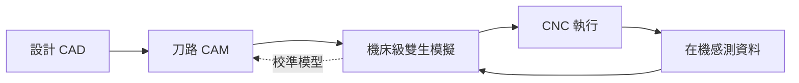

# 11.2 切削過程的數位雙生模擬：在電腦虛擬空間中預先演練刀具碰撞與流體力學

## 數位雙生（Digital Twin）的定義與分層

- 廣義數位雙生：為物理實體建立一個「由資料驅動、持續更新、可仿真」的數學鏡像；
- 機床領域自然分成三層：
  1. 幾何雙生：機床結構、刀具、夾具的 3D 模型——查碰撞、行程限位；
  2. 物理雙生：切削力、熱、振動的物理模型——預估誤差與刀具壽命；
  3. 生產雙生：整線排程、物流、在製品——工廠級的仿真（源自舊稱的虛擬製造 virtual manufacturing）。

## CAM 與模擬軟體的譜系

- 刀路驗證（verification）軟體：CGTech VERICUT（1988 起）、ModuleWorks 刀芯、Siemens NX CAM 等——以實體建模形式模擬材料去除、碰撞與干涉；
- 機床廠自家的刀具與運動鏈資料可使驗證軟體以「真實機床的運動學＋限位」建模；
- 加工過程仿真（process simulation）：以有限元（FEM）模擬切屑形成、切削力與溫度——Third Wave AdvantEdge、Deform 等代表；
- 2020s 雲端化：模型上雲＋即時資料回灌——真正的「工廠級雙生」浮現。

## 演練什麼？五大價值

1. 碰撞與超程：五軸加工中，刀柄撞工件、B 軸撞夾具、轉台撞床身——軟體模擬一次，工資數小時；
2. 刀軸方向的優化：在虛空間嘗試數千個刀軸向量，找干涉最少、剛性最好的組合；
3. 殘料與空切：模擬材料去除，避免「沒切到」與「切完了空走」；
4. 切削力與變形預估：薄壁件的讓刀誤差可在虛擬空間預測、用補償修正；
5. 員工訓練與試切節省：砂模時代「試切在同一台貴機」的學費被消滅。

## 從仿真到閉環

這個迴路的特殊之處是「同語言」：CAM 的刀路、模擬的運動學、CNC 的座標軸都使用同一套 G 碼與幾何描述——數位空間與物理機床之間，沒有翻譯損耗（與 1960s APT 時代的後置處理痛苦對照強烈）。

## 現實的挑戰

- 模型準度 vs 計算成本：FEM 全過程太貴，實際常用「混合模型」（幾何＋經驗公式＋少量機學習）；
- 機床會「老化」：絲桿磨損、軸承退火後，雙生模型需定期再校準；
- 資料所有權：機床廠、控制器廠、使用者之間誰擁有資料——2020s 的商戰戰場。

## 小結

數位雙生把「試錯」從鋼鐵世界搬到比特世界，把工程學費從報廢件變成 GPU 時間。下一節，我們看 AI 如何接棒這趟雙生之旅——自適應切削與預測性維護。
