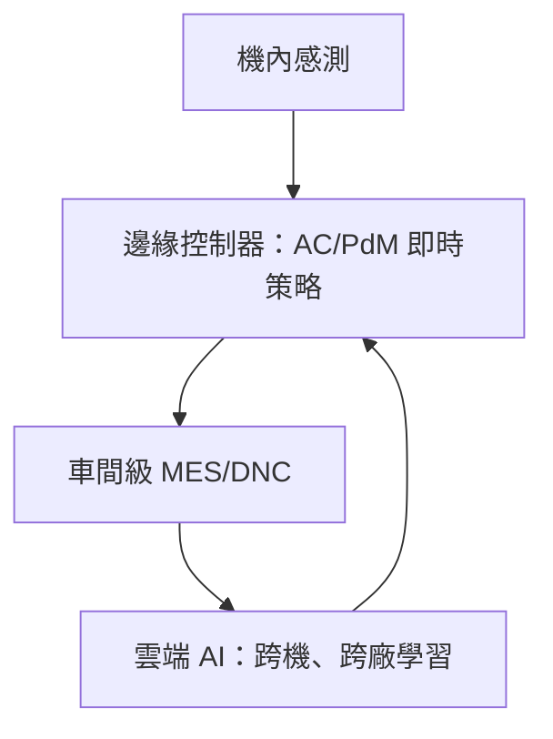

# 11.3 AI 驅動的自適應切削與預測性維護：當工具機感知主軸磨損並自動優化進給速度

## 從「參數表」到「即時調整」

傳統數控加工的進給速度，是程式裡寫死的 F 值——機器不懂材料疏密、餘量多寡、刀具利鈍；遇到材料偏硬就振刀，遇到餘量偏大就過載。

自適應控制（Adaptive Control, AC）的口訣：讓機器自己看著辦。

- 在機感測：主軸電流（扭矩估計）、振動（加速度計）、聲發射；
- 以切削力與主軸功率估計「當下的材料去除率與刀具狀態」；
- 控制器即時調整進給與轉速，把功率壓在上限之下、把振動壓在穩定葉谷之內。

歷史淵源值得一記：1960s–1970s Bendix 曾研發 AC 銑床（空軍資助），但因感測與計算能力太早熟而失敗；直至 2000s 感測器＋嵌入式計算成熟，一系列 AC 產品（Okuma 的 Machining Navi、Fanuc 伺服電流補償、各廠 feed override chip）才真正落地。

## 刀具磨損與預測性維護（PdM）

### 刀具壽命的 AI 化

- 以每一刀的電流／振動／聲特徵＋機學習模型（淺層模型到 LSTM／Transformer）估計刀尖磨損量；
- 「更換刀具」從「到時限」（calendar-based）變為「到狀態」（condition-based），到「到預測」（predictive-based）；
- 連動動作：自動換刀、自動改刀補、分批修正——「磨損感知的加工品質保證」。

### 機床本體的 PdM

- 以主軸振動頻譜、絲桿電流紋波、油液顆粒計數等訊號追蹤健康度；
- 預測主軸軸承剩餘壽命（RUL, remaining useful life）——用戶從「壞了損失三十萬停機」變成「三週前就知道該訂軸承」；
- 這把機床從「資產負債表上的設備」變成「會說話的服務合約」——機床廠的商業模式從賣機器轉向「機器＋服務＋資料」組合（如 Okuma、DMG MORI 的雲端服務）。

## 智慧工廠的最後一層

- 機器級：自適應＋維護；
- 車間級：任務排程、批次品質追蹤；
- 雲端級：跨機型、跨工廠的模型累積——機器越用越懂工件的「知識雪球」（本章呼應莫茲利的「以機造機」——如今機器也在累積自己的經驗）。

## 思想的閉環：機器開始模仿「師父」

約三百年前，莫茲利把匠人的手感固化為刻度盤；今天 AI 把老師傅的聽音、手感與經驗模型化成演算法。兩次革命指向同一件事：把「身體裡的知識」搬進「可複製、可傳承的位元世界」—— 工具機的教育學使命，在資訊時代換了一種載體繼續著。

## 小結

自適應切削與預測性維護是工具機的「感官與直覺」：感知真切世界、預判時間軸上的風險、即時執行決策。至此，本書最後但也最重要的主題展開完成。結語，我們回望三百年的鋼鐵長征。
