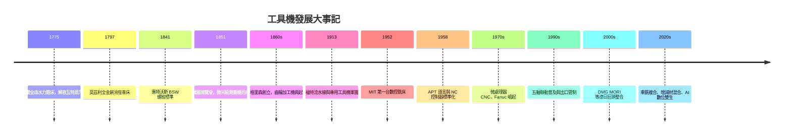

# 工具機的故事：從蒸汽機鏜床、工業母機、數控 CNC 革命到五軸超精密極限製造

「工具機」（Machine Tools，又稱機床或工作母機）是人類工業文明中「製造所有機器的機器」。它不上浮於消費電子產品的絢麗外表，而是沉潛於金屬切削、銑削、研磨、幾何精度與剛性結構的鋼鐵世界。從 18 世紀蒸汽機汽缸的鏜削，到當代五軸聯動加工中心切削航太葉片、半導體設備高精密零件，工具機的精度與能力直接決定了一個國家的工業總體天花板。

本書分為五篇、十一章，每章三節，沿年代軸講述工具機如何一步步用鋼鐵切削出現代工業文明的骨架。

## 目錄

### 第一篇：工業革命的鋼鐵產道與母機創世紀（18 世紀末 – 19 世紀）

* 第1章-約翰威爾金森與鏜床
    * [1.1-瓦特蒸汽機的致命痛點](01.1-瓦特蒸汽機的致命痛點.md)
    * [1.2-1775年威爾金森水力鏜床](01.2-1775年威爾金森水力鏜床.md)
    * [1.3-汽缸密合度的奇蹟突破](01.3-汽缸密合度的奇蹟突破.md)
* 第2章-亨利莫茲利與車床
    * [2.1-匠人手藝的極限與螺絲互換困境](02.1-匠人手藝的極限與螺絲互換困境.md)
    * [2.2-1797年全金屬滑座車床](02.2-1797年全金屬滑座車床.md)
    * [2.3-莫茲利車間與徒弟們](02.3-莫茲利車間與徒弟們.md)
* 第3章-惠特沃斯標準螺紋與微米級量具
    * [3.1-惠特沃斯與平面三板研磨法](03.1-惠特沃斯與平面三板研磨法.md)
    * [3.2-BSW螺紋標準](03.2-BSW螺紋標準.md)
    * [3.3-惠特沃斯百萬分度測量機](03.3-惠特沃斯百萬分度測量機.md)

### 第二篇：美國製造體系與專用工具機狂潮（19 世紀末 – 20 世紀初）

* 第4章-龍門銑床刨床與齒輪加工機
    * [4.1-龍門刨床與龍門銑床的機械幾何](04.1-龍門刨床與龍門銑床的機械幾何.md)
    * [4.2-格里森與螺旋傘齒輪切齒機](04.2-格里森與螺旋傘齒輪切齒機.md)
    * [4.3-刀具材料的第一次飛躍](04.3-刀具材料的第一次飛躍.md)
* 第5章-福特ModelT背後的鋼鐵軍團
    * [5.1-通用工具機與專用工具機](05.1-通用工具機與專用工具機.md)
    * [5.2-組合機床與自動連線](05.2-組合機床與自動連線.md)
    * [5.3-砂輪與高精密研磨機](05.3-砂輪與高精密研磨機.md)

### 第三篇：數控革命與數位化轉型（1950 年代 – 1980 年代）

* 第6章-約翰帕森斯與麻省理工學院
    * [6.1-冷戰空軍的複雜曲面噩夢](06.1-冷戰空軍的複雜曲面噩夢.md)
    * [6.2-1952年MIT第一台數控銑床](06.2-1952年MIT第一台數控銑床.md)
    * [6.3-APT語言與G碼標準化](06.3-APT語言與G碼標準化.md)
* 第7章-日本工具機的逆襲
    * [7.1-微處理器帶來的CNC轉折](07.1-微處理器帶來的CNC轉折.md)
    * [7.2-山崎馬扎克森精機與大隈](07.2-山崎馬扎克森精機與大隈.md)
    * [7.3-刀具塗層與硬質合金](07.3-刀具塗層與硬質合金.md)

### 第四篇：五軸聯動、超精密加工與全球巨頭割據（1990 年代 – 2010 年代）

* 第8章-五軸聯動與極限曲面加工
    * [8.1-從三軸到五軸](08.1-從三軸到五軸.md)
    * [8.2-航太葉輪葉片與醫療骨釘](08.2-航太葉輪葉片與醫療骨釘.md)
    * [8.3-五軸的出口管制與地緣政治](08.3-五軸的出口管制與地緣政治.md)
* 第9章-全球工具機帝國的格局
    * [9.1-德系工藝的極致](09.1-德系工藝的極致.md)
    * [9.2-日系細節與自動化](09.2-日系細節與自動化.md)
    * [9.3-超精密工具機](09.3-超精密工具機.md)

### 第五篇：複合加工、數位雙生與AI智慧工具機新紀元（2020 年代 – 至今）

* 第10章-車銑複合與增減材一體化
    * [10.1-一次裝夾完成所有工序](10.1-一次裝夾完成所有工序.md)
    * [10.2-雷射沉積與五軸切削的融合](10.2-雷射沉積與五軸切削的融合.md)
    * [10.3-直線馬達與靜壓軸承](10.3-直線馬達與靜壓軸承.md)
* 第11章-數位雙生AI補償與智慧機床
    * [11.1-熱變形與切削振顫的物理噩夢](11.1-熱變形與切削振顫的物理噩夢.md)
    * [11.2-切削過程的數位雙生模擬](11.2-切削過程的數位雙生模擬.md)
    * [11.3-AI自適應切削與預測性維護](11.3-AI自適應切削與預測性維護.md)

### 結語

* [99-結語](99-結語.md)

## 全書時間軸

