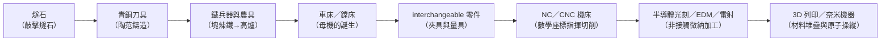

# 前言：造物者的延長手臂——工具如何從根本上塑造了人類文明的形狀

## 一個物種的生理事實

人類的爪不夠利、牙不夠尖、皮不夠厚、力氣連黑猩猩都不如——按照進化論的教科書標準，這個物種本應早就在草原上滅絕。但我們贏了，而且贏得整個地球。原因只有一個：**這個物種發明了一種可以體外遺傳的東西——工具**。

基因需要一代人才能傳播一次；一個更好的箭簇，一個下午就能傳遍整個聚落。人類等於把「演化」搬到了體外、搬到了矽片、搬到了 GDSII 與 NC 程式碼上。**工具是人類的第二套 DNA**。

## 「工具製造工具」：本書唯一的正題

在全書範圍內，我們反覆追問同一件事：

> 這個工具是怎麼被製造出來的？——用什麼工具製造？那個工具又是用什麼工具製造的？

這條「母機鏈」（mother-machine chain）決定了一個文明的工業上限：

每一環都是用上一環的工具造出來的。**文明的高度＝母機鏈上最高一環的精度。** 這是貫穿全書的主軸。

## 工具如何重塑的不只是物質世界

本書重視的不只是「機器清單」，而是工具與社會的互相雕刻：

- **身體**：火對食物的化學工具化（第 1 章），縮短了人類的腸道、重塑了牙齒，也對大腦的能量預算多撥出了容納新皮層的空間；使用手斧巧手精細抓握的基因壓力，本身就是「手被工具改造」的證據。
- **制度**：互換性零件（第 4、5 章）不僅是技術，更是一種社會契約——它把「匠人的手藝」變成「標準的度量衡」，這種制度邏輯後來複製到貨幣契約、合同、乃至今天的 ISO 標準。
- **思想**：泰勒的秒錶（第 7 章）把「勞動＝時間×動作」寫進管理者腦中，誕生了現代工商管理教育；約翰·帕森斯的打孔紙帶（第 8 章）把設計意圖數位化，預演了全部當代工業軟體的世界觀。
- **政治**：鐵的民間化（第 2 章）打破青銅貴族的武装壟斷；二戰的自由輪（第 9 章）證明大規模標準化製造是一種地緣政治力量。

## 閱讀指南

- **14 章，每章 3 節，一律按年代軸排列**，可跳讀；
- **每節含「前因—事件—後果」結構**，強調驅動關係而非軼事堆疊；
- 所有年代、人物、技術參數均為**真實史事**；估算與推論處必注明；
- 格式：標準 GitHub Markdown，含 LaTeX 數式與 Mermaid 圖。

一句話作為楔子：**人類選擇了工具，工具也選擇了人類。**

---

下一章：[第 1 章　裂開的燧石與第一把手斧](01.1-acheulean.md)
