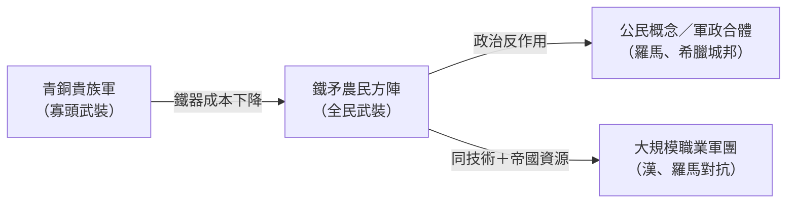

# 第 2 章　青銅與鐵器的暴力美學

# 2.3 劍與犁的對決：鐵質農具與兵器如何徹底改變古代農業生產力與戰爭形態？

## 2.3.1 技術分岔：同一種鐵，兩種命運

塊煉鐵以其加工彈性分裂成兩條產品線：

- **鍛打兵器**（刀、劍、矛頭）：剖面薄而硬，含碳淬火（雖然真正淬火鋼要到晚期才成熟，但滲碳鍛打已能提高硬度）；
- **農具**（犁鏵、鋤、鎌、斧）：可大量鑄造／鍛造，遠比木石工具耐久。

## 2.3.2 犁的革命：一鐵再鬆百畝土

鐵犁鏵的力學意義在於**降低翻土阻力、耐重土磨損**。古代農業的勞動生產力因此有幅度可觀的躍升（例如一人可耕面積與每勞動日收穫比的提高），並誘發一連串社會反應：

1. **墾荒**：硬土、黏土、山地森林不再不可開墾，農業邊界外擴；
2. **休耕制度鬆動**：勞動成本下降使深耕與輪作變得可行；
3. **人口增長**：糧食上限抬升——中國戰國至漢代、羅馬擴張期的人口峰值都與鐵農具普及密切相關。

## 2.3.3 劍的革命：全民戰士時代

青銅時代軍隊由貴族（青銅甲胄＋馬戰車）組成；鐵器時代發生兩個斷層：

1. **武裝平民化**：鐵矛頭＋鐵劍便宜到可以武裝農民步卒——希臘重裝步兵（hoplites）、羅馬軍團的**平民方陣**制度都建立在鐵器成本之上；
2. **攻城與騎兵**：鐵鎬、鐵錘、鐵構件的軍事工程能力（羅馬軍團的營地、橋樑、投石機金屬件），使戰爭從「決戰」轉為「系統化消耗」。

## 2.3.4 思想回響：鐵器與古典思想的同時性

一個常被忽略的思想史巧合：鐵器普及期（公元前 800–400 年）正是**軸心時代**（Karl Jaspers 之說）誕生期（孔子、釋迦牟尼、蘇格拉底、希伯來先知幾乎同期）。

- **技術解釋**：鐵農具創造了「**非武士精英階層**」（商人、書吏、哲人）的物質基礎——農業生產力使一部分人可以完全脫離生產專事思考；
- **政治解釋**：武裝平民打破寡頭，迫使思想界面對「應然秩序」——諸子百家的論戰氛圍，正是鐵器政治溢出的精神面。

## 2.3.5 前因後果

- **前因**：塊煉鐵的資源民主化（2.2）。
- **事件**：鐵農具與鐵兵器的雙線普及。
- **後果**：**農業生產力與軍事組織同時躍升**→帝國規模的新上限→軸心時代思想革命；而「劍與犁本為同爐」的物理事實，也借 「鑄劍為犁」（swords to plowshares）成為西方政治思想的永恆隱喻——語出希伯來先知書（以賽亞書 2:4、彌迦書 4:3）。

---

下一章：[第 3 章　槓桿、滑輪與斜面](03.1-archimedes.md)
