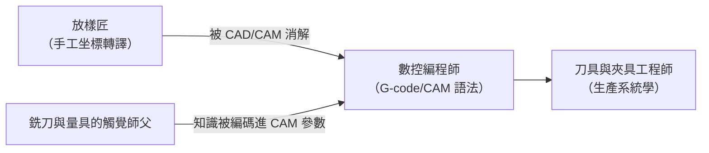

# 第 8 章　帕森斯與數控（NC）機床

# 8.3 從 NC 到 CNC：當微型電腦進入機床，傳統工匠徹底蛻變為數位編程師

## 8.3.1 NC 的第一代疼痛：計算是離線的

第一批 NC 機床最大的問題是**編譯鍊條太長**：工程圖紙 → 放樣師逐段讀座標 → 手工打孔紙帶 → 紙帶跑機床。**任何一個數字錯**，或者其「紙帶穿孔誤」都意味着要**重新打孔一遍**；而**更換工件**就是重頭再來。這是「**程式即耗材**」的艱窘時代。

## 8.3.2 電腦進機床：CNC 的誕生（1970s）

1970 年代，微型電腦的出現使 NC 發生質變：**CNC（Computer Numerical Control）**把控制器從「紙帶＋插補器」變成「**機床自己擁有一台可編程計算機**」：

1. **本地儲存與編輯**：程式可在機床上修改，紙帶成為備援；
2. **刀補、圓弧插補、螺距補償**等函數化功能直接放大加工能力；
3. **CAD/CAM 合流**（1970s 起，隨 APT→IGES 標準→3D CAD）——**設計軟體直接吐出切削路徑**，帕森斯「放樣」的職業徹底虛擬化。

## 8.3.3 職業的重生：工匠→編程師

一場文化變革發生在工廠地平面上：

調整（setting-up）、刀具選擇、切削參數的**手感知識**並未消失，而是**被寫進程式與刀具資料庫**——工匠的經驗被「編碼化」，人類第一次自然地以「**知識遷移到軟體**」的方式保存技藝。這正是本書第 10 章「AI for EDA」與第 14 章「知識外化於機器」的序曲。

## 8.3.4 前因後果

- **前因**：NC 的手工程序脆弱性＋微處理器（1971 Intel 4004 之後）的降價＋CAD/CAM 軟體成熟。
- **事件**：CNC 控制器全面取代硬連線 NC（1970s–80s）。
- **後果**：**機床成為「可下載指令的機器人」**；「生產彈性」概念問世，為精益生產（豐田系統）、快速換速（SMED）與客製化量產奠定物理基礎；第 11 章的半導體設備（其實就是**光刻版 CNC**）則是這條譜系的極限形態。

---

下一章：[第 9 章　世界大戰的軍工巨輪](09.1-arsenal-conversion.md)
