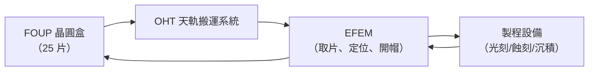

# 第 11 章　潔淨室裏的微觀雕刻

# 11.3 機器人與自動化晶圓傳輸（EFEM）：完全告別人類手觸、無塵室裏的無聲機械芭蕾

## 11.3.1 EFEM：晶圓的「接待與分派」專用工作台

**EFEM（Equipment Front End Module）**是現代 fab（晶圓廠）中機器設備與**FOUP（Front Opening Unified Pod，晶圓封裝盒）**之間的「**前台接口機**」：它以專用機械臂把晶圓從 FOUP 取出、下廠定位、開帽、翻轉、逐一送入製程設備。

其本質是**沒有任何人手介入的物流**——晶圓的一生（25 片一組、數百步製程）由 OHT（overhead hoist transport 天上搬運軌道）與設備內機器人接力完成。

## 11.3.2 精度與清潔的雙重苛刻

晶圓傳輸機械臂的要求比一般工業機械人更奪目：

1. **振動控制**：掃描曝光時廠房地面微小振動都會毀掉 nm 級疊對；
2. **潔淨度**：臂上任何脫屑（particle）都是殺手；驅動件多採**乾式潤滑、低發塵式傳動**；
3. **同步時間**：單片晶圓的取放需百毫秒級以支撐產能。

實現這些的前提是**機械＋控制＋材料的三重成熟**——本書第 6 章的回授控制（瓦特球）、第 8 章的伺服（CNC）、10 章的精密材料傳統在此匯流。

## 11.3.3 社會文化含義：「無人工廠」的現實版

- 2020 年代台積電、三星、 Intel 的先進 fab 中，**操作員的主要工作是「看守系統」而非搬動晶圓**；
- 每天每時，數百公里天軌上晶圓盒流動不息，像一座自動化的城市的血管；
- 業界有時以「**無聲芭蕾**」形容這座自動化——這一詩意表述同時也是 14.3 人機邊界問題的現實案例。

## 11.3.4 前因後果

- **前因**：200mm→300mm 晶圓大型化＋六標準差／六西格瑪體系＋ESD 靜電防護工學。
- **事件**：EFEM／OHT／AMHS（automated material handling）成為先進 fab 標配。
- **後果**：**半導體真正成為「全自動化工業」**；人類手觸（touch）被視為工藝缺陷，社會上「工人升級為系統守望者」，為 14.1（機械勞動力的 AI 轉升）提供了完整的現實版型。

---

下一章：[第 12 章　查克·赫爾與 3D 列印](12.1-sla-hull.md)
