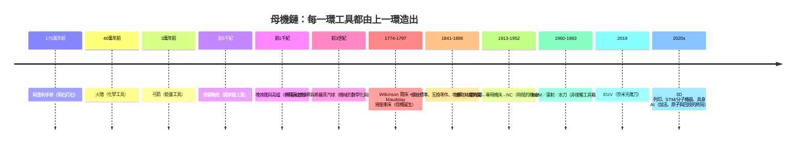

# 結語：從燧石手斧到星際造物——工具作為人類文明永遠在延伸的血肉

## 一條三百萬年的母機鏈

把全書十四部重要的關鍵工具接成一條鏈，會發現它們其實**是同一件事**的三百萬年展開：

## 五條貫穿全書的規律

### 1. 瓶頸轉移定律（經濟規律）

飛梭讓織快了，於是紡紗成瓶頸，於是水力紡機誕生；鏜床讓蒸汽機成立，於是所有機器都需要動力……**工具革命總是把缺口轉移到下一個工具**（6.1、5.3）。補瓶頸的，是下一個贏家。

### 2. 抽象化定律（技術規律）

從「手感」→「數值」→「座標」→「程式」→「意圖——每次抽象化一個台階，人類脫手一步（4.2、6.3、8.2、8.3、11 章）。**工具的終點是「指令變短，機器變聰明」。**

### 3. 制度先行的規律（社會規律）

惠特尼的互換性是合同（5.1）、莫茲利的工房是師徒制（4.2）、泰勒的秒錶是管理學科（7.1）——技術從不單獨行走，**制度是它的軌道與剎車**。

### 4. 政治設定工具的規律（政治規律）

冷戰造出半導體與 CNC（8、9、11 章）、封鎖造出國產化與開源（《EDA 的故事》姊妹篇）——**工具的正義與速度常常由戰爭與競爭的語法決定**。

### 5. 身份更替的規律（人文規律）

打石者→冶師→母機匠→編程師→系統守望者→AI 的教練——**人的價值位置沿著母機鏈向上游移動**，每次都有代價與福利（盧德運動到 21 世紀的勞動論戰）。

## 一個簡單的總結

> 當一位工程師按下 Print，用一台桌面級機器在數小時後拿到一件可以工作的金屬零件；當一位設計師交給機具一段自然語言的意圖；當人類在環繞地球的站上列印第一件備件——
>
> 這不是一次「工具的進步」，而是**三百萬年來那個第一次敲擊燧石的動作，延續至今的最新回聲**。

工具從來不只是「人手的延長」——它是**人類把自己交給一個可以不斷更新的身體**的過程。燧石、青銅、車床、NC、光刻機、分子機器……它們都只是這**血肉延續史**上的某一節脊椎。

**人類是工具的作者，工具也是人類的自畫像。**

---

**全書完** ｜ 回到 [目錄](README.md)
