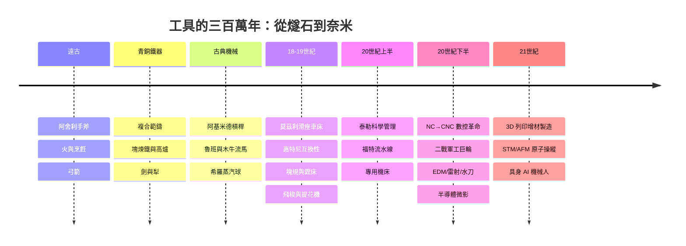

# 《工具的故事：從遠古打製石器、工業精密母機、數控革命到 3D 列印與奈米造物》

> 專為機械工程師、製造業創業者、科技史愛好者與全球工業文明觀察者設計的專題史。
>
> 「工具」（Tools）是人類文明最真實的底座。從遠古人類敲擊的第一塊燧石、青銅與鐵器的冶煉，到工業革命中造就一切現代機器的「母機」（Machine Tools），再到當代的 3D 列印增材製造與奈米分子機器。人類從來不是靠爪牙贏得地球，而是靠不斷升級的「工具」，將大自然賦予的物質世界雕刻成輝煌的數位與工業帝國。
>
> **全書核心視角——「工具製造工具」（Tool making tools）的母機邏輯**：人類文明的進步，本質上取決於「我們能造出多麼精密的工具去製造下一代更精密的工具」。

## 全書結構

---

## 目錄

### 前言：造物者的延長手臂——工具如何從根本上塑造了人類文明的形狀

見 [00-preface.md](00-preface.md)

---

### 第一篇：身體的延伸與石器、金屬的破曉（遠古 – 公元前）

* 第1章-裂開的燧石與第一把手斧：人類用工具將自己與野獸分開
    * [1.1-舊石器時代的敲擊智慧：阿舍利手斧與人類最早的標準化設計](01.1-acheulean.md)
    * [1.2-火的掌握與烹飪革命：化學工具如何改變人類的牙齒與大腦結構？](01.2-fire-cooking.md)
    * [1.3-弓箭與投擲器：利用彈性位能將人類肌肉力量放大數倍的遠程狩獵神器](01.3-bow-atlatl.md)

* 第2章-青銅與鐵器的暴力美學：礦石冶煉如何重構古代帝國版圖？
    * [2.1-熔銅與鑄模：美索不達米亞與中國商周時期青銅器背後的複雜爐溫控制](02.1-bronze-casting.md)
    * [2.2-煉鐵術的偶然與必然：從海綿鐵、塊煉鐵到高爐水力鼓風的技術跨越](02.2-iron-blast-furnace.md)
    * [2.3-劍與犁的對決：鐵質農具與兵器如何徹底改變古代農業生產力與戰爭形態？](02.3-sword-plow.md)

* 第3章-槓桿、滑輪與斜面：古希臘與中國古代的機械力學狂想
    * [3.1-阿基米德的狂言：「給我一個支點，我就能撬動地球」的槓桿與滑輪組實踐](03.1-archimedes.md)
    * [3.2-魯班與諸葛亮的神話：鋸子、滾木與木牛流馬等古代木工與運輸機械工具](03.2-luban-zhuge.md)
    * [3.3-亞歷山大圖書館的機械玩具：希羅的蒸氣球與自動機械萌芽](03.3-hero-alexandria.md)

### 第二篇：工業革命的母機與標準化之魂（18 世紀 – 19 世紀）

* 第4章-亨利·莫茲利與滑座車床：創造「能製造其他機器的機器」
    * [4.1-傳統手工作坊的極限：為什麼在沒有精確車床之前，連一顆像樣的螺絲都造不出來？](04.1-handcraft-limits.md)
    * [4.2-1797 年亨利·莫茲利的滑座車床：現代「精密母機」的創世紀](04.2-maudslay.md)
    * [4.3-螺紋標準化與互換性零件：消滅匠人手工修配，開啟大規模工業化的大門](04.3-threads-interchangeable.md)

* 第5章-美國製造體系（AMS）與精密量具的誕生
    * [5.1-伊萊·惠特尼的槍械工廠：用夾具與模板實現零件完全互換的傳奇](05.1-whitney.md)
    * [5.2-塊規與卡尺：毫米與微米之間的工業精確度宗教](05.2-gauge-blocks.md)
    * [5.3-詹姆斯·瓦特與博爾頓：當精密鏜床讓蒸汽機能夠真正密封運轉](05.3-boring-machine.md)

* 第6章-紡織機、水力與早期自動化控制工具
    * [6.1-凱伊的飛梭與阿克萊特的水力紡織機：引爆英國工業革命的機械巨獸](06.1-spinning.md)
    * [6.2-瓦特的離心式調速器：人類歷史上最早的回授控制機械工具](06.2-governor.md)
    * [6.3-雅克·雅卡爾與洛夫萊斯的母親：用打孔卡控制複雜圖案的機械計算先驅](06.3-jacquard-lovelace.md)

### 第三篇：泰勒主義、流水線與現代機械製造巨獸（20 世紀初 – 20 世紀中）

* 第7章-福特汽車的移動裝配線：把工具嵌進流水線的極致管理
    * [7.1-弗雷德里克·泰勒的科學管理法：用秒錶與動作分解把工人變成精密工具](07.1-taylor.md)
    * [7.2-1913 年福特高地公園廠：一條讓 Model T 汽車在 90 分鐘內組裝完成的動態生產線](07.2-fords-line.md)
    * [7.3-專用機床的統治：專為單一工序打造的鋼鐵自動化怪獸](07.3-dedicated-machines.md)

* 第8章-約翰·帕森斯與數控（NC）機床：用打孔卡指揮切削的第一次數位化革命
    * [8.1-美國空軍直升機螺旋槳葉片的製造噩夢：複雜曲面加工帶來的物理極限](08.1-parsons-rotor.md)
    * [8.2-1952 年麻省理工學院的 NC 銑床：第一次把數學座標指令輸入金屬切削機床](08.2-mit-nc.md)
    * [8.3-從 NC 到 CNC：當微型電腦進入機床，傳統工匠徹底蛻變為數位編程師](08.3-cnc.md)

* 第9章-世界大戰的軍工巨輪：從柏林到底特律的鋼鐵對決
    * [9.1-兵工廠大轉型：民用汽車生產線如何在幾週內改造成謝爾曼坦克與航空發動機製造廠？](09.1-arsenal-conversion.md)
    * [9.2-自由輪的焊接奇蹟：模組化造船工具與流水線裝配的極限爆發](09.2-liberty-ship.md)
    * [9.3-戰時技術外溢：雷達、航空發動機與超硬合金刀具對戰後工業的深遠影響](09.3-wartime-spinoff.md)

### 第四篇：雷射、電火花與半導體超微細加工（20 世紀下半葉）

* 第10章-雷射、電火花（EDM）與非接觸式精密加工革命
    * [10.1-電火花加工（EDM）的發現：科學家利用放電腐蝕來切削超硬導電金屬的奇蹟](10.1-edm.md)
    * [10.2-雷射切割與焊接：用一道光束代替實體刀刃，在金屬與合金上進行毫無應力的精密雕刻](10.2-laser.md)
    * [10.3-水刀切割：結合超高壓水流與石榴石砂的萬能柔性切割工具](10.3-waterjet.md)

* 第11章-潔淨室裏的微觀雕刻：半導體微影與蝕刻工具
    * [11.1-從巨型機械到微米矽片：半導體設備作為人類歷史上最精密的「原子級工具」](11.1-semiequip.md)
    * [11.2-離子束、電漿與深紫外線：在指甲蓋大小的晶片上雕刻百億電路的光學雕刀](11.2-litho-etch.md)
    * [11.3-機器人與自動化晶圓傳輸（EFEM）：完全告別人類手觸、無塵室裏的無聲機械芭蕾](11.3-efem.md)

### 第五篇：3D 列印、分子機器與未來造物新紀元（21 世紀 – 至今）

* 第12章-查克·赫爾與 3D 列印（增材製造）：從「減法切削」到「加法堆疊」的逆向革命
    * [12.1-1983 年光固化立體造型（SLA）的深夜發明：用紫外線激光將液態樹脂一層層「畫」成立體物件](12.1-sla-hull.md)
    * [12.2-從粉末燒結（SLS）到金屬 3D 列印：航天發動機與複雜內部流道設計的終極製造解方](12.2-sls-metal.md)
    * [12.3-分布式製造與創客（Maker）運動：當每個人家裏都有一台桌面級 3D 列印機時發生了什麼？](12.3-maker.md)

* 第13章-理查·費曼的預言與奈米碳管、分子機器
    * [13.1-1959 年理查·費曼的名言：「底部大有可為」](13.1-feynman.md)
    * [13.2-掃描隧道顯微鏡（STM）與原子力顯微鏡（AFM）：人類第一次在原子尺度上「看見」並「移動」單個原子](13.2-stm-afm.md)
    * [13.3-分子機器與 DNA 摺紙術：自然界最完美的奈米工具啟示錄](13.3-dna-nano.md)

* 第14章-終極神話：當通用 AI 驅動的自動化機械臂開始自我複製
    * [14.1-具身智慧（Embodied AI）與人形機器人：穿梭在人類世界中、擁有通用雙手的機械勞動力](14.1-embodied-robot.md)
    * [14.2-太空資源採掘與月球基地 3D 列印：用外星土壤與太陽能直接在太空中建造人類防護罩](14.2-lunar-3d.md)
    * [14.3-終極想像：當工具進化到能夠自我修復、自我迭代甚至創造智慧時，人類與工具的邊界將在哪裡消融？](14.3-boundary.md)

---

### 結語：從燧石手斧到星際造物——工具作為人類文明永遠在延伸的血肉

見 [15-epilogue.md](15-epilogue.md)

---

## 💡 本目錄亮點

1. **完整穿透人類造物史**：從遠古打製石器與金屬冶煉 → 莫茲利滑座車床與工業革命母機 → 福特流水線與帕森斯 NC 數控機床 → 雷射、電火花與半導體微觀雕刻 → 3D 列印增材製造、奈米分子機器與 AI 具身機械人。
2. **深刻解構「工具製造工具（Tool making tools）」的母機邏輯**：貫穿全書的核心視角是——人類文明的進步，本質上取決於「我們能造出多麼精密的工具去製造下一代更精密的工具」。
3. **結構嚴謹**：全書 14 章，每章均包含 **3 個深度小節**。重視歷史關聯與前因後果——科技、經濟、制度、文化、政治、思想、教育互相的驅動關係。所有事件皆為真實史事。
