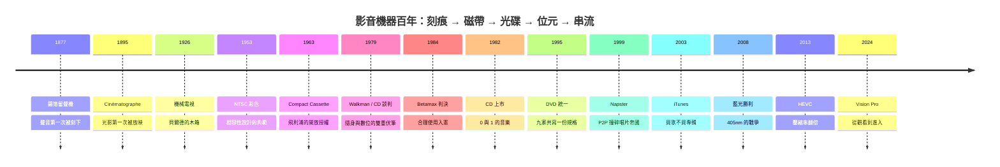

# 前言：凝結時光的魔法——影音機器如何將聲音與光影化為永恆的感官記憶

1877 年，愛迪生把一片錫箔纏上圓筒，對著喇叭吼了一句童謠，再倒轉機器重播——那一刻，人類第一次聽見「過去」的聲音。十九年後，盧米埃兄弟在巴黎一家咖啡館的地下一層，把銀幕上的一列火車放進觀眾眼裡。此後一百三十年，影音機器的全部歷史，都在回答同一組問題：**如何把瞬間的聲浪與光影捕捉下來、儲存起來、重現出來，並傳播出去**。

## 一、影音科技的兩條演化軸線

- **聲音**：類比溝槽（愛迪生圓筒、柏林納碟片）→ 磁性介質（開盤帶、卡帶、Walkman）→ PCM 數位化（CD 的 16-bit/44.1kHz）→ 心理聲學壓縮（MP3）→ 無損 Hi-Res 與空間音訊物件（Dolby Atmos）。每一代介質之戰，都是信噪比、容量、成本與商業模式的多方博弈——RIAA 等化曲線、杜比壓擴、遮蔽效應，都是工程師對人類聽覺極限的精確計算。
- **視訊**：膠捲（每秒 24 格）→ 機械掃描與電子電視之爭 → NTSC/PAL/SECAM 的彩色標準政治 → 磁帶螺旋掃描（Betamax vs VHS）→ 光學雷射（LD/VCD/DVD/藍光）→ 面板大決戰（電漿/LCD/OLED）與 H.264/HEVC 壓縮 → 4K/8K 串流與計算畫質。顯示與壓縮的每一次躍遷，都重寫了娛樂產業的金錢流向。

## 二、一百三十年江山圖

## 三、本書的紀律

- **史實可考**：從愛迪生的錫箔圓筒、1992 年《蝙蝠俠歸來》成為首部 Dolby Digital 電影、1995 年九家廠商共寫 DVD 規格、2008 年華納轉向藍光導致東芝退場，到 2019 年《曼達洛人》LED 虛擬攝影棚——每個故事皆真實，傳說（如「CD 為貝多芬第九而生」）會標明為哪一方的說法。
- **機理可算**：RIAA 等化的轉移函數、螺旋掃描的相對速度幾何 $v_{rel}\approx\omega r$、量化動態範圍 $6.02N+1.76$ dB、藍光容量與 $\lambda/NA$ 的關係、心理聲學遮蔽曲線——每章至少一段可檢驗的工程推理。
- **因果可追**：技術的背後是制度與人心——飛利浦免權利金授權讓卡帶成為全球標準；1984 年最高法院的 Betamax 判決為錄影合理使用背書，卻在三十年後被串流帝國改寫；MP3 的免費盜版逼出 iTunes 的 99 美分交易。讀者將看到：每一台影音機器，都是物理定律、產業利益與人類慾望的三體運動。

從錫箔上的一道刻痕，到 Vision Pro 裡的空間影片——影音機器的故事，本質上是一群工程師不斷逼近「完美重現現實」的感官極限。翻開下一頁，我們從那位厭倦了重複電話留言的發明家說起。
