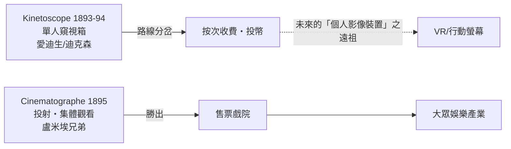

# 第 2 章 · 第 1 節 盧米埃與電影機： Grand Café 地下室的一個夜晚

## 先有觀看箱，還是先有銀幕

1890 年代初，愛迪生實驗室在技師威廉·迪克森（William Dickson）手中做出 **Kinetoscope**：電動馬達帶動一卷 35 mm 軟片連續通過放大鏡，觀看者投幣、俯身在木箱的窺視孔上，一次一人。1893 年樣機公開、1894 年開始商業安裝，在遊藝場般的「Kinetoscope 影廳」裡排成一列，客人在櫃檯投幣，逐台觀看十幾秒的拳擊、舞蹈或噴嚏。愛迪生團隊拍片的攝影棚是一座可旋轉開向太陽的黑色小屋，人稱「黑瑪麗亞」（Black Maria）。

愛迪生的判斷很明確：影像應該像留聲機一樣，一台機器賣給一個人，**按次收費、單人觀看**——延伸的正是投幣留聲機（phonograph parlor）的商業模型。他起初對「把電影投射到大銀幕上」興趣寥寥，認為那是小眾把戲。

大西洋彼岸的里昂，一家生產感光底片的家族企業給出了相反答案。

## 1895 年 12 月 28 日

路易·盧米埃（Louis Lumière）在父親與哥哥奧古斯特的協助下，造出 **Cinematographe**：一部集攝影、印片、放映於一體的手搖機器，重約五公斤，用間歇機構讓 35 mm 軟片以約每秒 16 格走停交替。它的關鍵巧思是爪式抓片機構與精巧的遮光輪，讓畫面在「停」時曝光、「走」時遮蔽。

1895 年 12 月 28 日（星期六）晚，巴黎 Grand Café 的「印度沙龍」地下室，約 33 位付了 1 法郎的觀客，看見《火車進站》（L'Arrivée d'un train en gare de La Ciotat）中那列火車迎面而來——傳說中有觀眾驚慌躲閃（此細節史家存疑，姑妄聽之）。同場放映的還有《工廠大門》《嬰兒的午餐》《水澆園丁》。這是公認史上第一場**售票、公開、投射式**的電影放映。不出幾個月，盧米埃的放映師帶著機器與底片跑遍世界，把「活動影像」變成全球生意。

## 技術原理：視覺暫留與間歇運動

電影的核心騙術是視覺暫留（與其說「暫留」，更精確說是大腦對閃爍光流的積分與運動補完）：一系列靜止畫面以足夠快的頻率呈現，大腦便將其融為連續運動。理論上每秒 10–12 格即能產生運動感，但低於約 16 格會出現明顯閃爍；盧米埃選 16 格/秒，默片時代常見 16–20 格，到了有聲片時代，為了配合光學聲軌品質而固定為 **24 格/秒**——這個標準沿用至今。間歇機構（影片「走—停」）與旋轉遮光葉片（放映時遮光）是讓「停格被照亮、換格不看見」的機械保證：

$$\text{連續運動感} \approx \text{每秒} \ge 16 \text{ 幅靜止像} + \text{逐幅遮光}$$

## 路線分岔的深意

愛迪生選「個人終端」，盧米埃選「集體銀幕」——這條岔路在日後的媒體史上一再重演：收音機與電影院、電視與電影、個人電腦與劇院音響。1890 年代的結局是投射路線大勝：電影以戲院、群眾、票房的姿態誕生，迅速長成二十世紀第一個全球化大眾娛樂產業，並在成長過程中一路與專利糾紛（愛迪生的「電影託拉斯」）、審查制度與移民人口的文化需求纏鬥。而那個「單人窺視箱」，則作為一條暗線蟄伏百年，等待另一次復活。
