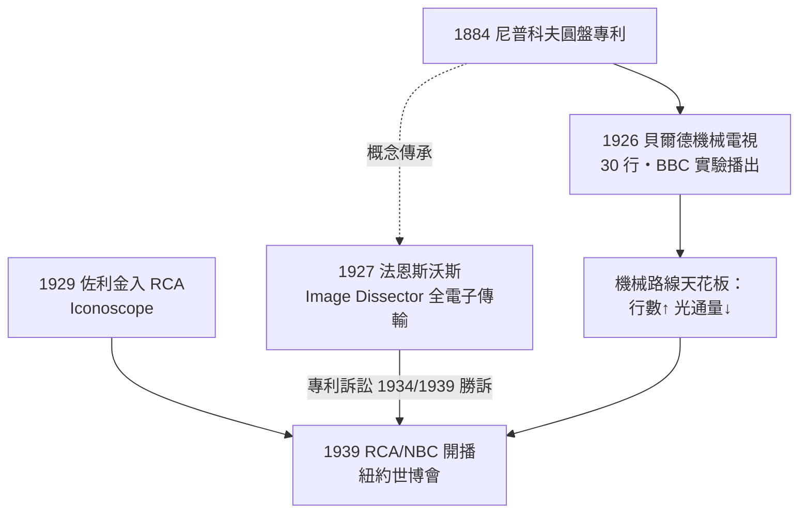

# 第 2 章 · 第 2 節 機械電視 vs 電子電視：尼普科夫圓盤的最後一戰

## 機械路線：貝爾德的「看見無線電」

蘇格蘭發明家約翰·洛吉·貝爾德（John Logie Baird）的裝備近乎滑稽：餅乾罐、縫紉針、舊茶箱、馬達。但原理嚴謹——他的系統繞著 1884 年德國學生保羅·尼普科夫（Paul Nipkow）提出的**掃描圓盤**運轉：盤上鑿有一圈螺旋排列的小孔，旋轉時小孔逐行掃過亮畫面，把影像分解成明暗序列；光電池把序列變成電信號，接收端另一只同步圓盤配合氖燈，把明暗重組為影像。

1926 年 1 月，貝爾德在倫敦蘇活區向公眾演示機械電視，傳送了一個玩偶臉「Stooky Bill」，之後也成功傳送真人面孔。他持續改良，甚至示範了彩色與跨大西洋傳輸。1932–1935 年，BBC 曾以貝爾德系統播出有限的實驗節目（30 行、每秒約 12.5 幀）。但機械掃描的天花板很快顯現：旋轉圓盤的孔徑與轉速限制了掃描行數與光通量——**行數越多，每孔透光越少**。這是一條物理上的死路。

## 電子路線：兩個男人，兩種感光管

真正的未來在真空管裡。

**菲洛·法恩斯沃斯**（Philo Farnsworth）是愛達荷州的農家少年，16 歲時在自家農場的麥田犁溝時（他後來自述）悟出：影像應該像犁田一樣，一行一行「犁」過去。1927 年，21 歲的他以 **Image Dissector（影像解析管）**完成了史上第一次全電子電視傳輸——一根直線、隨後一枚玻璃片上的信號，在舊金山綠街實驗室的螢幕上重現。

**弗拉基米爾·佐利金**（Vladimir Zworykin）是俄國出身的工程師，1920 年代在 Westinghouse 提出的構想一度被上級評為「不值一談」。1929 年他被薩諾夫（David Sarnoff）招入 **RCA**，主導研發**Iconoscope（光電攝像管）**，配合接收端的 Kinescope（顯像管），構成完整的電子電視系統。1939 年 4 月，RCA 在紐約世界博覽會隆重開播，NBC 以艾mpire State Building 發射，FDR 成為首位上電視的總統。

## 專利大戰：小實驗室槓上大財閥

RCA 的策略是資本時代的教科書：先嘗試以 10 萬美元收購法恩斯沃斯的公司遭拒，隨後主張其專利無效，並訴諸法庭。關鍵在於**發明日期的證明**：法恩斯沃斯 1922 年（15 歲時）寄給舊金山化學老師托爾曼（Justin Tolman）的草圖與信件，成為「優先發明日」的鐵證。1934 年美國專利局裁定、1939 年上訴法院維持：**法恩斯沃斯勝訴**，RCA 必須支付專利權利金（雙方最終亦達成交叉授權）。一個大學都沒念完的農家子弟，靠一封信打贏了美國最強的企業法務機器。但二戰與之後的專利到期，最終紅利仍歸於擁有製造、廣播網與行銷資本的 RCA——發明人與產業贏家，常常不是同一個人。

## 歷史的因果

電視的誕生是一場三重賽局：**物理**（機械掃描在行數上撞牆，電子束掃描可無限放大）、**法律**（專利優先權的文書考古學）、**資本**（廣播網、CRT 量產與國家頻譜分配缺一不可）。貝爾德證明了「電視」在概念上可行，法恩斯沃斯證明了「電子」路線可行，佐利金與薩諾夫則證明了「產業」可以規模化。1941 年美國 NTSC 定下 525 行黑白標準後，電視從實驗室奇觀變成客廳物件——但真正讓它征服世界的，是戰後那張空白頻譜上展開的標準之爭。
