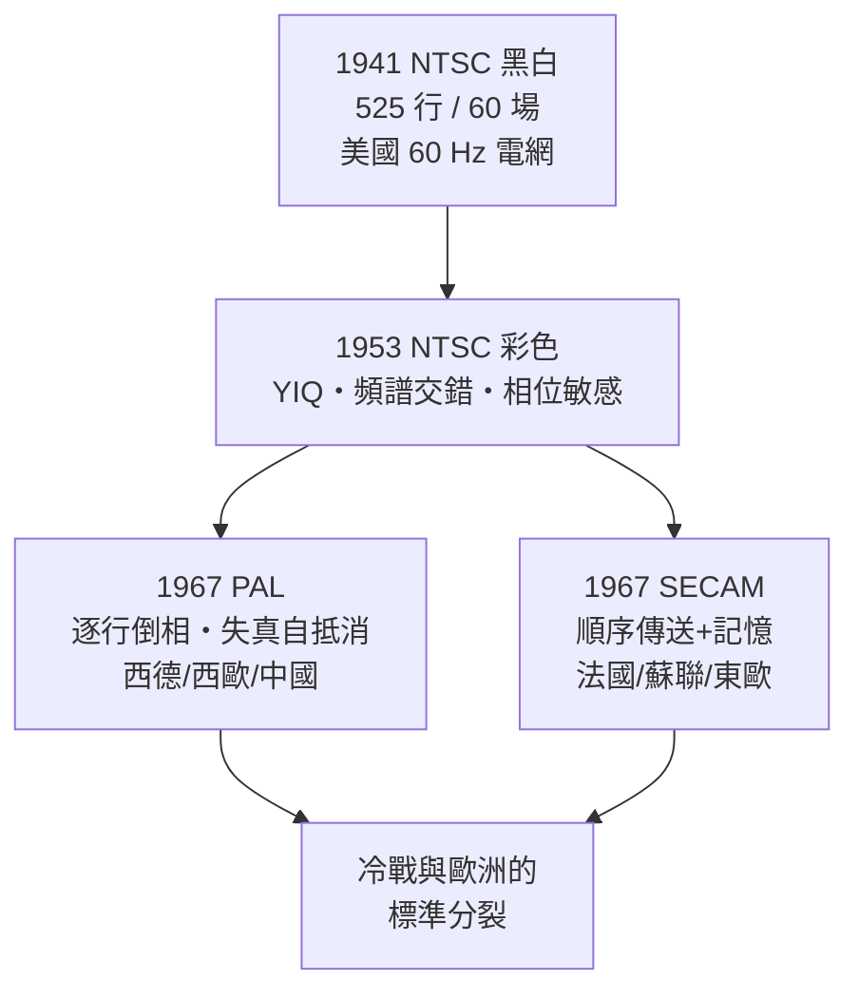

# 第 2 章 · 第 3 節 NTSC、PAL、SECAM：彩色電視的三國志

## 黑白的定錨（1941）

1941 年，美國國家電視系統委員會（NTSC）定案黑白電視標準：**525 行、每秒 30 幀（60 場、2:1 隔行）**。為什麼是 60？因為美國電網是 60 Hz——早期以電網頻率作為掃描時脈與濾波參考，可以讓電源漣波干擾在畫面上靜止不動，工程上最省事。歐洲多為 50 Hz 電網，因此歐洲系統天然走向 50 場/秒。**插座的頻率，決定了半個地球看電視的幀率**——這是基礎設施對媒體標準最直白的支配。

## 1953：NTSC 彩色——相容性設計的傑作

彩色電視最大的難題不是技術，而是**相容**：千萬台黑白電視已經在客廳裡，新彩色信號必須讓舊電視照常顯示黑白。RCA 主導的方案在 1953 年 12 月獲 FCC 核准，1954 年初開播，即 **NTSC 彩色標準**。

核心思想是把畫面分解為：

$$Y = 0.30R + 0.59G + 0.11B \quad \text{（亮度，黑白電視只看它）}$$

$I$、$Q$ 兩個色度分量（分別對應人眼較敏感與較不敏感的色軸）則以正交調變（quadrature modulation）塞進亮度信號頻譜的高頻縫隙裡（頻譜交錯，spectral interleaving），副載波約 3.58 MHz。黑白電視自動忽略色度，彩色電視解調還原——「向後相容」由數學而非強制淘汰達成。代價是：I/Q 相位若在傳輸中失真，色彩便整體偏移，工程師只能加一條「色相（tint）」旋鈕讓用戶手動救回。NTSC 因此被同行戲稱為「Never Twice the Same Color」（顏色從不重樣）。

## 德國的答案：PAL（1967）

Telefunken 的沃爾特·布魯赫（Walter Bruch）針對相位失真開出一劑藥方：**PAL（Phase Alternating Line）**——每一行的色度副載波相位**逐行反轉 180°**。傳輸造成的相位誤差在第 $n$ 行與第 $n+1$ 行方向相反，接收端把相鄰行平均，誤差便相互抵消（平均後近似被除以 2），色相偏移轉化為不易察覺的飽和度微變。1967 年西德開播 PAL（625 行、50 場），英國、大多數西歐與後來的中國大陸跟進。代價是接收機較複雜（需一行延遲線），垂直彩色解析度減半。

## 法國的孤傲：SECAM

法國工程師亨利·德法蘭西（Henri de France）早在 1956 年提出 **SECAM（Séquentiel Couleur à Mémoire，順序傳送記憶制）**：R-Y 與 B-Y 兩個色差信號**逐行輪流傳送**，接收端用一行超音波延遲線「記憶」上一行，拼回完整色彩。它徹底迴避了相位調變，不怕相位失真，但收視者無法簡單把 SECAM 節目自行轉錄、轉制，且製播設備成本高。1967 年法國開播，蘇聯與東歐集團跟進——有人解讀為法國的科技主權姿態，也有人指出蘇聯選擇與「政治上不可靠的西歐節目」難以互通的用意。標準，自此成為地緣政治的貨幣。

## 歷史的因果

NTSC、PAL、SECAM 的分裂，表面是工程取捨（相位敏感度 vs 複雜度 vs 頻寬），底層卻是**產業位置與國家意志**：美國要的是與龐大黑白存量相容、讓 RCA 賣新電視；西德要的是擺脫美國專利、讓 Telefunken 收權利金；法國要的是不受制於人。標準之爭告訴我們：媒介的物理規格，從來同時是政治文件。這場三國志要到 1990 年代數位電視興起、模擬彩色退場才真正落幕，而「新格式必須相容舊存量」的教訓，則長存於每一代媒體標準之中。
