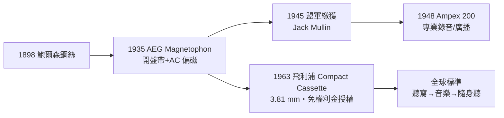

# 第 3 章 · 第 1 節 磁帶與卡帶：從鋼絲到 3.81 mm 的全球標準

## 磁性錄音的長前奏

磁性錄音的故事比唱片晚了二十年，卻走得更遠。1898 年，丹麥工程師瓦爾德馬·鮑爾森（Valdemar Poulsen）發明**Telegraphone 鋼絲錄音機**：聲音驅動電磁鐵，鋼絲從磁極間通過時被**依信號磁化**，重放時磁化強度感應出電壓。這是「磁化剩餘」儲存聲音的第一次示範。它比蠟筒更耐久、可消磁重錄，但鋼絲笨重、編輯困難，數十年間始終小眾。

兩項關鍵突破在 1920–30 年代降臨：一是 **AC 偏磁（bias）**——在信號上疊加高頻電流，讓磁化曲線工作在線性區，大幅降低失真、提升高頻；二是材質革命。1935 年，德國 AEG 與 BASF（IG Farben 體系）在柏林無線電展推出 **Magnetophon K1 開盤帶錄音機**：以醋酸纖維帶基塗布氧化鐵磁粉的**帶狀**介質，配合環形磁頭，可剪輯、可拼接、可長時間錄音。

## 二戰的意外情報：瓦爾特·布魯赫聽見的「不可能現場」

磁性錄音改寫歷史的一幕發生在戰爭末期的廣播界。1944–45 年，盟軍技術人員（常引述的關鍵人物包括美國信號兵約翰·赫伯特與傑克·穆林 Jack Mullin）監聽德國廣播時疑惑：號稱「現場直播」的布魯赫愛樂（Bruckner）交響曲，節目竟長達一小時以上且音質完美——當時盟軍的鋼絲/刻紋錄音根本做不到。德軍投降後，穆林在法蘭克福附近取得兩台 **Magnetophon**，拆運回美國反覆演示；工程師理查·霍夫（Richard Howarth）、比靈斯等完善了偏磁細節。1947 年穆林在好萊塢演示，Bing Crosby 的工程師當場買下機器——克羅斯比厭倦每週現場直播同一節目，用磁帶預錄，從此改變廣播工業。1948 年，克羅斯比出資支持的新創公司 **Ampex** 推出 Model 200 開盤錄音機，成為美國專業錄音的標準機。戰爭繳獲，意外餵養了戰後的錄音黃金年代。

## 1963： Lou Ottens 的「小盒子」

戰後磁帶雖好，開盤機昂貴、帶盤易鬆，始終進不了尋常家庭。荷蘭飛利浦（Philips）的產品主管盧·奧騰斯（Lou Ottens）在聽寫機部門多年，受夠了笨重的開盤系統。他的目標簡單粗暴：**把整台錄音機裝進上衣口袋**。為此他親手用木頭削出一個小盒子作為設計原型。

1963 年 8 月，飛利浦在柏林無線電展發表 **Compact Cassette**。幾個決定塑造了此後半個世紀：

- **帶寬 3.81 mm（1/8 吋）**：直接沿用當時現成的工業帶料，不必另開生產線；
- **帶盒一體化**：兩個捲軸收在保護殼內，帶端固定在捲軸上，用戶永不「穿帶」；
- **機構極簡**：為聽寫與口述設計，初期音質平庸——但正因簡單，才能便宜、耐用、小型化；
- **開放授權**：1965 年前後，飛利浦做了媒體史上最反直覺的決定——**免權利金授權全世界**（僅象徵性收費）。索尼等日本廠商迅速加入，帶盒規格成為全球統一標準。

## 歷史的因果

卡帶的成功是**制度智慧**的勝利：飛利浦放棄權利金收入，換來的是「標準即王座」——所有相容機、帶、軟體的市場都在替飛利浦的規格打工。對照同時期各種封閉規格的湮滅，這一課直接影響了日後 JVC 對 VHS 的策略。而奧騰斯口中「為辦公聽寫而生」的小盒子，很快會被一群年輕人和一位愛歌劇的社長，改寫成青年文化的載體。
