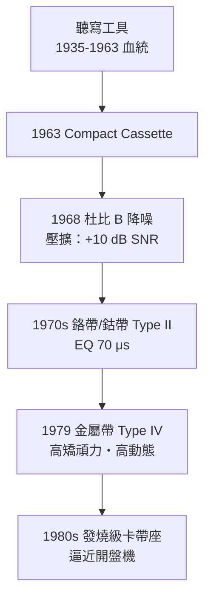

# 第 3 章 · 第 3 節 杜比降噪與金屬帶：卡帶的技術登階

## 磁帶的天敵：嘶聲

磁性錄音的物理宿命是噪聲。磁帶上的氧化鐵磁粉是無數微小磁粒子，即使「空白」也各有剩磁，重放時疊加成 broadband 的**嘶聲（hiss）**。更麻煩的是它的分布：磁帶噪聲能量集中在**中高頻**——恰好是人耳最敏感的區域（等響度曲線告訴我們，小音量時耳朵對 2–5 kHz 特別靈敏）。卡帶帶速慢（4.76 cm/s，僅為開盤帶的約 1/16）、帶寬窄（3.81 mm 兩軌立體聲），磁軌面積小、信號弱，嘶聲問題比開盤機嚴重得多。聽寫無妨，聽音樂則難以忍受。

## Ray Dolby 與壓擴

雷·杜比（Ray Dolby）是英國出生的美國工程師，少年時即在 Ampex 打工（參與過早期錄影機專案），後赴劍橋取得物理博士。1965 年他在倫敦創立 Dolby Laboratories，1966 年推出專業用的 **A 型降噪**（多頻段壓擴），迅速進入唱片與電影工業；1968 年推出為消費產品設計、單頻段處理的 **B 型降噪**，針對的正是磁帶嘶聲。

原理是**壓擴（companding = compression + expansion）**：

1. **錄音時（編碼）**：對低電平的中高頻信號**動態提升**——信號越弱、提升越多；強信號（本來就遠高於噪聲）則幾乎不動，以免過載；
2. **播放時（解碼）**：做完全相反的衰減，信號還原為原貌；
3. **噪聲的遭遇**：磁帶嘶聲是在編碼之後、解碼之前混入的，解碼時同樣被衰減——

$$SNR_{\text{out}} = \frac{S}{N/g} = g \cdot SNR_{\text{in}} \quad (\text{有效信噪比提升約 } 10\ \text{dB})$$

關鍵在於**只壓低電平的高頻**：這樣編碼增益不會吃掉動態餘裕（headroom），失真不惡化，且誤配（用戶忘了開/關 Dolby）時聽感劣化也可容忍。A 型用四個頻段分工更精細，B 型用單一可變高通側鏈，簡單到能塞進消費機。此後還有針對不同媒體的 C 型（1980，卡帶用，約再進 10 dB）與 S 型。杜比符號很快成為卡帶盒上的品質印記——降噪從此是「規格」的一部分。

## 1979：金屬帶（Type IV）

降噪對付的是「重放端」的噪聲，材質革命則對付「寫入端」的極限。1979 年，以 3M 與日系廠商（TDK、Sony 等）為首的帶廠推出**金屬帶（Type IV）**：磁層改用**純金屬合金磁粉（鐵為主，鈷、鎳等合金化）**，取代氧化鐵或鈷改質氧化鐵（Type II 鉻帶/鈷帶）。金屬磁粉的**矯頑磁力**（coercivity，約為氧化鐵帶的兩倍以上）與殘磁（remanence）大幅提高：

- **矯頑力高** → 需要更強的偏磁與抹音場，但一旦寫入，信號「刻得更深」，高頻餘裕與最大輸出電平（MOL/SOL）躍升；
- **殘磁高** → 同樣長度磁帶儲存的磁能更多，動態範圍擴大。

配合杜比 B/C，卡帶的信噪比與頻寬（高端可達 15–20 kHz 級）終於逼近開盤機水準。1979 年前後，Sony、Panasonic 等也推出金屬帶機種，卡帶座成為 Hi-Fi 系統的正統成員。

## 歷史的因果

降噪與金屬帶是一對互補的階梯：杜比處理**噪聲的相對量**，金屬帶處理**信號的絕對量**，兩者疊加把 1963 年那台平庸的聽寫機，抬舉成 1980 年代能登大雅之堂的音樂媒體。這條「技術階梯」也說明了標準演化的智慧——Type I/II/IV 以不同偏磁與等化（120/70 μs）並存於同一台機器上，向後相容、分層升級。正是這個成熟到「值得盜版」的媒體，即將迎來它最意想不到的角色：1980 年代，空白卡帶與雙卡收錄音機讓全球青年開始「翻錄」——唱片業的憤怒與「Home Taping Is Killing Music」的標語，是數位時代版權戰爭的預演。而卡帶真正的姊妹篇——錄影帶——則把「家庭複製」問題，一路告到了美國最高法院。
