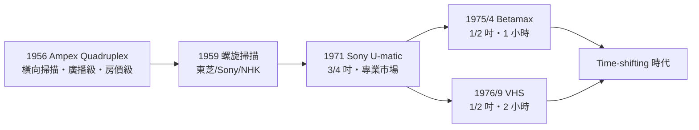

# 第 4 章 · 第 1 節 VCR 爆發與螺旋掃描：把廣播裝進磁帶

## 從橫掃到斜繞

錄影的難題是頻寬。視訊信號高達數 MHz，而磁記錄的上限頻率取決於**磁頭與磁帶的相對速度**：

$$f_{max} \approx \frac{v_{rel}}{\lambda_{min}}，\quad v_{rel} \approx \omega r \ \text{（磁鼓角速度 × 磁頭迴轉半徑）}$$

固定磁頭要寫入 4 MHz 得讓磁帶以每秒數十米飛奔——一卷帶子幾分鐘就用完。Ampex 的解法（1956 年 **Quadruplex**）是讓**四個磁頭裝在高速旋轉的輪上，橫向掃過 2 吋寬磁帶**，相對速度暴增至每秒約 40 米，達到廣播級品質。Quadruplex 橫掃電視網，節目從此可以錄了、寄了、重播了——但它重達數百公斤、價格如房產，是電視台的機器，不是家庭的。

## 螺旋掃描：一個幾何直覺

1950 年代起，日本與美國的多個團隊（東芝、Sony、NHK、Ampex、RCA 等）競逐更簡潔的方案：**螺旋掃描（helical scan）**。讓磁帶**斜著**繞上一個旋轉磁鼓，磁頭在磁帶上刻出斜向的長條視軌：

$$\text{視軌長度} = \pi d \ \text{（磁鼓直徑 } d\text{），遠大於帶寬} \Rightarrow \text{低帶速也能有高相對速度}$$

帶速可以慢到幾 cm/s，相對速度卻靠磁鼓旋轉拉高——錄一小時節目，磁帶只需一米級長度。1959 年東芝率先公開螺旋掃描樣機，Sony 與 NHK 亦推出實用系統；螺旋掃描成為此後所有家用錄影機、攝錄放影機乃至 DV 的共同祖先。Sony 1971 年的 U-matic（3/4 吋）先占了專業與企業市場，但價格仍高、帶盒大，家庭市場仍在門外。

## 進場前的最後衝刺：Beta 與 VHS

1975 年 4 月，Sony 以 **Betamax SL-6300**（1/2 吋帶、卡式帶盒）進入家用市場，定價約 229,500 日圓，先錄一小時。JVC（Victor Company of Japan，松下系）則在其母公司松下幸之助「要能錄下一場棒球賽」的訓示下，堅持更長的錄影時間與更簡的機構，於 1976 年 9 月推出 **VHS**（Video Home System）：同為 1/2 吋帶，但帶盒更大、走帶路徑 M 形穿帶，首機 HR-3300 定價約 256,000 日圓，**單卷可錄 2 小時**。兩強在家用錄影的起跑線上僅相差 17 個月。

## 時間平移：重新定義「電視」

錄影機帶來的行為革命被稱為 **time-shifting（時間平移）**：觀眾第一次可以把節目「存起來」，在自己選擇的時間觀看。廣播電視的時間軸是工業時代的火車時刻表——所有人在同一時刻看同一節目；錄影機把時間主權交還給個人。這個看似溫和的行為，引發了媒體史上最重要的法律戰爭之一（版權方一度主張「錄下來就是侵權」），也開啟了出租、隨選、暫停直播的整條演進線。

## 歷史的因果

螺旋掃描是一場「幾何學的降維打擊」：不改變記錄物理，只改變磁帶與磁頭的**相對姿態**，便把廣播級寫入頻寬裝進一台電風扇大小的機器。日本廠商在此展現了系統工程的壓倒性優勢——磁頭材料、伺服控制、帶盒機構的每一環都做到極致。但技術優勢從不保證市場勝利：Betamax 與 VHS 的差異是 1 小時與 2 小時、封閉與開放——下一節，我們看這場被寫進所有商學院教材的格式大戰。
