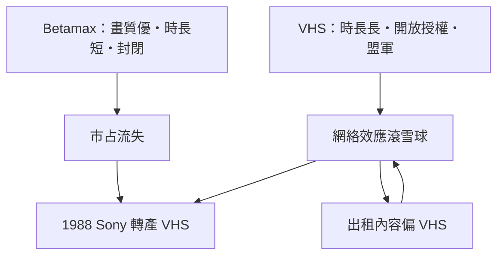

# 第 4 章 · 第 2 節 Betamax vs VHS：畫質敗給了時長

## 一小時與兩小時

1975 年 Sony Betamax 上市時，單卷只能錄 1 小時（L-750 帶）；1976 年 JVC VHS 首機 HR-3300 一開局就是 **2 小時**（T-120 帶）。這個差距看似微小，卻精準命中消費者的痛點：一場美式足球賽加上前後節目不止一小時，一部好萊塢電影超過兩小時的比比皆是，而「錄到一半帶子用完」是最令人抓狂的使用經驗。Sony 之後陸續延長至 2 小時（1977）、3 小時（Beta II 慢速模式）、4.5 小時以上；VHS 也以 6 小時模式（EP/SLP）反制。雙方畫質差距隨慢速模式而縮小，但**第一印象已經刻進市場**：VHS 能「一卷錄完一場比賽」。

## 聯盟 vs 自營

真正的勝負手在陣營。Sony 的策略相對封閉：Betamax 由 Sony 自家（及少數被授權者如東芝、Sanyo 的特定關係）生產，規格主導權緊握手中。JVC 與母公司松下則反其道而行：**開放授權、廣結盟友**。松下（Panasonic）、日立、夏普、三菱相繼出 VHS 機；更具決定性的是美國市場——RCA 於 1977 年向松下下單貼牌 VHS，並以「能錄一整場球賽」為賣點大力行銷，把 VHS 鋪進美國主流連鎖通路。產能、價格戰、通路廣度全面倒向 VHS：到 1980 年代初，VHS 在美國與全球市占已明顯領先，1988 年 1 月，**Sony 宣布生產 VHS 錄影機**——長達十二年的格式戰爭實質落幕（Sony 仍續產 Betamax 至 2002 年，主要供拉美等殘存市場）。

## 一個備受爭議的推力：成人影片

1980 年前後，錄影帶出租店在美國如雨後春筍（早期多為藥局、雜貨店附設或獨立小店）。成人影片產業在這波生態中扮演了真實而常被低調處理的角色：錄影帶讓成人內容離開城市裡的影院，進入郵購與出租的私領域，市場爆發式成長；出租店與郵購商在備貨時採用了更普及、租盤流轉更快的 VHS，進一步放大 VHS 的網絡效應。史學上應謹慎表述——它**不是**唯一甚至未必是最主要的決定因素（時長、陣營、價格才是主因），但確實是 VHS 生態加速的正回饋之一：格式贏家通吃內容，內容又固化格式。

## 技術規格對照

| | Betamax（1975） | VHS（1976） |
|---|---|---|
| 帶寬 | 1/2 吋（12.7 mm） | 1/2 吋（12.7 mm） |
| 帶盒 | 較小（約 156×96×25 mm） | 較大（約 188×104×25 mm） |
| 走帶 | Ω 形 U 穿帶 | M 形穿帶 |
| 初始時長 | 1 小時 | 2 小時 |
| 標準帶速 | 4 cm/s 級 | 3.34 cm/s |
| 陣營 | Sony 為主 | JVC/松下+日系廠+RCA |

## 商業教訓：規格開放 vs 品質封閉

這場戰爭的教訓被概括為「開放打敗品質」，但更準確的表述是：**消費媒體的勝負取決於生態而非單點規格**。VHS 的「2 小時」解決的是真實使用場景（錄整場球賽/電影），開放授權換來的是產能與價格優勢，聯盟換來的是通路；三者相乘，把 Beta 的畫質優勢碾成次要變數。Sony 從此學到（並在後來的格式戰中反覆運用）聯盟策略——日後的 DVD、Blu-ray 戰爭裡，Sony 都是拉幫結派的高手。歷史沒有浪費這一課。

而格式戰的餘波還掀起另一場更根本的戰爭：在法庭上，「消費者錄電視節目究竟是不是小偷」——下一節，我們走進 1984 年的美國最高法院。
