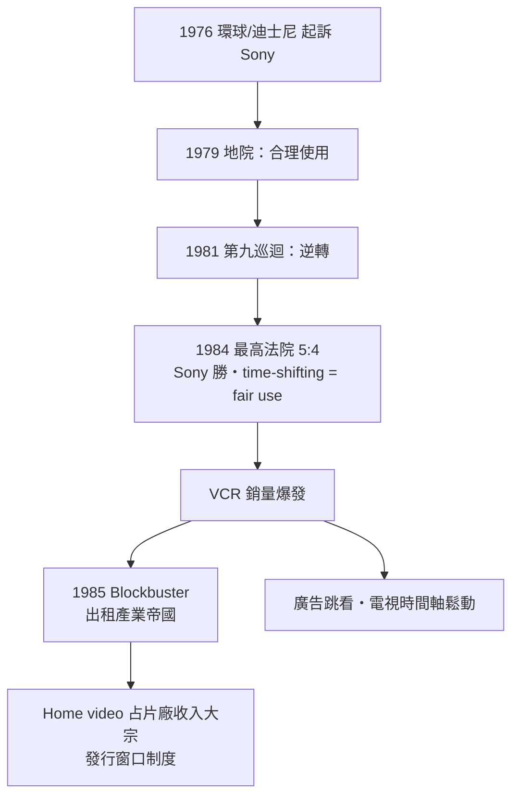

# 第 4 章 · 第 3 節 家庭錄影制度戰：Sony v. Universal 與出租業的黃金年代

## 一場告到最高法院的訴訟

錄影機賣得越好，好萊塢越是恐懼。1976 年 11 月，環球影業（Universal City Studios）與迪士尼對 Sony 提起訴訟，主張：製造、銷售 Betamax 本身即構成「幫助侵權」（contributory infringement），因為消費者用它錄下電視節目重看，就是侵犯版權。訴訟歷經八年：加州中區聯邦地院 1979 年判 Sony 勝（家庭錄影屬合理使用）、第九巡迴上訴法院 1981 年反轉判環球勝、**1984 年 1 月 17 日，美國最高法院以 5:4 終審改判 Sony 勝**。

多數意見（Stevens 大法官執筆）確立了兩個原則：

1. **「時間平移」（time-shifting）屬於合理使用（fair use）**：消費者為私人、非商業目的錄下免費廣播的節目、延後觀看，是對版權人利益的公平使用；
2. **「實質非侵權用途」原則（後被稱為 Betamax doctrine / staple article doctrine）**：如果一件商品具有**廣泛正當的商業用途**（capable of substantial noninfringing uses），銷售者不必為用戶的侵權行為負連帶責任。

這份判決書被譽為科技與版權關係的憲章：家用電腦、MP3 播放器、雲端錄影、YouTube……其後每一代「新媒體 vs 舊版權」的訴訟，都回到 1984 年這五票上尋求庇護。若當年判決反轉，錄影機工業可能整體熄火——制度，在這裡不是科技的外部環境，而是科技能否存在的先決條件。

## 從恐懼到金礦：Home Video 的驚人逆轉

判決之後，劇情完全反轉。好萊塢很快發現 home video 不是盜賊，而是**史上最肥的第二市場**：錄影帶以約 60–80 美元的高價售賣的「 sell-through 」模式起效緩慢，真正引爆的是**出租**。1985 年 10 月，達拉斯的 David Cook 創立 **Blockbuster Video**——大片面積店面、每店數千捲帶、電腦化庫存與會員管理，把出租從雜貨店角落升級為郊區家庭週末儀式；數年內開店千餘家，1990 年代初門市逾三千家。到 1980 年代末，**home video 貢獻片廠總收入已達四成上下，1990 年代更超過票房**，成為電影工業第一大收入來源。片廠的商業模式被改寫：首輪票房只是首付款，真正的利潤在「發行窗口」（theatrical → home video → pay TV → broadcast）的階梯上。VHS 帶銷量以億計，好萊塢的「恐懼」變成了仰賴。

## 對電視生態的衝擊

VCR 也動搖了廣播電視的根基。觀眾可以錄下節目、跳過廣告（zapping/zipping），廣告商對「廣告被快轉」的焦慮成為電視業持續數十年的心病；收視行為從「同步全民直播」轉向「個人化時間表」，為後來 DVR（TiVo，1999）與串流隨選預鋪了心理與商業軌道。電視網與廣告業的因應——更精準的收視率測量、植入式行銷、付費頻道崛起——都是這場時間主權轉移的漣漪。

## 歷史的因果

這一節的主題是**法律如何為科技讓路，又如何被科技重塑**。最高法院沒有判「盜版合法」，而是劃下一條精細的線：私人、非商業、時間平移可以，公開散布不行——這條線此后被反覆挪移與爭奪（Napster 案即以 Betamax 案為交鋒核心，2005 年 Grokster 案又對它做出補充）。錄影機的故事完整展示了媒體科技的鐵三角：**工程**（螺旋掃描）、**商業**（格式大戰、開放授權）、**制度**（合理使用判決）——缺一角，VCR 都不會走進千萬客廳。而當個人終於握住媒體的時間軸，下一個問題自然浮現：能不能也握住「內容」本身？那是數位時代的故事了。
