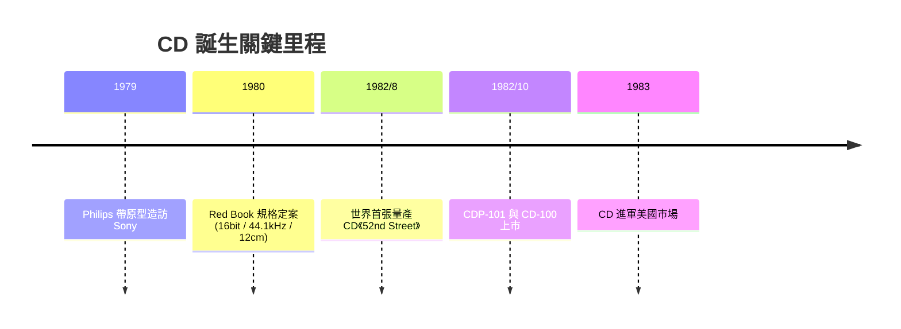

# 第 5 章 · 第 1 節 CD 的誕生：Sony 與 Philips 的世紀聯姻

1979 年春天，Philips 的音訊副總裁 Joop Sinjou 帶著一支雪茄盒大小的樣品，走進東京 Sony 總部。盒子裡是一張直徑 11.5 公分的透明光碟原型——雷射讀取、無接觸播放。這場會面，開啟了消費電子史上最著名的一次跨國合作。

## 類比唱片的黃昏

在 CD 出現之前，音樂的載體百年來都離不開「針」與「溝」。黑膠唱片靠唱針在微米級音溝中機械振動還原聲音，代價是：每一次播放都是一次磨損，灰塵、指紋、刮痕直接變成爆音與失真。愛樂者擦拭唱片、更換唱針、調整抗滑，與其說是聽音樂，不如說是在伺候音樂。錄音帶解決了磨損，卻引入了磁帶的嘶聲與音質妥協。工程師們的共同夢想是：**讓音樂離開機械接觸**。

Philips 早有積累。1970 年代，它與 MCA 合作開發出 LaserVision 影碟（後來的 LD），已掌握光學讀取的關鍵：以半導體雷射照射旋轉碟面上的微坑（pit），依反射光強弱還原訊號。碟片上的資訊以凹坑與平面構成，雷射頭讀的是光，不是針壓——這正是無磨損播放的物理基礎。但 Philips 在一個環節上遇到了天花板：**數位訊號處理**。若要光碟儲存數位音訊，需要極高精度的取樣、量化與錯誤校正，這正是 Sony 的強項——Sony 自 1960 年代末即投入 PCM 數位錄音研發，1978 年已做出 16-bit 的數位音訊處理晶片與 PCM 轉換器。

## 兩個團隊，一場談判

1979 至 1980 年間，兩家公司的工程團隊在 Eindhoven 與東京之間來回奔波，談的是規格，拼的是信念。最著名的分歧是**碟片直徑**：Philips 主張沿用影碟血統的小碟（11.5 公分，約等於口袋可放），Sony 則由音樂人出身的大賀典雄拍板要求更大容量。最終 12 公分成為定案——這個「整數」尺寸的背後，藏著一段關於貝多芬第九交響曲的故事（下一節詳述）。取樣率、量化位元數、錯誤校正方式，每一項都在跨海電報與會議桌上反覆拉鋸。據參與者回憶，談判的激烈程度不亞於商戰，但兩家都明白：**統一規格、共享標準，遠勝於各賣各的格式戰**——這是從 VHS 與 Betamax 之戰學到的教訓。

1980 年，「Red Book」（紅皮書）數位音訊光碟規格定案。1982 年 8 月，CBS/Sony 在日本靜岡縣大井川工廠量產出世界第一張商業 CD：Billy Joel 的《52nd Street》，同批上市還有 HERB ALPERT 與 日本音樂家作品等約五十種曲目。1982 年 10 月，CD 播放機 CDP-101 與 CD-100 分別由 Sony 與 Philips 在日本與歐洲上市。1983 年，CD 登陸美國。

## 意義：標準的勝利

CD 的誕生不只是產品，而是三種力量的匯流：

1. **技術**：半導體雷射＋數位 PCM，讓音訊徹底脫離機械與磁帶的物理缺陷。
2. **經濟**：唱片工業獲得了重新出售音樂庫的機會——整個類比時代的曲目可以用數位形式再賣一次。
3. **制度**：Sony 與 Philips 選擇授權開放規格而非獨佔，讓 CD 迅速成為全球標準，這個「競合」模式成為後來 DVD、藍光的範本。

雷射取代唱針的那一刻，音樂第一次真正「無磨損」。但 12 公分與 74 分鐘的背後，還有一段更動人的工程史詩。
