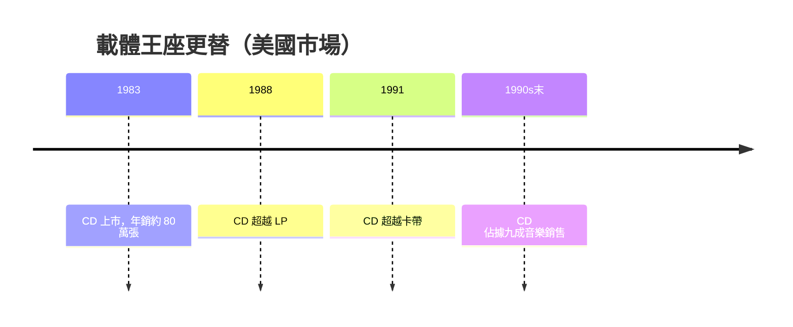

# 第 5 章 · 第 3 節 CD 黃金時代：雷射、暴利與二次銷售

1983 年，CD 在美國上市第一年賣出約 80 萬張，輿論仍以「昂貴玩具」視之。但黃金時代來得比所有人預想的都快、都狠——它徹底重寫了唱片工業的損益表。

## 技術下探：雷射頭與一體式 DAC

初代 CD 播放機 CDP-101 定價約 168,000 日圓，且採多晶片方案。真正的轉折在 1980 年代中後期：半導體雷射量產成本暴跌，Philips 推出將 DAC（數位類比轉換器）與相關電路整合的單晶片方案，Sony 亦推出輕薄「軌道式」光學讀取頭。播放機價格從十幾萬日圓滑落到數萬，最終入門機與隨身聽（Discman）進入百貨公司家電櫃。**數位音訊的核心元件——雷射、光學頭、DAC——全部晶片化**，這是 CD 得以平民化的經濟學前提。

## 銷量的歷史性跨越

市場資料勾勒出明確的換代曲線：

- **1988 年**：美國 CD 銷量超越黑膠唱片（LP）；
- **1991 年**：CD 銷量超越卡帶，成為美國第一大音樂載體。

## 唱片工業的暴利：一次音樂庫的重新出售

CD 對唱片公司而言是天上掉下來的禮物：全球數十年積累的錄音——披頭四、古典全集、爵士名盤——不必重新錄製，只需數位化母帶、壓片，便以更高單價再賣一次。消費者「重新購買自己已擁有的音樂」，構成唱片史上的二次銷售浪潮。壓片成本遠低於售價，1990 年代 CD 銷售毛利率驚人，五大唱片集團進入史上最肥的十年。這份暴利也埋下隱患：當 MP3 讓複製成本趨近於零，整個以「載體壟斷」為基礎的商業模式將被連根拔起。

## 秋葉原與 Hi-Fi 文化

東京秋葉原從戰後家電街蛻變為音響聖地。1980 年代，CD 播放機、擴大機、喇叭在秋葉原的陳列窗裡展開規格競賽：誤差抖動（jitter）、超取樣濾波、DAC 位元數（1-bit vs 多位元之爭）成為發燒雜誌的熱門辯題。日本工程師文化與中產階級客廳，讓「聽音樂」變成一門技術修養——這股 Hi-Fi 文化與 CD 相互哺育，也為後來的耳機發燒與數位串流培養了第一批高要求的用戶。

## CD-R：消費者握筆的那一刻

1990 年，Philips 與 Sony 發表 **CD-R**（可錄式 CD）規格，以有機染料層替代壓製凹坑：高功率雷射在染料上燒出不可逆的暗點，模擬凹坑光學特性。1990 年代中後期，燒錄機價格崩落，「抓音軌、自製精選輯」成為大眾行為。這是**消費者第一次擁有數位複製能力**——唱片工業的暴利大廈，從 CD-R 的雷射燒穿染料那一刻，開始出現裂縫。Napster 不過是沿著這道裂縫，把牆推倒。

黃金時代的本質是：一項好技術＋一次載體壟斷＋一群尚未警覺的內容商。而裂縫，正沿著染料層緩慢蔓延。
