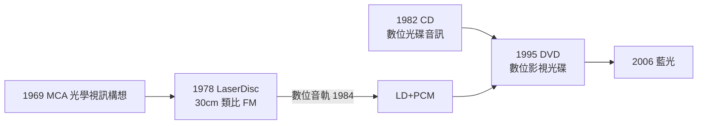

# 第 6 章 · 第 1 節 LaserDisc 試水溫：光碟影視的先行者

在 DVD 之前二十年，就有人把整部電影壓進一張光碟。它的名字叫 LaserDisc（LD），一個在商業上近乎失敗、卻在技術上功不可沒的先行者。

## 1978：Discovision 問世

1960 年代末，美國 MCA 公司的 David Paul Gregg 早在 1958 年起便構想光學視訊唱片；1969 年 MCA 展示 DisCoVision 系統。1970 年代，Philips 與 MCA 合作（並在美國合資成立 Discovision Associates），於 **1978 年**以 LaserDisc 名義在美國上市——比 CD 早了四年。LD 是一張 **30 公分**的大碟，外觀像放大版的黑膠，本質卻是光學讀取：雷射掃描碟面凹坑，無機械磨損。

## FM 調變：把影像「烙」進光碟

LD 採**類比 FM 調變**記錄：影像亮度與色度訊號被調變到不同載波頻率，與聲音載波疊加後以凹坑長度與間距刻錄在碟面。理論頻寬優勢使 LD 水平解析度約 400–425 線，明顯高於 VHS 的約 240 線。1984 年，LD 加入**數位音訊軌**（與 CD 同源的 PCM 記錄方式），畫質音質雙雙壓倒錄影帶——發燒友稱之為「影碟中的黑膠」。

## 為何叫好不叫座

LD 的困境是三重夾擊：

1. **體積**：30 公分碟片又大又重，封套如巨型唱片，存放與搬運皆不便；
2. **價格**：播放機昂貴，碟片售價數倍於 VHS 錄影帶租片；
3. **無法錄影**：VHS 可以錄電視節目，LD 只能播放——在「錄影」為剛需的年代，這是致命傷。

市場上 LD 幾乎淪為小眾：美國滲透率始終有限，反倒在 **日本** 意外地繁榮。日本的發燒友文化、小坪數公寓的視聽間文化與 Pioneer 的傾力推廣，讓 LD 成為 1980–90 年代日本影音宅的圖騰。 Pioneer 自 1981 年起成為 LD 最重要的推手，卡拉 OK、鐳射影碟出租店、動畫碟片——LD 在日本走出了一條美國沒有的路。

## 對 DVD 的鋪路

LD 的真正遺產是**完整的光碟影視工程學**：光學頭伺服控制、碟片高速旋轉的抖動抑制、雷射壽命與成本管理、光碟壓片廠供應鏈。當 1990 年代數位壓縮（MPEG）成熟，工程師只需把 LD 的類比 FM 換成數位位元流——**LD 與 CD 各貢獻一半血統，合成 DVD**。Pioneer 更是唯一堅持 LD 戰線到最後的大廠，直至 2009 年才停產 LD 播放機，為這條光學前驅之路畫下句點。

## 一場「失敗」的意外收穫

歷史上不少失敗者比勝利者更有影響力，LD 是典範。它訓練了整個光學碟片供應鏈：碟片母盤刻錄（glass mastering）、壓片廠的潔淨室管理、雷射頭的量產工藝——這些能力後來直接被 CD 與 DVD 繼承。它也教育了市場：先讓消費者習慣「光碟比磁帶好」，後繼者只需把價格與體積打下來。從產業史的角度看，LD 不是一段歧路，而是一條必要的引橋：**沒有 LD 試水溫，光碟影視的革命不會在 1990 年代如此順滑地到來**。
