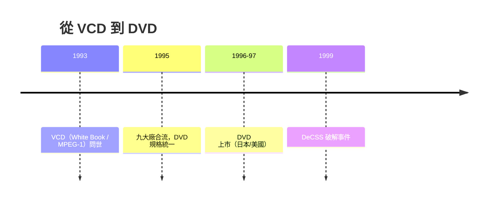

# 第 6 章 · 第 2 節 VCD 野蠻生長與 DVD 統一：規格戰的教訓

1993 年，當日本與美國還在為次世代影碟吵得不可開交時，一個低解析度的小格式已在亞洲默默改變了世界。它的名字叫 VCD。

## VCD：被低估的 1.2Mbps

VCD（Video CD）以 **MPEG-1** 壓縮視訊，碼率約 1.2Mbps，解析度 352×240（NTSC 系）——不到 VHS 的解析精細度，但成本極低：一張普通 CD 壓 74 分鐘影片，播放機就是加了 MPEG 解碼晶片的 CD 唱機。1993 年由 Sony、Philips、松下、JVC 共同制定 **White Book** 規格。

真正的爆發在 **中國大陸與東南亞**。1990 年代中後期，中國湧現數千家 VCD 播放機組裝廠，萬燕（Wanyan）1993 年造出世界首批商用 VCD 機後，價格戰將播放機打到幾百元人民幣。與此同時，**盜版壓製產業野蠻生長**：正版影片五、六十元，盜版 VCD 五到十元，街頭碟片攤成為一代人的影像啟蒙。好萊塢與當地政府屢屢打擊，但低價硬體＋廉價內容的閉環勢不可擋。VCD 以「劣質但便宜」完成了一次殘酷的市場教育——**光碟看電影**，從此成為亞洲家庭的常識。這段盜版氾濫是公認的真實歷史，也逼得後續所有格式都必須內建內容保護。

## DVD 統一：避免第二場格式戰

1990 年代初，兩大陣營各自研發高密度光碟：

- **Sony + Philips 的 MMCD**（MultiMedia CD，單層約 3.7GB）；
- **Toshiba + Matsushita（Panasonic）+ 日立、時代華納等的 SD**（Super Density，單層約 5GB）。

眼看 Betamax vs VHS、Blu-ray 前身之戰即將重演，**IBM 的 Louis Gerstner 與電腦業（IBM、HP、微軟、蘋果等）出面施厭**：電腦產業拒絕再為互斥格式買單，要求兩陣營合流。1995 年 9 月，九家公司（Sony、Philips、Toshiba、Pioneer、Panasonic、JVC、日立、三菱、時代華納）達成妥協：採 SD 的物理結構為基底、併入 Sony/Philips 的部分技術，**DVD**（後定名 Digital Versatile Disc）誕生。

## 規格核心

- **MPEG-2 壓縮**：約 3–9Mbps 可變碼率，畫質遠勝 VHS 與 VCD；
- **4.7GB／層**：以 650nm 紅光雷射、NA≈0.6 的短波長光學達成（對比 CD 的 780nm）；
- **雙層、雙面**：單面雙層可達 8.5GB。

## 區碼與 CSS：內容保護的政治

好萊塢被 VCD 盜版嚇怕了，把條件寫進規格：

1. **區碼（Region Code）**：全球分六大區，碟片與播放機雙重鎖定，電影可分區分時上映——這是「政治地圖壓進光學規格」的罕見案例；
2. **CSS**（Content Scramble System）：DVD 資料以 40-bit 級加密，解密金鑰存在播放機中，禁止數位輸出未加密串流。

區碼與 CSS 是**內容產業對硬體產業的勝利**：工程師造機器，律師寫規則。1999 年，挪威少年 Jon Lech Johansen 與夥伴逆向破解 CSS（DeCSS），引發長年的法律大戰——版權保護與技術自由的戰爭，就此成為數位時代的主旋律。

DVD 的故事告訴我們：**技術可以合流，利益必須分配**。而分配的規則——區碼與加密——將在二十年後的藍光與串流時代繼續發酵。

回頭看，1993 到 1995 這三年是影音載體史的樞紐：下層是 VCD 在亞洲用盜版與低價完成市場啟蒙，上層是九大廠在談判桌上完成史上罕見的規格合流。野蠻生長與制度妥協同時發生、互為表裡——**市場的混亂逼出了統一的決心，統一的規格又試圖用加密馴服混亂**。這組張力，從此成為數位內容產業的永久課題。
