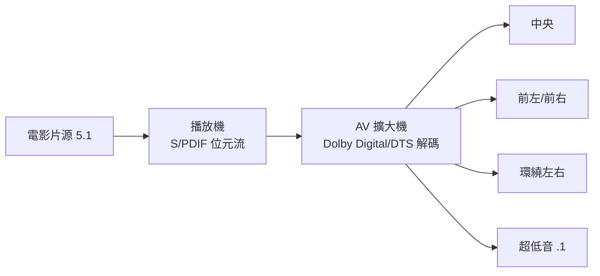

# 第 6 章 · 第 3 節 5.1 聲道落地：把戲院搬進客廳

電影原本只有一個喇叭的聲音。1980–90 年代，一場「聲音的立體革命」在戲院發生，又在 1990 年代末攻陷客廳——這就是 5.1 聲道的故事。

## 從 Dolby Stereo 說起

1970 年代 Dolby Stereo（1975/77 年《星際大戰》帶動）讓戲院擁有四聲道矩陣環繞。但矩陣編碼的四聲道分離度有限，數位電影時代需要真正的分離多聲道。**1992 年，Dolby 推出 AC-3（後稱 Dolby Digital）數位 5.1 系統；《蝙蝠俠大戰企鵝人》（Batman Returns，1992）成為首部搭載 AC-3 數位聲道的電影**。1993 年，DTS（Digital Theater Systems）以《侏羅紀公園》（Jurassic Park）登場——斯皮爾伯格堅持以更高碼率的數位音軌還原恐龍腳步的震撼，DTS 一戰成名。同年 SDDS 亦加入戰局，戲院音效進入三雄競逐。

## 什麼是 5.1？「.1」的由來

5.1 聲道＝五個全頻段聲道＋一個低頻通道：

- **前左、前右、中央**（對白鎖定於中央，符合銀幕畫面位置）、
- **後左、後右**（環繞聲營造空間感）、
- **LFE（Low-Frequency Effects）**：專責 20–120Hz 的低頻特效。

LFE 就是「**.1**」的由來：它不是完整的聲道，而是**頻寬受限（約僅聽覺頻譜的十分之一）的輔助通道**，且錄音師可自主決定要不要用。炸彈爆炸、太空船轟鳴交給超低音喇叭，主聲道則不必浪費功率在超低頻——這是心理聲學與工程經濟的巧妙妥協：人耳對低頻的定位能力極弱，單一超低音即可「欺騙」全身。

## 從戲院到客廳

1995 年，Dolby Digital AC-3 被納入 **DVD 規格**為標配音訊（NTSC 區），這是關鍵的制度性跳板：每台 DVD 播放機都得處理 5.1，家庭劇院從此有標準可循。

- **AV 擴大機**崛起：多聲道功率放大＋環繞解碼（Dolby Digital / DTS）成為客廳中樞；
- **數位介面**：光纖（Toslink）與同軸 S/PDIF 輸出，讓播放機只送位元流、擴大機負責解碼——音質與架構雙雙數位化；
- **THX 認證**：盧卡斯影業 1983 年設立的戲院音畫品質標準，延伸到家庭影音器材與空間，成為「發燒級」的品牌背書。

## 文化：客廳即戲院

1990 年代末，「家庭劇院」成為中產客廳的標配語彙：五隻喇叭＋一顆重低音＋大螢幕電視，週末看碟取代上戲院。日本廠商（Pioneer、Yamaha、Denon、Onkyo）統治 AV 擴大機市場，環繞聲設定（「斯巴達式」的喇叭擺位）成為男性影音宅的儀式。5.1 不只是技術規格，它重塑了「在家看電影」的感官期待——也為後來藍光戰爭中「音畫規格」成為武器埋下伏筆。

兩個喇叭到六個聲道，隔著的是二十年的心理聲學研究、一套巧妙的「.1」工程妥協，以及消費者終於相信：震撼，不必走進戲院。

更深一層看，5.1 的落地是一場**標準擴散**的教科書案例：戲院驗證技術（1992–95）、DVD 強制標配（1995–97）、擴大機與喇叭供應鏈降價（1998–2000）、內容隨手可得——四個環節缺一不可。此後 6.1、7.1 乃至 Atmos 的每一次升級，走的都是同一條路：先在商業影院證明，再由一個大眾載體（藍光、串流）把它帶進客廳。聲音的革命，從來是隨著畫面的革命搭便車而來。
