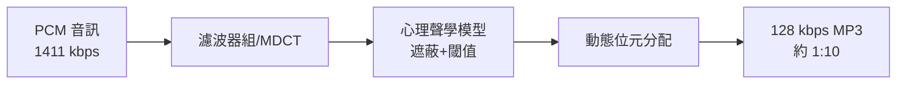

# 第 7 章 · 第 1 節 Fraunhofer 與 MP3：心理聲學的勝利

1990 年代末，一首歌只需 3–4MB，一張軟碟就能塞半張專輯。讓音樂「縮小十倍」而不露破綻的，是一群德國工程師和他們研究多年的冷門科學：**心理聲學**。

## Fraunhofer IIS 與 Brandenburg

德國 Fraunhofer 學會旗下的 IIS 研究所（位於 Erlangen）自 1980 年代起研究音訊壓縮，核心人物 **Karlheinz Brandenburg** 以數位音訊壓縮取得博士學位，被後世稱為「MP3 之父」。1987 年起，團隊參與國際音訊編碼競賽；1993 年，MPEG-1 標準定案，其音訊部分分三層，最高階的 **Layer III（MP3）** 以 Fraunhofer 主導的技術為骨幹。初代 MP3 播放軟體 l3enc 於 1994 年前後問世，1997 年流行的 **Winamp** 加上直覺介面，`.mp3` 副檔名自此席捲網路。

Brandenburg 常被引用的軼事：他早期調校壓縮演算法時，反覆測試的一首歌是 Suzanne Vega 的 **《Tom's Diner》**——清唱、無伴奏，最能暴露編碼瑕疵。他因此被暱稱為「Tom's Diner 之父」，這段故事屬實，成為心理聲學史上的浪漫註腳。

## 壓縮的祕密：刪掉「聽不到」的聲音

MP3 的核心不是數學魔術，而是**科學地欺騙耳朵**：

1. **絕對聽覺閾值**：低於一定聲壓的聲音人耳根本聽不見，直接丟棄；
2. **頻域遮蔽（simultaneous masking）**：大音量的聲音（如鼓聲）會「蓋住」鄰近頻率的小聲音，被遮住的成分不必編碼；
3. **時間遮蔽（temporal masking）**：強音的前後極短時間內，較弱的聲音也聽不到；
4. 剩下的可聽成分以有限精度量化——**量化噪音被巧妙安置在遮蔽閾值之下**。

MP3 將音訊以濾波器組拆成多個子頻帶並做 MDCT 變換，依心理聲學模型動態分配位元。結果：**約 1:10 的壓縮率**（128kbps 對 CD 原始 1411kbps），多數人耳幾乎難辨差異。

## 制度面：一場遲到的授權

Fraunhofer 與 Thomson 為 MP3 建立專利授權制度，但 1990 年代末網路上散播的編碼器多為盜用，執法遠遠追不上傳播速度。MP3 本身並不「免費」，卻以**事實上的免費**完成了普及——這個矛盾預示了後來整個數位音樂的授權亂局。

## 為什麼 MP3 改變了世界

技術上，MP3 只是壓縮演算法；但在**經濟與文化**上，它把一首歌縮小到能透過撥接網路在幾分鐘內傳完、能存進硬碟上百首、能在 P2P 網路無限複製。唱片工業賴以生存的「載體物理限制」（買一張 CD 才能得到音樂）被演算法一夕瓦解。MP3 沒有殺死唱片業——殺死唱片業的是「MP3＋網路」的組合。而下一節的 Napster，正是這個組合引爆的第一顆炸彈。

也別忘了這段歷史的思想面：MP3 證明了「感知品質」與「訊號保真」可以分家——重要的不再是聲音儲存得多完整，而是**聽起來是否一樣**。這種以人耳為最終裁判的工程哲學，貫穿了後世所有編解碼器（AAC、Opus、AV1 的碼率控制）。從 Fraunhofer 的實驗室到全球的耳朵，一門關於「聽覺如何被欺騙」的科學，就此成為數位世界的基礎設施。
