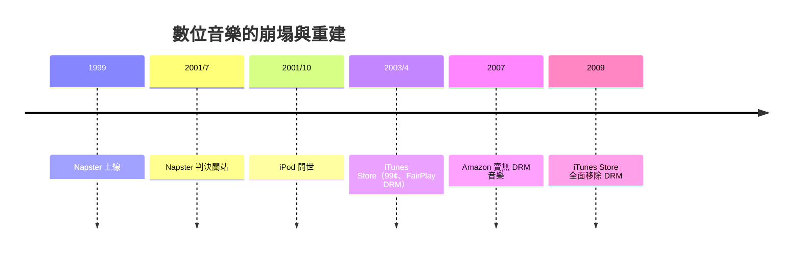

# 第 7 章 · 第 2 節 Napster 與 iPod：帝國崩塌與蘋果救贖

1999 年到 2003 年，短短四年，音樂產業經歷了載體發明以來最猛烈的一次地殼變動：先是被 P2P 掀翻，再被一家電腦公司重新立起來。

## Napster：把每台電腦變成唱片行

1999 年，19 歲的東北大學生 **Shawn Fanning** 寫出 Napster：一個集中索引、分散檔案的 P2P 系統——用戶把 MP3 供人下載，Napster 伺服器只負責媒合「誰有這首歌」。巔峰時期上千萬用戶同時在線，「共享」成為世代語彙。

法律上，Napster 沒有那麼幸運。1999 年底 RIAA 提告；2001 年法院認定 Napster 對侵權承擔輔助與代理責任，**2001 年 7 月 Napster 被令關閉**。但為時已晚：Kazaa、eMule、BitTorrent 等更分散的後繼者已接棒。

## 唱片帝國的崩跌

美國唱片銷量自 1999–2000 年的峰值後持續暴跌，其後十年間營收腰斬再腰斬——這是公認的產業級崩塌。唱片公司把資源投入告訴消費者，而非提供合法的下載選擇；「打擊盜版」變成打擊自己的顧客。

## iPod + iTunes：賈伯斯的重構

2001 年 10 月，蘋果發表 **iPod**：「把一千首歌放進口袋」。硬體上它用 1.8 吋筆記型硬碟（Toshiba 供應）與轉盤介面；但真正的殺招在制度。2003 年 4 月，**iTunes Music Store** 開張：

- **每首 99 美分**，單曲可買——「買歌不買專輯」直接瓦解了唱片業以專輯綁架消費者的定價結構；
- 與五大唱片簽約，建立第一個大規模合法數位音樂商店；
- 採 **FairPlay DRM**：下載的歌限定在 iPod 與有限台電腦播放，安撫唱片公司對盜版的恐懼。

## DRM 的興亡

FairPlay 證明了一件事：**便利可以戰勝免費**——iPod＋iTunes 的體驗好到讓人願意付錢。但 DRM 同時招致消費者反感與他廠排斥。2007 年起，Amazon 與 EMI 率先推出無 DRM 音樂，**2009 年 iTunes Store 全面改售無 DRM 的 AAC**，數位音樂終於回到「檔案即資產」的常識。

## 制度性打擊的本質

Napster 摧毀的是**載體壟斷**：當複製成本趨零，靠賣塑膠片抽取暴利的模式必然崩塌。iTunes 摧毀的是**專輯綁售**：單曲定價把定價權還給消費者。兩者合計，唱片公司失去的不只是營收，更是整條價值鏈的中介地位——此後，音樂的錢越來越多地流向設備（iPod）、平台（iTunes）乃至後來的串流（Spotify），而非傳統唱片集團。

歷史的弔詭：拯救音樂產業的，是一家從不賣唱片的公司；而它用的武器，正是差點殺死產業的那個格式——MP3。

iPod 時代還留下另一項制度遺產：**平台成為新的守門人**。iTunes Store 證明了合法數位商店可以規模化，也證明了平台有權決定歌曲怎麼賣、DRM 怎麼綁、抽成多少。這套「內容方＋平台方」的新秩序，一路延伸到 App Store 與串流時代的分潤爭議——蘋果在 2003 年種下的，不只是 99 美分單曲的生意，而是一個延續至今的平台經濟範式。
