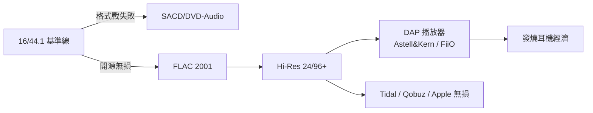

# 第 7 章 · 第 3 節 Hi-Res 與 DAP：發燒友的最後堡壘

當串流讓音樂變成「每月十美元聽到飽」的電，仍有一群人堅持：音樂應該更乾淨、更大、更真。高解析音訊（Hi-Res）與便攜播放器（DAP），是數位時代的發燒堡壘。

## FLAC：無損的開源答案

MP3 是「有損」壓縮——刪掉的資訊回不來。**2001 年，Josh Coalson 發布 FLAC**（Free Lossless Audio Codec）：以線性預測＋熵編碼無損壓縮音訊（約壓縮至一半），且完全開源、免授權費。它成為網路社群與音樂收藏者的標準選擇。蘋果則推出封閉但整合的 Apple Lossless（ALAC，2004），後於 2011 年開源。從此「無損」與「開放」結盟，抗衡授權混亂的有損世界。

## 失敗的格式戰：SACD vs DVD-Audio

在 MP3 狂潮中，兩大陣營卻反其道而行，推出更重、更貴的高解析光碟：

- **SACD**（Super Audio CD，1999）：Sony/Philips 推出，採 **DSD**（Direct Stream Digital，1-bit、2.8224MHz 高取樣）編碼；
- **DVD-Audio**（2000）：DVD 聯盟的 24-bit/96kHz+ 線性 PCM 陣營。

兩者互不相容、播放機昂貴、曲目稀少，還都得對抗「盜版恐懼」而加裝防拷。消費者用腳投票：**雙雙慘敗**，只留下古典與爵士小眾市場。這場戰爭證明：沒有內容生態與低門檻，純技術優勢毫無意義——是 CD 標準成功後，標準失敗的一面鏡子。

## Hi-Res 與國產 DAP 的崛起

Hi-Res Audio 定義泛指超越 CD 的規格：**24-bit/96kHz 以上**。2010 年代，發燒音源回歸「檔案＋播放器」形態，日韓廠商率先奪回攜帶式市場：韓國 iriver 系的 **Astell&Kern**（2012 年起）以工業設計與高規 DAC（Wolfson、AKM、ESS 晶片）定義了高階 DAP 品類；日本 ONKYO、FiiO（飛傲）等跟進，中國廠商 FiiO、Shanling、iBasso 更以性價比席捲入門到中階。DAP 復活了「器材」文化：晶片、運放、電池供電純淨度重新成為論壇的爭辯主題。

## 串流時代的無損與耳機經濟

2015 年起，**Tidal**（HiFi 無損）、**Qobuz**、Apple Music（2021 年起無損不加價）、Amazon Music HD 陸續提供 FLAC/ALAC 級串流，Hi-Res 終於繞過光碟、直接上雲。MQA（Master Quality Authenticated）一度攪局，2023 年 Tidal 轉向 FLAC 後退潮。

與此同時，**耳機經濟**爆發：Beats（2008）證明耳機可以是時尚品；入耳式監聽（IEM）客製化市場（JH Audio、64 Audio）、平衡電樞與動圈混合單體、中國耳機品牌（Moondrop、Softears、7Hz）崛起，讓「發燒」從客廳音響櫃搬進口袋。DAP＋IEM 的組合，成為串流帝國疆域外的發燒飛地。

Hi-Res 的歷史揭示一條鐵律：**音質是門生意，不是只靠規格**。SACD 有規格無生態而亡，FLAC 有生態無規格之爭而昌——最終，發燒友的堅持以「串流無損＋千元耳機」的形態，安靜地活了下來。

這段歷史也是對「發燒」二字的文化註解：發燒友從來不是市場主流，卻是品質標準的守門人。他們論壇裡的盲聽測試、測量曲線與爭論，逼著產業不敢把「夠用就好」寫成天花板。當 Tidal 把無損變成訂閱選項、當中國 DAP 把 ESS DAC 塞進千元機，某種意義上，是三十年前那群堅持 24-bit 的工程師與願意多花錢的耳朵，共同守住了音樂數位化的品質下限。
